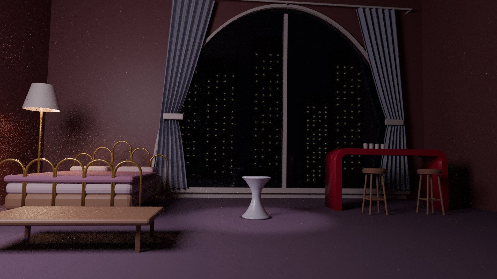

# City-window bedroom stage / 城市拱窗卧室舞台

## 当前增量 R09b（仍未验收）

[增量报告](docs/R09b-report.zh.md) · [R09b材质BLEND](models/R09b_material.blend) · [白模BLEND](models/R09b_white.blend) · [材质GLB](models/R09b_material.glb) · [白模GLB](models/R09b_white.glb)

仅D/E/F相机姿态变化，共享几何未动。含原51点、F09不可靠端点复核、半圈可见性诊断、保留退步和原尺寸叠图。完整重建仍未验收。下列R08段落是已交付基线，不被增量覆盖。

2026-11-03 创建的真正新场景候选，**来源几何/外观未验收**。不是旧卧室改名，也不代表完整标准已通过。

- R08基线可编辑原件：[R08 material](models/R08_material.blend)、[R08 white](models/R08_white.blend)
- 导出：[material GLB](models/R08_material.glb)、[white GLB](models/R08_white.glb)
- [中文报告及未验收项](docs/R08-report.zh.md)
- [逐物件观察/推断表](docs/object-evidence.md)
- [执行与失败历史](docs/plan-and-execution.md)
- 来源原件/最高菜单解码/片内时刻/SHA：`sources/`
- 实际单目相对逆深度：`depth/`（5官方图），`depth-fan4k/`（3投稿图）。不是距离测量。
- 最终原尺寸渲染：`renders/R08_material/`、`renders/R08_white/`（材白各14张，共28张；以实际文件和render-status为证）
- 直接50%原尺寸叠图与8角联系表：`comparisons/R08/`（12张原尺寸直接叠图、2张缩略联系表、16张同矩形细节裁切）
- 独立网格/导出/有限房壳射线/条件性投影诊断：`qa/R08-*.json`

建模与渲染在 dot 云电脑的现有 Blender 4.3.2 完成。材白共享几何与相机，固定灯光，各机位不改物件/材质或隐藏几何。所有原尺寸源与渲染保留，联系表为缩略查看辅助。原模型不依赖外部贴图；材质及代理几何已包含于blend，所有生成与修复脚本随Git留存。

R01—R08均是实际当日阶段，包含被纠正的失败方案；`R08_trial_raised_*`是接地修正前试制原件，不是最终版本。没有LFS，没有强推或删历史。提交时间带本机+09:00时区偏移，表示真实同一UTC时刻，不改变北京时间2026-11-03归属。

原件交付闭环需核对外部Git归档任务的完整远端字节读回清单。这个本地README不声称远端已经完成，也不把Space临备当最终Git交付。

## 主图（未验收候选）

[材质8角](comparisons/R08/material-8-check-views.jpg) · [白模8角](comparisons/R08/white-8-check-views.jpg) · [B机位直接50%](comparisons/R08/material-SOURCE_B-direct50.png)
