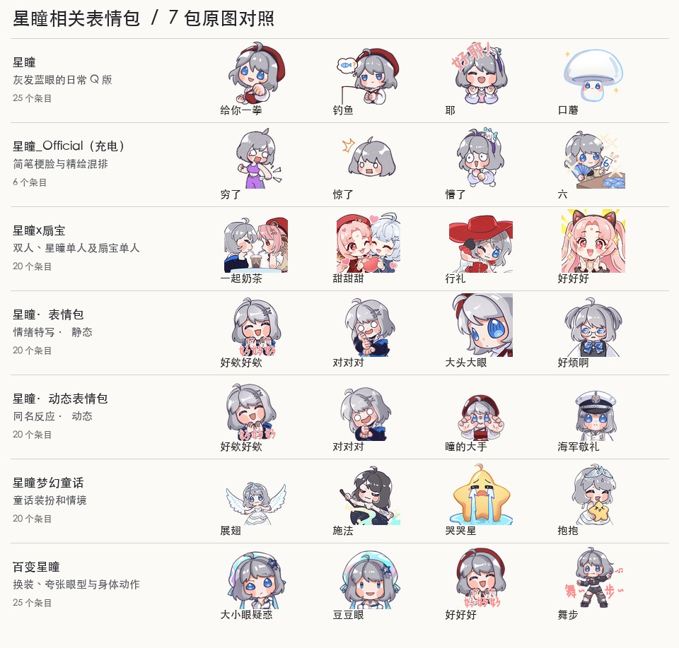

# 星瞳 · 七个表情包逐包索引

范围为 [B 站表情备份固定版本](https://github.com/ccmuyuu/bilibili-emotes/tree/bcb470908ffaf2d2498da324792e6f22a2161e4a) 顶层包名含「星瞳」、XingTong 或 Xing Tong 的目录。检出 7 包、136 个发布条目，逐张解码并查看它们的 PNG。包含两套各 20 项的同名静态、动态反应。136 是发布条目数，同一角色、表情和动作可能跨包重复。另解码全部 20 张原始 GIF，均为 10 帧、每轮 1 秒。

| 包 | 条目 | 用途与版本差别 | 全部缩略图 |
|---|---:|---|---|
| [星瞳](https://github.com/ccmuyuu/bilibili-emotes/tree/bcb470908ffaf2d2498da324792e6f22a2161e4a/%E6%98%9F%E7%9E%B3) | 25 | 红帽与白袖、紫发带与小头饰是同包不同装扮。「口蘑」「小企鹅来咯」属于道具、吉祥物，不能用作人物脸型。 | [全包](base.jpg) |
| [星瞳_Official（充电）](https://github.com/ccmuyuu/bilibili-emotes/tree/bcb470908ffaf2d2498da324792e6f22a2161e4a/%E6%98%9F%E7%9E%B3_Official%EF%BC%88%E5%85%85%E7%94%B5%EF%BC%89) | 6 | 「穷了」「惊了」的脸是豆眼、小方嘴和很少的线条；「懵了」用瞪大的白眼，「六」用大蓝眼和彩色道具。 | [全包](support.jpg) |
| [星瞳x扇宝](https://github.com/ccmuyuu/bilibili-emotes/tree/bcb470908ffaf2d2498da324792e6f22a2161e4a/%E6%98%9F%E7%9E%B3x%E6%89%87%E5%AE%9D) | 20 | 「一起奶茶」「甜甜甜」可看两人互动；「行礼」是红衣红帽蓝眼的星瞳形象。「好好好」的粉发角色应单独识别。 | [全包](collab.jpg) |
| [星瞳·表情包](https://github.com/ccmuyuu/bilibili-emotes/tree/bcb470908ffaf2d2498da324792e6f22a2161e4a/%E6%98%9F%E7%9E%B3%C2%B7%E8%A1%A8%E6%83%85%E5%8C%85) | 20 | 拍手和赞同同用银灰侧分与交叉夹，但前者是笑眼、后者是呆白眼。「大头大眼」是近景蓝眼，「好烦啊」是眼镜和双马尾。 | [全包](reactions-static.jpg) |
| [星瞳·动态表情包](https://github.com/ccmuyuu/bilibili-emotes/tree/bcb470908ffaf2d2498da324792e6f22a2161e4a/%E6%98%9F%E7%9E%B3%C2%B7%E5%8A%A8%E6%80%81%E8%A1%A8%E6%83%85%E5%8C%85) | 20 | 与静态包的 20 个名称一一对应。文件与取帧有差别；看动作时使用 JSON 指向的原始 GIF。 | [全包](reactions-animated.jpg) |
| [星瞳梦幻童话](https://github.com/ccmuyuu/bilibili-emotes/tree/bcb470908ffaf2d2498da324792e6f22a2161e4a/%E6%98%9F%E7%9E%B3%E6%A2%A6%E5%B9%BB%E7%AB%A5%E8%AF%9D) | 20 | 银发皇冠、黑发魔法造型及哭泣的黄色星星同包出现。先选角色、服装和场景，再看脸。 | [全包](fairytale.jpg) |
| [百变星瞳](https://github.com/ccmuyuu/bilibili-emotes/tree/bcb470908ffaf2d2498da324792e6f22a2161e4a/%E7%99%BE%E5%8F%98%E6%98%9F%E7%9E%B3) | 25 | 蓝色头饰的大小眼和豆豆眼、红帽拍手、全身舞步的表现不同。「六爷」「小星星」单列吉祥物。 | [全包](costumes.jpg) |

[20 张原 GIF 的动作抽帧](motion.jpg) · [136 项逐条来源，包括 20 个 GIF 原址](sources.tsv)。

「聊天六宫格」属于前序生成物，「大肥鱼」来自独立的 DeepSeek 娘表情包，另两者应在各自的栏目对照。上述分类描述视觉特征，作者归属以原发布资料为准。
