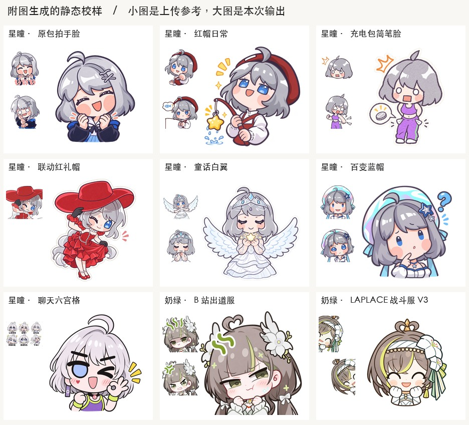

# 按表情包原图生成的静态校样

在 Playground 选择 gpt-image-2.6-sunburst，以每套各自的图片作为编辑附件，输出选 PNG。下列九张是通过结果卡 Copy 导出的完整 1024×1024 PNG；保留剪贴板返回的 PNG 字节。文件哈希用于校验这些本地导出。

| 独立校样 | 附件来源 | 文件 |
|---|---|---|
| 星瞳 · 原包拍手脸 | 星瞳·表情包 / 好欸好欸、对对对 | [1024px PNG](x-bili.png) |
| 星瞳 · 红帽日常 | 星瞳 / 给你一拳、钓鱼 | [1024px PNG](x-red-beret.png) |
| 星瞳 · 充电包简笔脸 | 星瞳_Official（充电）/ 惊了、穷了 | [1024px PNG](x-simple.png) |
| 星瞳 · 联动红礼帽 | 星瞳x扇宝 / 行礼（星瞳单人） | [1024px PNG](x-collab.png) |
| 星瞳 · 童话白翼 | 星瞳梦幻童话 / 展翅、祈愿 | [1024px PNG](x-fairytale.png) |
| 星瞳 · 百变蓝帽 | 百变星瞳 / 豆豆眼、大小眼疑惑 | [1024px PNG](x-blue-hat.png) |
| 星瞳 · 聊天六宫格 | 分享对话原六宫格 | [1024px PNG](x-six-grid.png) |
| 奶绿 · B 站出道服 | 明前奶绿 / 哼哼、生气 | [1024px PNG](n-bili.png) |
| 奶绿 · LAPLACE 战斗服 V3 | 探头动图第 1、17 帧 | [1024px PNG](n-laplace.png) |

充电简笔校样保留了较夸张的白底圆眼；红礼帽校样专取联动包中的星瞳。奶绿 V3 用白蝴蝶结与手套，B 站静态包保留白花和窄眼。不同来源单独使用。

第十个申请为额外的「大肥鱼 × 星瞳」试稿，Playground 的安全系统拒绝该请求。该组保留已有参考与提示词，没有本次输出。

[完整提示词](prompts.md) · [文件哈希与来源](manifest.json) · [星瞳七包全部条目](../../../docs/changes/20261105-sunburst-emotes/xingtong-packs/README.md)。
