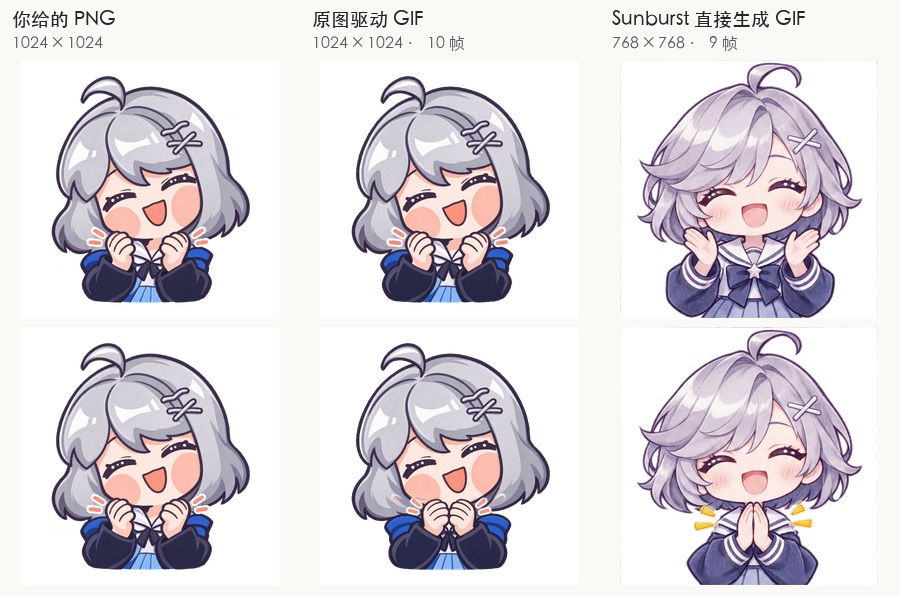

# 原图驱动的 1024px GIF 与原生直出对照

四个 GIF 从用户给的 1024×1024 PNG 起步。Sunburst 通过带原图的编辑请求生成同分辨率动作关键帧，本地沿关键帧取动作，再将原画的色块、轮廓和透明通道编码为 GIF。相同调色板贯穿每个循环，保留透明背景。GIF 的透明度是二值的，浅色半透明边缘和连续渐变会有量化损失。

| 下载 | 可见动作 | 帧数 | 周期 |
|---|---|---:|---:|
| [星瞳 · 笑着拍手](x-bili.gif) | 按编辑关键帧对齐指节和袖口，双手由脸旁移到下巴前靠拢再分开。 | 10 | 1.03 秒 |
| [奶绿 · 鼓腮抿嘴](n-bili.gif) | 以编辑姿势作指引，原画两侧脸颊鼓起，双拳微抬再放松，动作较轻。 | 12 | 1.32 秒 |
| [红帽星瞳 · 钓起星星](x-red-beret.gif) | 保留原画闪光与鱼竿纹理，按编辑姿势形变鱼竿和钓线，星星上提再落下。 | 12 | 1.32 秒 |
| [蓝帽星瞳 · 眨眼](x-blue-hat.gif) | 原画蓝眼向下合上，闭眼处使用编辑关键帧里的眼线，复原时帽面高光与问号保持位置。 | 8 | 1.24 秒 |

校验包括全帧解码、实际播放时长、无限循环标志和 SHA-256。将首帧与原 PNG 都合成到白底后比较，四张首帧的 RGB 通道平均绝对误差为 1.50～2.15（0～255）。这是首帧的编码差异，仅用于说明起始画面的保真度。[完整参数与 SHA-256](manifest.json) · [Sunburst 的四张动作关键帧](keyframes/) · [输入 PNG](../pack-style-proofs/playground-originals/)。

## 原生直出对照

同一星瞳造型仅输入文字，指定高质量。1024×1024、9 帧与 4 帧均收到 HTTP 400，原因分别是内部拼帧尺寸超出像素预算和最长边限制。768×768、9 帧请求成功，返回 9 个不同画面、每帧 160 ms、每轮 1.44 秒、无限循环。直接生成画出了更细的发束与织物纹理，同时重新设计了额发、衣领和胸口星形饰物。该实测仅覆盖此轮规格和模型。

[原生 768px GIF](x-bili-native-768.gif) · [三次请求的参数与结果](native-comparison.json)

