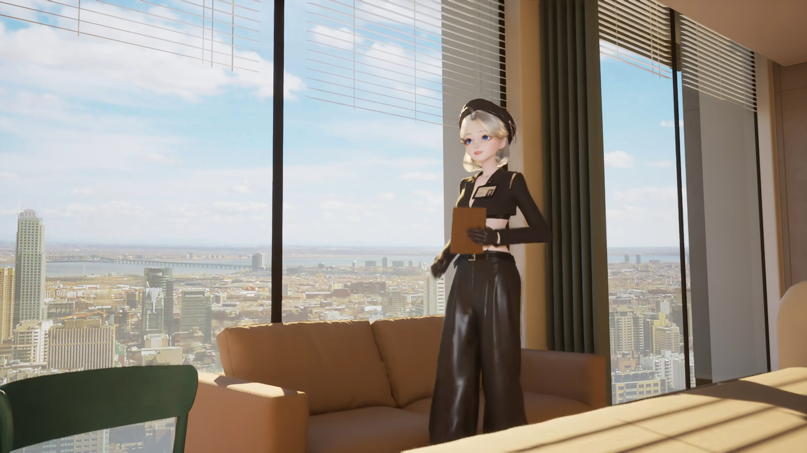
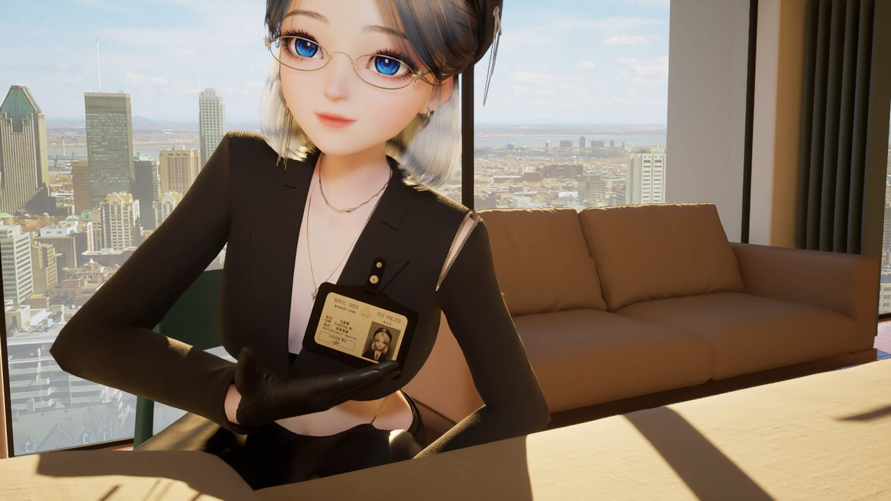
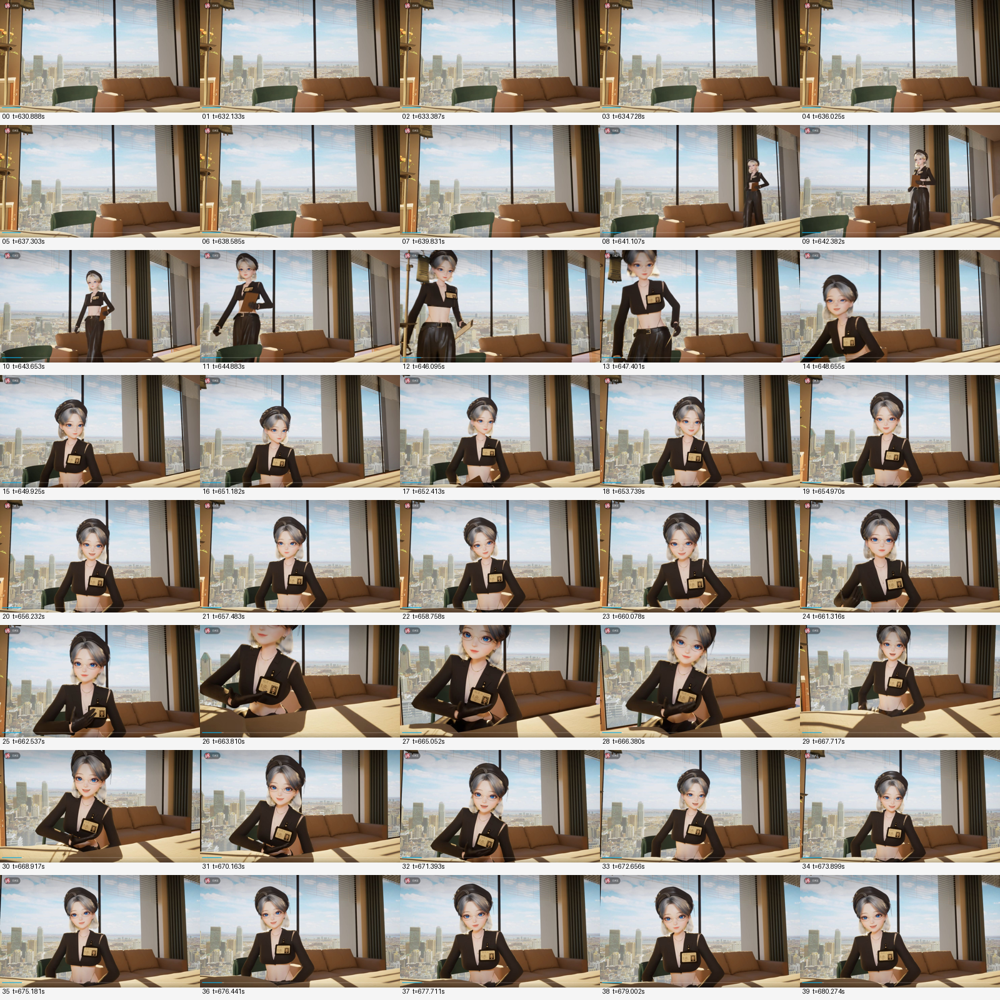
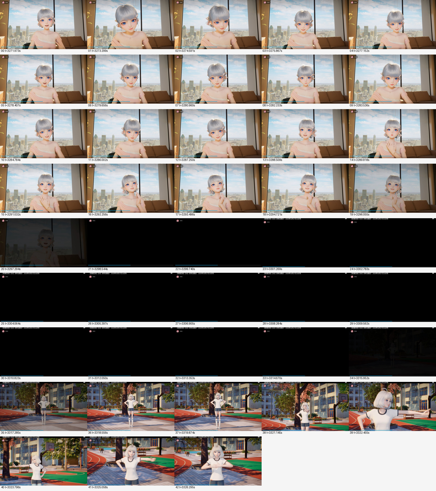
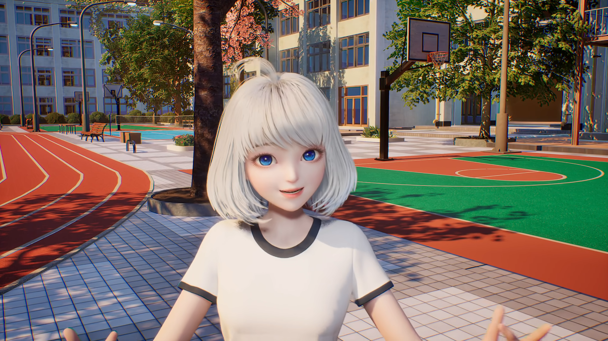

# 扩展视频取证：完整原件、有限覆盖与场景边界

本版本将权威索引的122件全部落实为可核验Git文件：**本次新增120件原件；640.406589秒PNG及其元数据两件继续引用PR #55，不复制。** 另新增权威交接索引1件，故本次新增原文件共121件、21,667,987字节；加README、交付状态、本机核验及SHA清单4份，共125件新增仓库文件。全部来源文件字节保持不变，原Library文件名到建议Git路径的映射明确保存在交付状态中。

[完整权威索引](provenance/BV1GqXMByE1s_expanded_evidence_Library_Git_handoff_index.json)含122件的ID、版本、SHA、精确时间、类型和依赖；[delivery-status.json](delivery-status.json)逐件给出实际Git路径以及两件已存在依赖的固定提交，原索引建议路径不等于本次重复复制。[SHA清单](SHA256SUMS.txt)覆盖本次121件新增原文件。[原生产方综合报告](expanded_video_evidence_review_20261014.md)保留原文。

## 来源与覆盖

源视频：[BV1GqXMByE1s](https://www.bilibili.com/video/BV1GqXMByE1s/)，生产方记录总长6673秒（1:51:13）、最高可见1080P高码率、实际解码1920×1080。以下播放观察来自已交付的云端记录；本Mac仅做文件核验和已保存图像检查，没有操作浏览器或重播视频。

本轮有**18张离散粗采样JPEG**，另有两段正常播放共**106.342214秒（约106.342秒）**，保存40+43=83张周期观察JPEG。不是全片看完，不把周期采样写成逐帧覆盖。

| 连续播放记录范围 | 时长 | 原JPEG数 | 可支持的观察 |
|---|---:|---:|---|
| 630.857091–681.551379秒 | 50.694288秒 | 40 | 无人窗向、人物入场、右转及俯视片段；新闻CG到医院的切换落在此前稀疏间隙 |
| 3271.929219–3327.577145秒 | 55.647926秒 | 43 | 医院整体淡黑、黑画面、校园全屏表演插段 |

除离散点外，0–630.857091、681.551379–3271.929219、3327.577145–6673秒未在本轮连续核看。47:30定位未确认稳定解码，未计有效覆盖。旧18:15–18:45及30:15–30:35观察不在本轮重复取证范围。

83张JPEG均为独立原文件，见两段[记录A](continuous/1025_initial_hospital_reveal/records.json)、[记录B](continuous/5430_hospital_to_insert/records.json)及完整索引；没有下载、创建或归档ZIP。JPEG实际1188×668，联系图为缩小派生拼图，均不冒充1920×1080原生量测帧。保留可能出现的公开上传者标记和播放器线条，不据此改变其证据类型。observations.json保留交接指定v1，未误用早期3样本v0。

## 医院新原帧与场景分类

640.406589秒无人原图与元数据已在[PR #55版本](https://github.com/Shuang-su/metaxingtong/blob/69362cc243f716fb44a41438dbe6c8204369c34e/scenes/hospital-room/research/source-acquisition-20261014/README.md)保存。本次只补两张医院PNG：642.617525秒右转、665.501733秒俯视；均1920×1080，精确来源/SHA见各自同名JSON。

665帧可帮助确认沙发靠背下缘→座面→圆鼓前缘及右扶手内侧接合；下方暗带不是已证刚性底座，新清晰边也不能改称床边。642帧右端浅色端板片仍待识别，不据此断言床头/床尾。床枕位、可配对的两条床长侧缘、端板—护栏连接仍未齐；帘杆实际入柱点与柱侧面深度也未得到直接补证。

连续记录显示3296.055秒（约54:56）医院明显变暗，3298.544–3314.670秒存样为黑画面；3315.952秒（约55:15）校园篮球场暗中出现，3317.285秒清楚可见并进入全身表演/多镜头切换。该全屏校园表演应单列插段，未出现从医院移动到校园的连续空间路径；是否预录不能由这些视觉证据决定。其他校园对话及手机叠层段落性质仍待定，不自动继承这一判断。

3600.996983秒校园原生PNG仅用于分类，禁止并入医院几何、内参或连续空间证据。所有新观察都不证明相机无变焦、跨时段同内参或完全静态布局；不能用人物大小反推焦距。

## 已保存关键图证（全部展开）

### 医院右转 · 642.617525秒

### 医院俯视 · 665.501733秒

### 10:30–11:21 连续周期观察联系图 · 缩小派生图

### 54:31–55:27 医院淡黑至校园表演插段 · 缩小派生图

### 校园分类参考 · 3600.996983秒 · 禁止用于医院拟合

## 状态与未解决问题

本阶段不修改CURRENT、旧资产、D未验收/J1拒绝/H85px撤回结论；不恢复旧65件，也不重试旧10件待传。床侧缘、枕位、端板/护栏接点仍缺证，没有新拟合或渲染。所有图证展开，未使用折叠。Git原件、Issue正文回读与浏览器实显是不同核验；本Mac没有操作Safari，不将本批图像计入此前实显通过数。后续本版本状态在同一Issue评论原位更新。
