# 床端与前景身份更正：木桌证据与未定条带

原生665.501733与viewport6063.423552可见浅木纹硬直桌面，桌面身份有直接证据；G/H/N640浅色前景仍身份待定，不能全部重标为桌，也不能据此扩大床。模型首命中Bed对象仅说明现有模型占据像素，不能证明来源就是床。没有修改几何、相机或CURRENT。

36条路径包括35件payload和一份生产交付index，共12,811,779字节，另附本次Library交接权威索引。28新存+8精确Library复用全部按relative_path恢复；F/G/H是从历史恢复ZIP中取得、此轮首次分别保存的原生PNG，本次按普通PNG交付，不发ZIP。N640/N665复用既有精确PNG身份。所有viewport JPEG保持1180×757，不缩放成原生残差输入。5476低机位可见软包外侧、托边、斜撑和轮脚，但不证明完整床长、另一端板、同一实例/transform或患者躺姿。真正A/B/G端板族分支、圆肩拆分、遮挡排除、所有无残差限制不变。

36件原件与1份权威索引共12,852,892字节，全部从当前Library正规流程物化，在本机核对精确版本、身份、大小和SHA。所有原相对路径及字节保留。云端绝对路径只是溯源，原报告“未Git”是生产当时状态。

[原报告](files/README_%E5%BA%8A%E7%AB%AF%E4%B8%8E%E5%89%8D%E6%99%AF%E8%BA%AB%E4%BB%BD%E5%A4%8D%E6%A0%B8_20261015.md) · [逐件核验](archive-verification.json) · [完整SHA](SHA256SUMS.txt) · [冻结交接索引](provenance/identity_review_library_git_handoff_index_20261015.json)

[身份措辞更正后的独立派生标注](corrections/source_contour_branches_N640_G_H.corrected_identity_20261015.json) · [限定差异核验](corrections/additive-correction-verification.json)。旧冻结标注不覆盖，只替换2处note及1处排除标签，其余数据完全一致。

## 全部原图展开

### independent_visual/foreground_identity_evidence.png — 独立来源身份标注展示

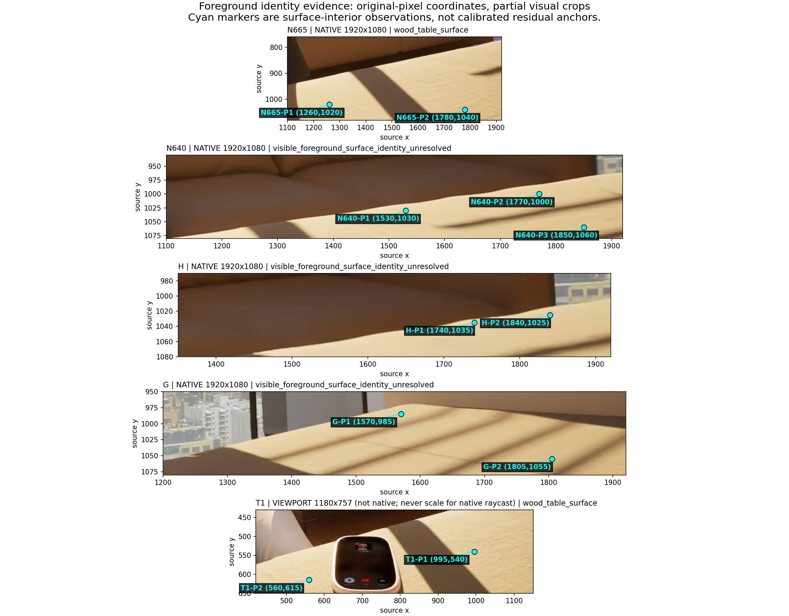

### independent_visual/exact_crops/G_detail.png — 原像素裁切诊断

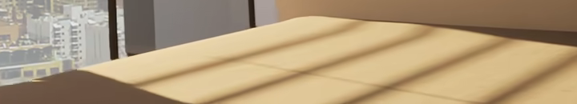

### independent_visual/exact_crops/G_y740_1080_no_rescale.png — 原像素裁切诊断

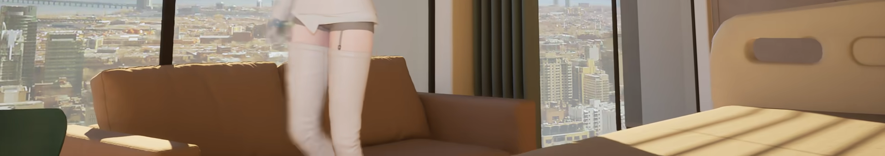

### independent_visual/exact_crops/H_detail.png — 原像素裁切诊断

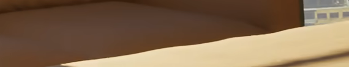

### independent_visual/exact_crops/H_y740_1080_no_rescale.png — 原像素裁切诊断

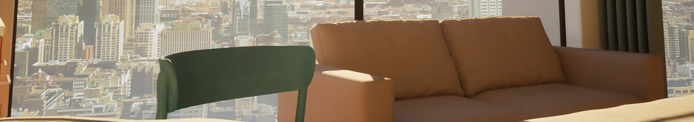

### independent_visual/exact_crops/N640_detail.png — 原像素裁切诊断

### independent_visual/exact_crops/N640_y740_1080_no_rescale.png — 原像素裁切诊断

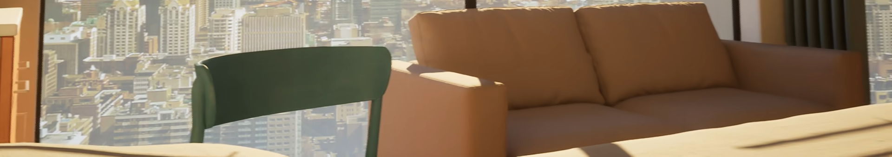

### independent_visual/exact_crops/N665_y740_1080_no_rescale.png — 原像素裁切诊断

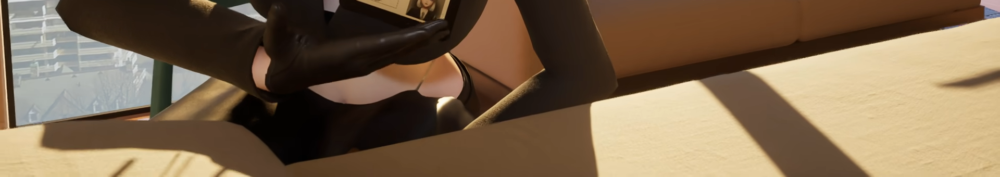

### independent_visual/sources/BV1GqXMByE1s_640.406589_empty_hospital_native.png — 原生PNG参考，精确来源见原清单

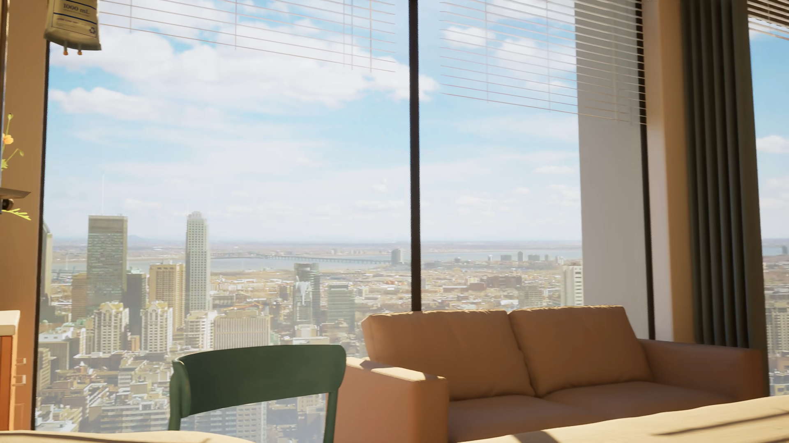

### independent_visual/sources/BV1GqXMByE1s_665.501733_downward_native.png — 原生PNG参考，精确来源见原清单

### independent_visual/sources/hospital-F-tv-BV1GqXMByE1s-t1823.678156-native.png — 原生PNG参考，精确来源见原清单

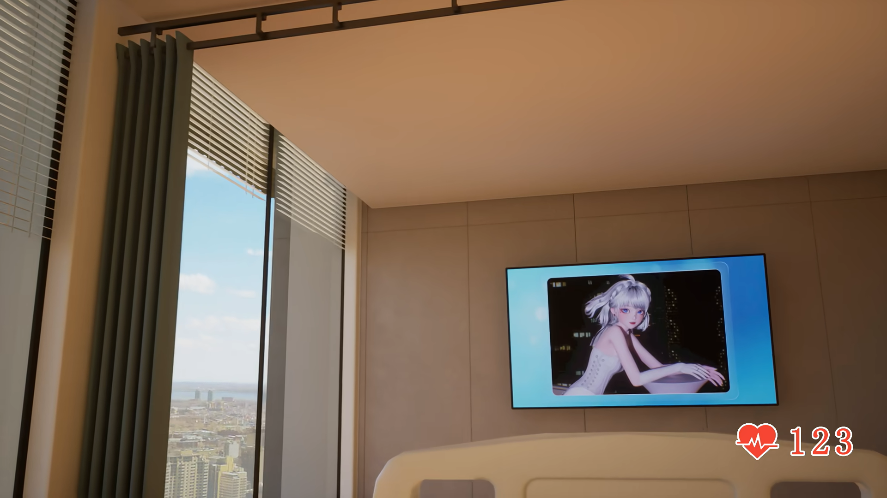

### independent_visual/sources/hospital-G-bed-edge-BV1GqXMByE1s-t1116.180816-native.png — 原生PNG参考，精确来源见原清单

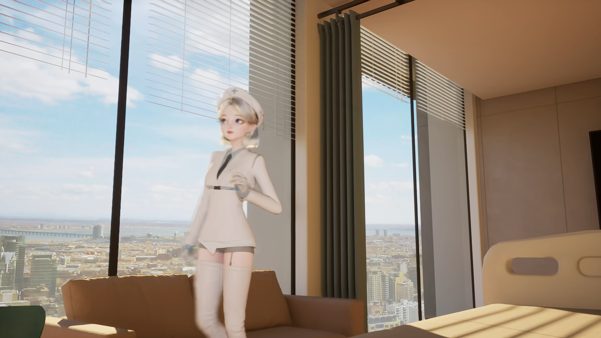

### independent_visual/sources/hospital-H-window-BV1GqXMByE1s-t1101.728114-native.png — 原生PNG参考，精确来源见原清单

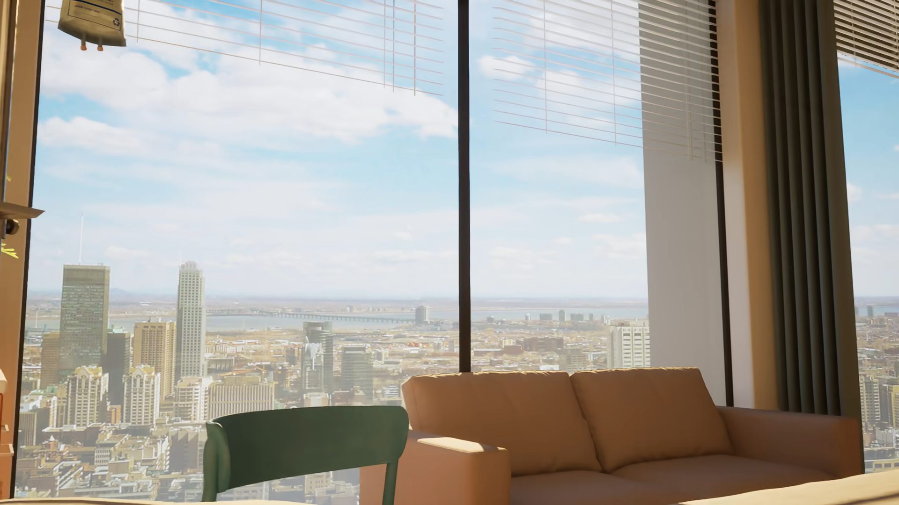

### independent_visual/sources/obs_5476.600449.jpg — 视口JPEG或保存状态UI证据，非原生帧

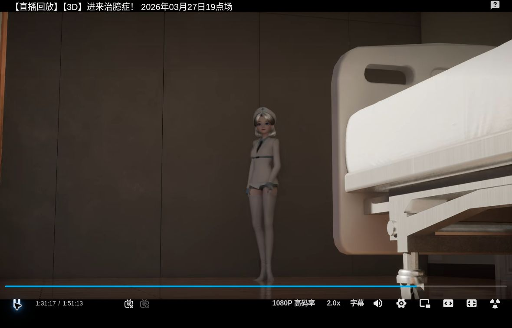

### independent_visual/sources/obs_5477.528817.jpg — 视口JPEG或保存状态UI证据，非原生帧

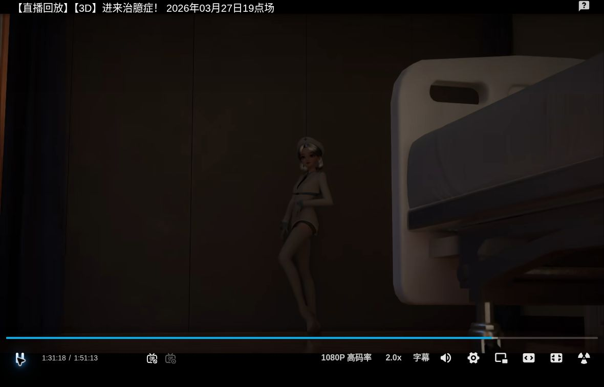

### independent_visual/sources/obs_5663.912151.jpg — 视口JPEG或保存状态UI证据，非原生帧

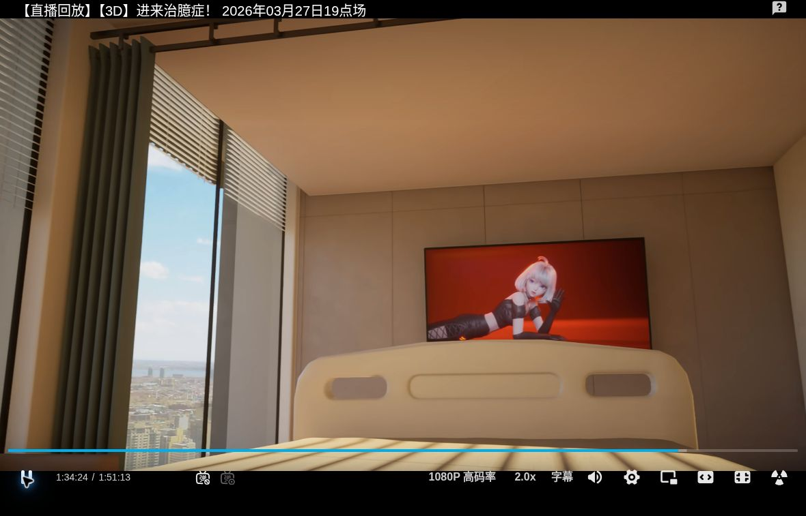

### independent_visual/sources/obs_5668.329653.jpg — 视口JPEG或保存状态UI证据，非原生帧

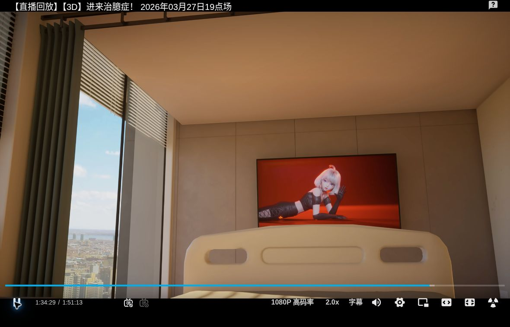

### independent_visual/sources/obs_5693.628433.jpg — 视口JPEG或保存状态UI证据，非原生帧

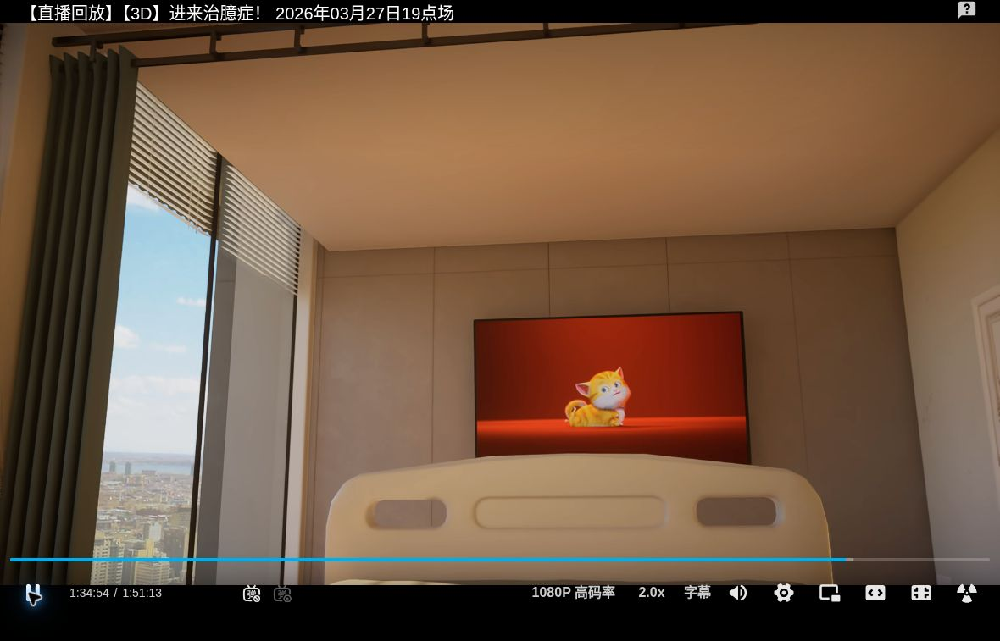

### independent_visual/sources/obs_6063.423552.jpg — 视口JPEG或保存状态UI证据，非原生帧

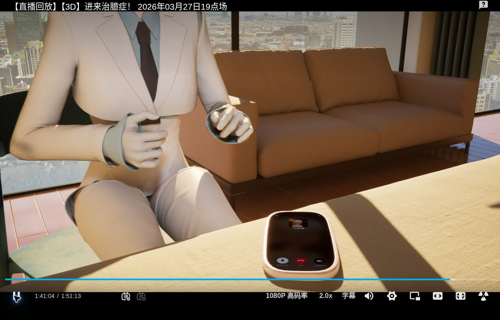

### independent_visual/sources/review_5473_5482.jpg — 联系图/缩略展示，不作为原生残差

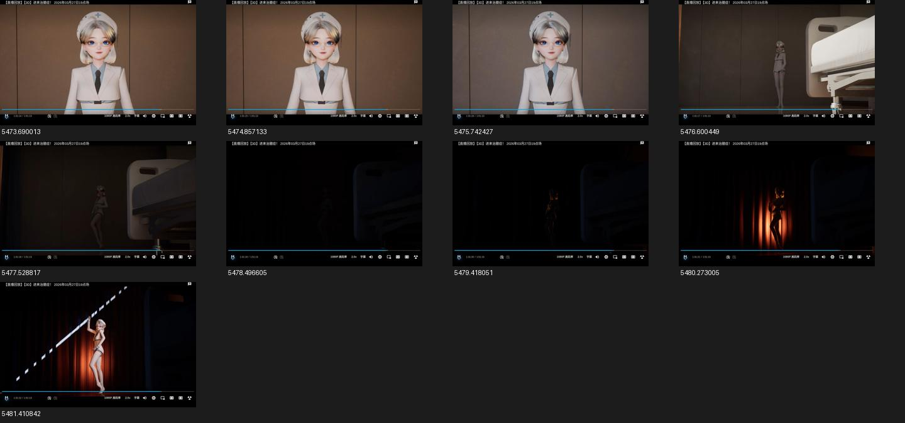

新增评论图证全部展开，GitHub逐位置浏览器实显尚未执行。旧C3的42处实显是另外一批，不涵盖本版本图片。当前所有未采纳/拒绝状态、CURRENT、旧motion10及失联65件缺口不变。
