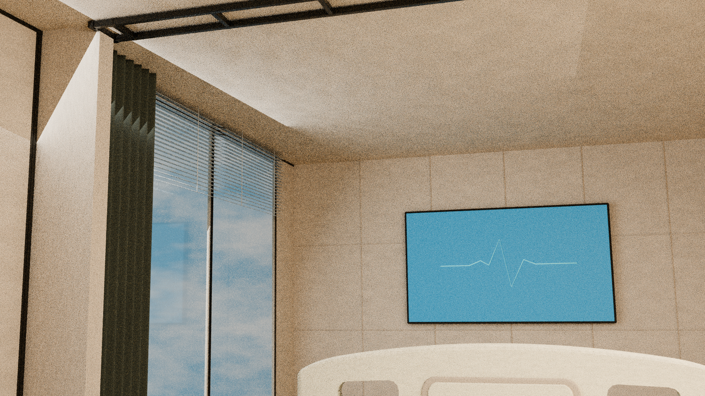
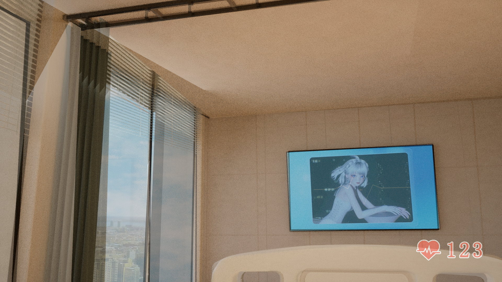
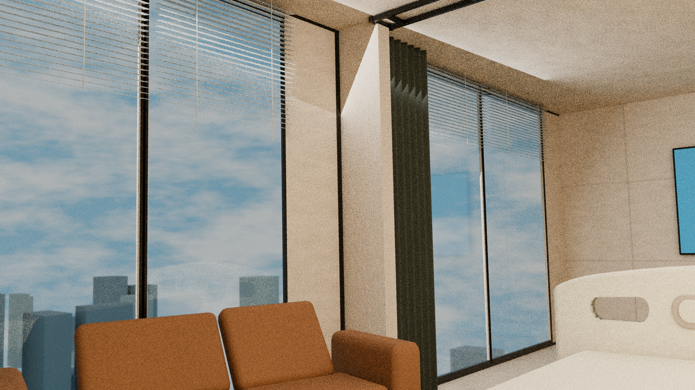
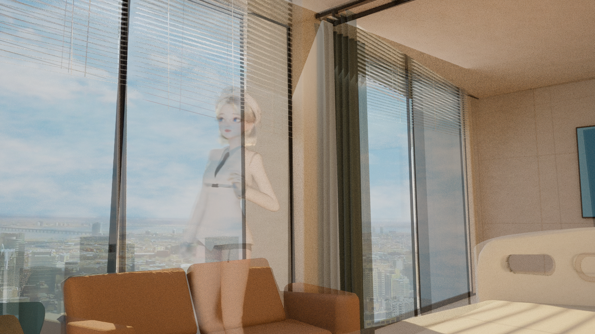
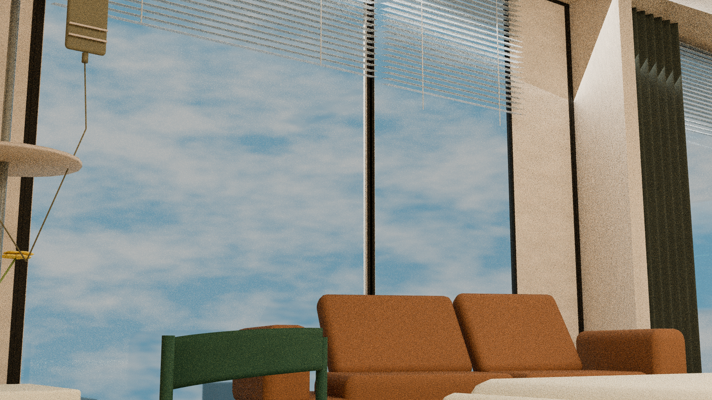
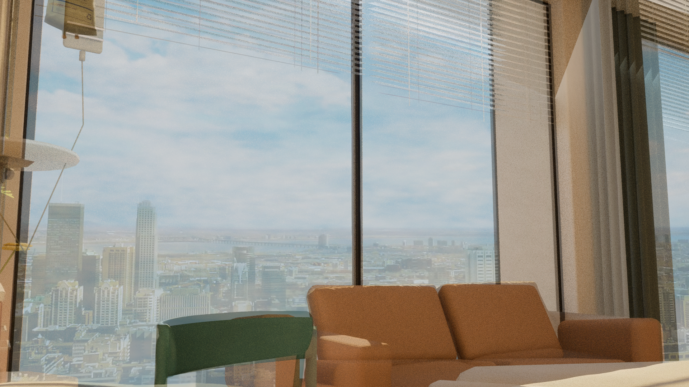
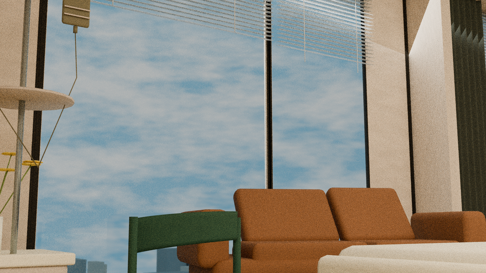
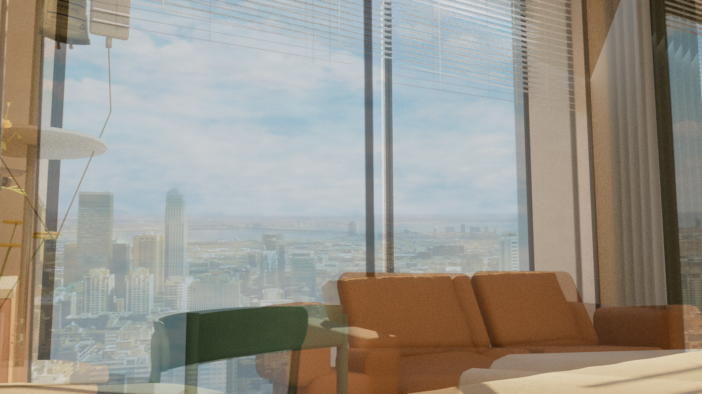

# C2左靠背局部修改未验收候选

继承P1，左靠背底部固定、顶部渐变小幅位移；右靠背大幅拟合撞到参数边界，被拒绝且未应用。保留材质/同几何WHITE模型和F/G/H/N640四视图RAW及同坐标直接50%叠图。局部靠背轮廓改善不构成整场来源通过；柱遮挡、顶部/轨道走向、右靠背、床与相机关系仍失败。

来源为BV1GqXMByE1s：F1823.678156s、G1116.180816s、H1101.728114s、N640640.406589s，原生1920×1080。F仅条件性留出，G/H用于指定分支拟合；N640迁移假设未通过直接来源验证。642.617525/665.501733只作补充形态观察。跨BV同场、床双侧长缘/护栏/枕位仍未证；保留病人躺床第一视角及横向拉帘杆接柱的用户语义，承重属性和真实截面/柱深未证。

原RAW为Cycles CPU 16 samples，ViewLayer实际未启用降噪，可见颗粒；50%图是同坐标RGB直接混合，未裁切、缩放、配准或warp。局部比较明确原像素裁切范围，不增加机位。8张960×540 Workbench普通检查图与展示联系表不充作来源机位。

本阶段保存25件原文件，共51,562,989字节；按冻结索引的相对路径保存于../files，原字节不改。

[本阶段SHA](./C2-SHA256SUMS.txt) · [本机核验](./C2-archive-verification.json)

原报告中的“未Git”是生产时历史；当前真实Git归档状态由各PR/commit记录。原云端绝对路径只作溯源，不代表本机存在。没有新模型/拟合/渲染或浏览器操作。CURRENT、旧模型、motion10和失联65件状态保持不变。

## 本阶段原件

- [C2_branch_visibility.json](../files/C2_branch_visibility.json)
- [C2_selected_parameters.json](../files/C2_selected_parameters.json)
- [build_candidates.py](../files/build_candidates.py)
- [fit_local_candidate.py](../files/fit_local_candidate.py)
- [independent_physics/C2_material_white_identity.json](../files/independent_physics/C2_material_white_identity.json)
- [independent_physics/final_independent_physics_report.json](../files/independent_physics/final_independent_physics_report.json)
- [independent_physics/hospital_C2_small_shared_geometry_UNACCEPTED_changed_evaluated_world_meshes.json](../files/independent_physics/hospital_C2_small_shared_geometry_UNACCEPTED_changed_evaluated_world_meshes.json)
- [independent_physics/hospital_C2_small_shared_geometry_UNACCEPTED_final_regression.json](../files/independent_physics/hospital_C2_small_shared_geometry_UNACCEPTED_final_regression.json)
- [independent_physics/independent_physics_summary.json](../files/independent_physics/independent_physics_summary.json)
- [independent_physics/regress_final_candidates.py](../files/independent_physics/regress_final_candidates.py)
- [independent_physics/verify_white_identity.py](../files/independent_physics/verify_white_identity.py)
- [local_fit_candidate.json](../files/local_fit_candidate.json)
- [models/hospital_C2_small_shared_geometry_UNACCEPTED.blend](../files/models/hospital_C2_small_shared_geometry_UNACCEPTED.blend)
- [models/hospital_C2_small_shared_geometry_WHITE_UNACCEPTED.blend](../files/models/hospital_C2_small_shared_geometry_WHITE_UNACCEPTED.blend)
- [renders_C2/F_C2_RAW_1920x1080.png](../files/renders_C2/F_C2_RAW_1920x1080.png)
- [renders_C2/F_C2_direct_50pct_overlay_1920x1080.png](../files/renders_C2/F_C2_direct_50pct_overlay_1920x1080.png)
- [renders_C2/G_C2_RAW_1920x1080.png](../files/renders_C2/G_C2_RAW_1920x1080.png)
- [renders_C2/G_C2_direct_50pct_overlay_1920x1080.png](../files/renders_C2/G_C2_direct_50pct_overlay_1920x1080.png)
- [renders_C2/H_C2_RAW_1920x1080.png](../files/renders_C2/H_C2_RAW_1920x1080.png)
- [renders_C2/H_C2_direct_50pct_overlay_1920x1080.png](../files/renders_C2/H_C2_direct_50pct_overlay_1920x1080.png)
- [renders_C2/N640_C2_RAW_1920x1080.png](../files/renders_C2/N640_C2_RAW_1920x1080.png)
- [renders_C2/N640_C2_direct_50pct_overlay_1920x1080.png](../files/renders_C2/N640_C2_direct_50pct_overlay_1920x1080.png)
- [renders_C2/manifest.json](../files/renders_C2/manifest.json)
- [select_small_candidate.py](../files/select_small_candidate.py)
- [stage_manifest.json](../files/stage_manifest.json)

## 全部图证展开

### renders_C2/F_C2_RAW_1920x1080.png — 来源相机条件下RAW

### renders_C2/F_C2_direct_50pct_overlay_1920x1080.png — 未经配准的直接50%叠图

### renders_C2/G_C2_RAW_1920x1080.png — 来源相机条件下RAW

### renders_C2/G_C2_direct_50pct_overlay_1920x1080.png — 未经配准的直接50%叠图

### renders_C2/H_C2_RAW_1920x1080.png — 来源相机条件下RAW

### renders_C2/H_C2_direct_50pct_overlay_1920x1080.png — 未经配准的直接50%叠图

### renders_C2/N640_C2_RAW_1920x1080.png — 来源相机条件下RAW

### renders_C2/N640_C2_direct_50pct_overlay_1920x1080.png — 未经配准的直接50%叠图

本机已核对字节/SHA、PNG完整CRC/IDAT扫描行、JSON/Python语法及GLB结构；没有把这些文件完整性检查当作来源或浏览器实显验收。新增图证的GitHub浏览器逐图实显尚未执行。
