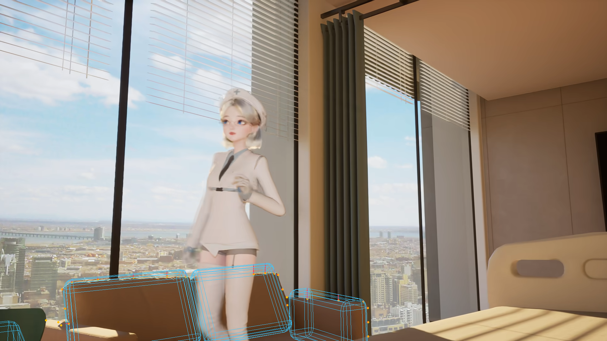
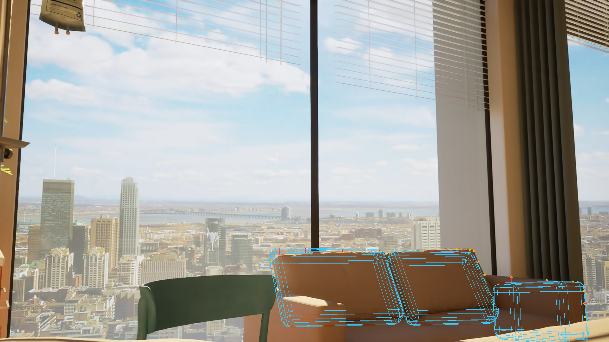
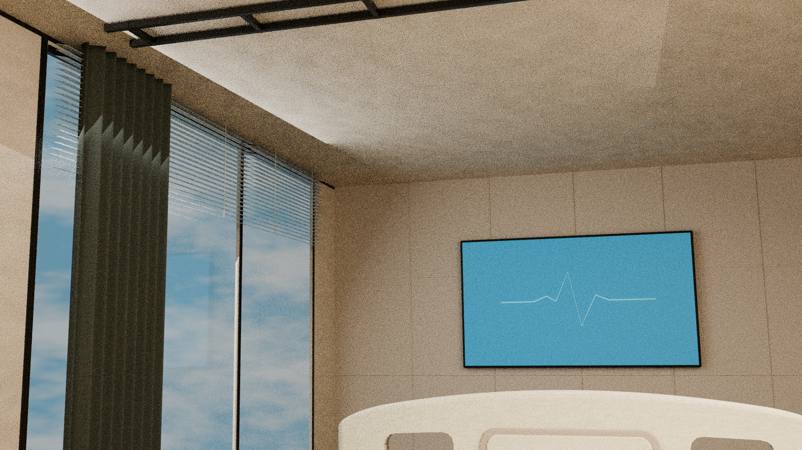
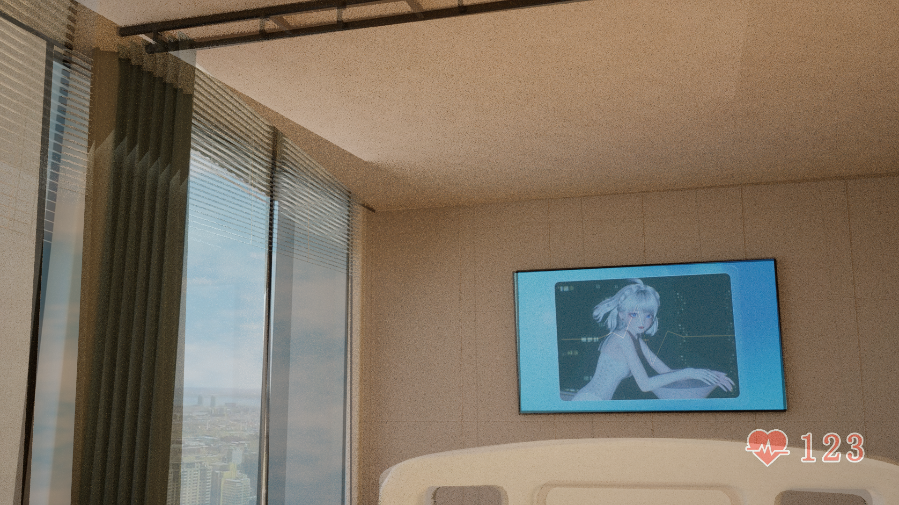
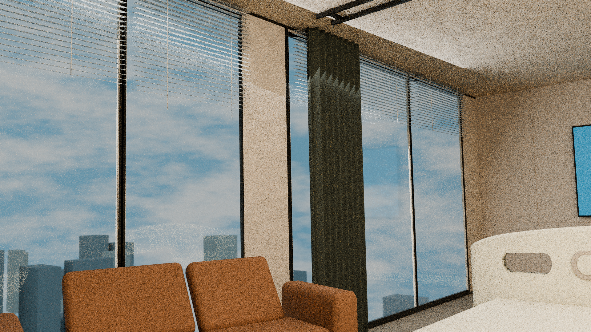
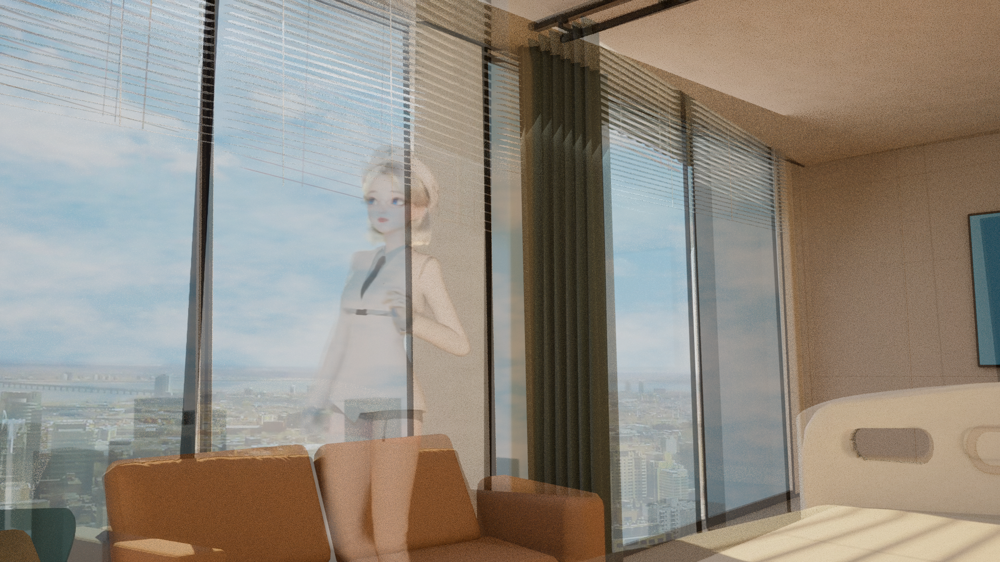
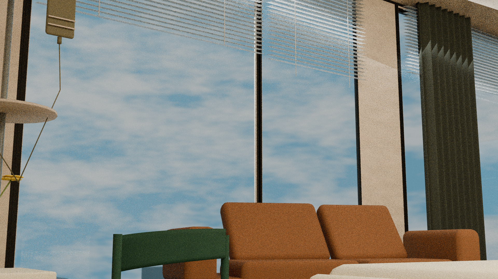
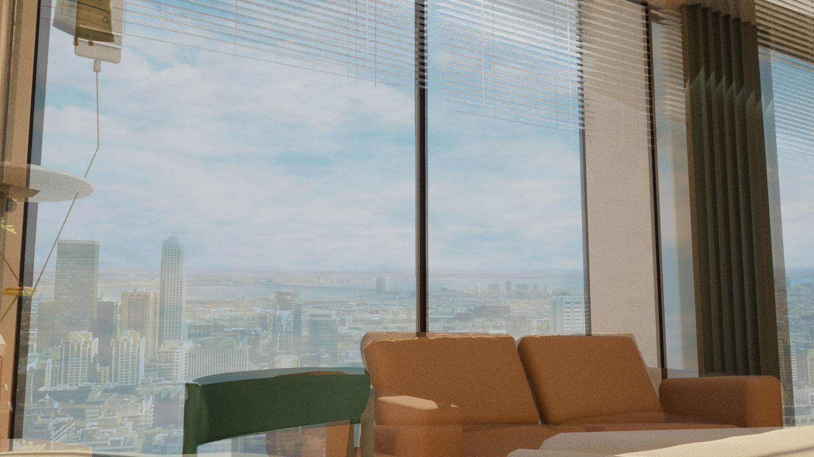

# D基线复查与穿插起点勘误

D基线本身已有bank 3 slat01–21与灰折面的真实表面穿插；J1不是该缺陷起点。J1另新增灰折面与ROOM_SHELL、perimeter rail和Window_3上下sill/lintel的穿插。D仍D_SHARED_SPATIAL_RESEARCH_NOT_ADOPTED，J1仍REJECTED_DIAGNOSTIC。旧D及J1字节不变，H旧85px撤回与B/F旧凸包指标限制不变。这里是2026-10-15的新复查，不能把此前未做的检查倒写成历史已完成。D输入为已有hospital_D_before_J1_cameras.blend；本轮使用其原D F/G/H相机，未采用错误J1 H相机。

来源为BV1GqXMByE1s：F1823.678156s、G1116.180816s、H1101.728114s、N640640.406589s，原生1920×1080。F仅条件性留出，G/H用于指定分支拟合；N640迁移假设未通过直接来源验证。642.617525/665.501733只作补充形态观察。跨BV同场、床双侧长缘/护栏/枕位仍未证；保留病人躺床第一视角及横向拉帘杆接柱的用户语义，承重属性和真实截面/柱深未证。

原RAW为Cycles CPU 16 samples，ViewLayer实际未启用降噪，可见颗粒；50%图是同坐标RGB直接混合，未裁切、缩放、配准或warp。局部比较明确原像素裁切范围，不增加机位。8张960×540 Workbench普通检查图与展示联系表不充作来源机位。

本阶段保存32件原文件，共48,039,478字节；按冻结索引的相对路径保存于../files，原字节不改。

[本阶段SHA](./D-SHA256SUMS.txt) · [本机核验](./D-archive-verification.json)

原报告中的“未Git”是生产时历史；当前真实Git归档状态由各PR/commit记录。原云端绝对路径只作溯源，不代表本机存在。没有新模型/拟合/渲染或浏览器操作。CURRENT、旧模型、motion10和失联65件状态保持不变。

## 本阶段原件

- [D_branch_visibility.json](../files/D_branch_visibility.json)
- [D_directed_branch_precheck.json](../files/D_directed_branch_precheck.json)
- [D_scene_meshes.json](../files/D_scene_meshes.json)
- [G_D_wire_branch_diagnostic.png](../files/G_D_wire_branch_diagnostic.png)
- [H_D_wire_branch_diagnostic.png](../files/H_D_wire_branch_diagnostic.png)
- [diagnose_contours.py](../files/diagnose_contours.py)
- [independent_physics/audit_physics.py](../files/independent_physics/audit_physics.py)
- [independent_physics/hospital_D_before_J1_cameras_changed_evaluated_world_meshes.json](../files/independent_physics/hospital_D_before_J1_cameras_changed_evaluated_world_meshes.json)
- [independent_physics/hospital_D_before_J1_cameras_clearance_variants.json](../files/independent_physics/hospital_D_before_J1_cameras_clearance_variants.json)
- [independent_physics/hospital_D_before_J1_cameras_evaluated_world_meshes.json](../files/independent_physics/hospital_D_before_J1_cameras_evaluated_world_meshes.json)
- [independent_physics/hospital_D_before_J1_cameras_final_regression.json](../files/independent_physics/hospital_D_before_J1_cameras_final_regression.json)
- [independent_physics/hospital_D_before_J1_cameras_inventory.json](../files/independent_physics/hospital_D_before_J1_cameras_inventory.json)
- [independent_physics/hospital_D_before_J1_cameras_physical_audit.json](../files/independent_physics/hospital_D_before_J1_cameras_physical_audit.json)
- [independent_physics/hospital_joint_J1_REJECTED_clearance_variants.json](../files/independent_physics/hospital_joint_J1_REJECTED_clearance_variants.json)
- [independent_physics/hospital_joint_J1_REJECTED_evaluated_world_meshes.json](../files/independent_physics/hospital_joint_J1_REJECTED_evaluated_world_meshes.json)
- [independent_physics/hospital_joint_J1_REJECTED_inventory.json](../files/independent_physics/hospital_joint_J1_REJECTED_inventory.json)
- [independent_physics/hospital_joint_J1_REJECTED_physical_audit.json](../files/independent_physics/hospital_joint_J1_REJECTED_physical_audit.json)
- [independent_physics/inspect_boundary_contacts.py](../files/independent_physics/inspect_boundary_contacts.py)
- [independent_physics/inspect_inventory.py](../files/independent_physics/inspect_inventory.py)
- [inspect_render_settings.py](../files/inspect_render_settings.py)
- [inspect_scene.py](../files/inspect_scene.py)
- [render_baseline.py](../files/render_baseline.py)
- [renders_D_baseline/F_D_RAW_1920x1080.png](../files/renders_D_baseline/F_D_RAW_1920x1080.png)
- [renders_D_baseline/F_D_direct_50pct_overlay_1920x1080.png](../files/renders_D_baseline/F_D_direct_50pct_overlay_1920x1080.png)
- [renders_D_baseline/G_D_RAW_1920x1080.png](../files/renders_D_baseline/G_D_RAW_1920x1080.png)
- [renders_D_baseline/G_D_direct_50pct_overlay_1920x1080.png](../files/renders_D_baseline/G_D_direct_50pct_overlay_1920x1080.png)
- [renders_D_baseline/H_D_RAW_1920x1080.png](../files/renders_D_baseline/H_D_RAW_1920x1080.png)
- [renders_D_baseline/H_D_direct_50pct_overlay_1920x1080.png](../files/renders_D_baseline/H_D_direct_50pct_overlay_1920x1080.png)
- [renders_D_baseline/manifest.json](../files/renders_D_baseline/manifest.json)
- [source_byte_verification.json](../files/source_byte_verification.json)
- [source_model_inputs.json](../files/source_model_inputs.json)
- [validate_model_visibility.py](../files/validate_model_visibility.py)

## 全部图证展开

### G_D_wire_branch_diagnostic.png — 指定分支线框诊断

### H_D_wire_branch_diagnostic.png — 指定分支线框诊断

### renders_D_baseline/F_D_RAW_1920x1080.png — 来源相机条件下RAW

### renders_D_baseline/F_D_direct_50pct_overlay_1920x1080.png — 未经配准的直接50%叠图

### renders_D_baseline/G_D_RAW_1920x1080.png — 来源相机条件下RAW

### renders_D_baseline/G_D_direct_50pct_overlay_1920x1080.png — 未经配准的直接50%叠图

### renders_D_baseline/H_D_RAW_1920x1080.png — 来源相机条件下RAW

### renders_D_baseline/H_D_direct_50pct_overlay_1920x1080.png — 未经配准的直接50%叠图

本机已核对字节/SHA、PNG完整CRC/IDAT扫描行、JSON/Python语法及GLB结构；没有把这些文件完整性检查当作来源或浏览器实显验收。新增图证的GitHub浏览器逐图实显尚未执行。
