# 新增18处图链接：云端完整实显通过，屏证原件归档

归档记录时间：2026-10-13T23:38:10.679037+00:00。核验时间：**2026-10-13 23:22–23:26:55 UTC**（原清单完成时刻23:26:55.142Z）。

**18/18逐图完整显示通过：运动观察2/2、J1诊断16/16；0坏图、0折叠、0可见部分加载。** 这是云端原生Chromium已登录私有仓库会话的实际可视核验，由原报告和逐图URL/时间清单记录；本Mac仅接收、核验字节并归档，没有重跑浏览器或操作Safari。

| 已核验评论 | 图片位置 | 覆盖 |
|---|---:|---|
| [运动观察](https://github.com/Shuang-su/metaxingtong/issues/4#issuecomment-6157101462) | 2 | 长概览通过重叠滚动检查，包含18:45、30:35末格和评论尾部 |
| [J1拒绝诊断](https://github.com/Shuang-su/metaxingtong/issues/4#issuecomment-6157249635) | 16 | 每张目标图完整入视口，包含第16张底边及评论尾部 |

完成判断来自浏览器实际渲染的可视检查，不以DOM解码、图片尺寸或文件校验替代实显。19张屏证与18个源图位置是不同计数：屏证多出一张J1评论末尾；运动部分只保存两张尾部屏证，其余长图范围的重叠滚动检查见原报告，未伪造完整滚动拼图。

## 实际收到并归档的文件

**21件交付原件（19 PNG + 1逐图JSON + 1报告）共6,430,198字节，另加独立索引14,166字节，共22件、6,444,364字节。** 全部按原字节保留，未重新裁切或生成截图。生产方仅裁去浏览器工具栏、个人信息侧栏等无关区域；裁切坐标、原截图尺寸、每张来源URL和时刻均留在原清单。

- [原核验报告](files/GitHub_18图实显验收报告.md)
- [逐图URL、时间与裁切清单](files/GitHub_18图实显验收_逐图URL与时间.json)
- [独立交付索引原件](provenance/GitHub_display_check_21files_independent_Library_handoff_index.json)：v0，SHA256 `eb7719e0de30dee3dd0c71fd7a78a8e3a1a92d13ec548cc70a462579de5e5908`。
- [22件SHA256](SHA256SUMS.txt)、[交付状态](delivery-status.json)、[本机核验](archive-verification.json)。

## 状态边界与历史保留

本结果只确认上述时间窗口内已登录会话的图链接实显，不验收几何或用户目标，也不保证未来或匿名访客可访问私有仓库图像。J1仍为REJECTED_DIAGNOSTIC：21片百叶/灰褶相交、H旧85px撤回、B/F旧125/53px只作历史全凸包指标、新上包络诊断未通过且未渲染，均保持不变。

运动观察仍为PARTIAL_4_OF_14，十件源观察/联系图仍待传，不能把这批显示屏证当作其补齐。本批不是旧38件验图原件或CP1的恢复；旧65件“当前原件不可取得／恢复待查”状态未改。此前35处以及更早批次均不重复计数。CURRENT、旧模型、原PNG和所有拒绝/未采纳状态不变。

两条评论与对应README/交付状态只补充本次云端完成记录，原正文和原图链接/顺序完整保留。此前“本CLI未做浏览器核验”的语句及截图中的相同文字是当时的本机任务记录；不改写为当时已通过。原报告“没有写GitHub”描述生产方核验时的只读行为，本Mac后续提交与评论补充属于独立归档步骤。

## 屏证原件（19张展开，不折叠）

### motion_01_tail_privacy_crop.png

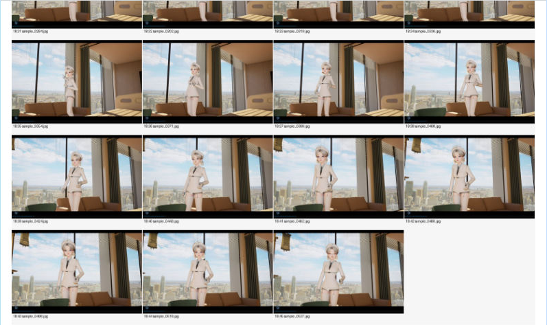

### motion_02_tail_and_j1_header_privacy_crop.png

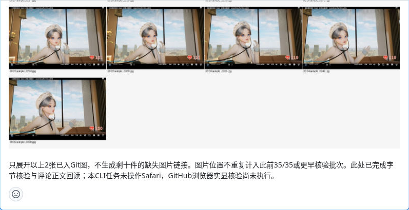

### J1_01_GitHub_display_privacy_crop.png

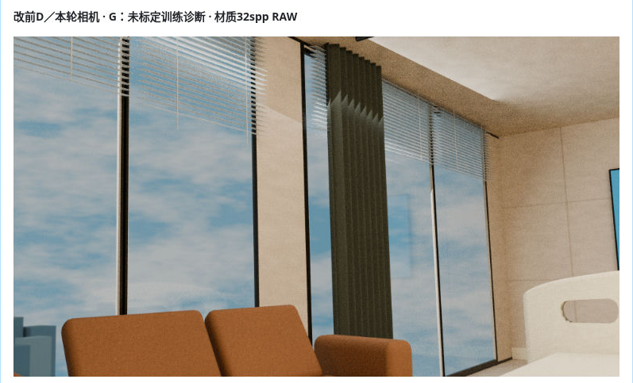

### J1_02_GitHub_display_privacy_crop.png

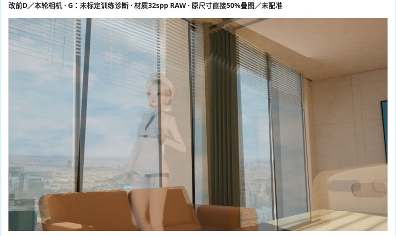

### J1_03_GitHub_display_privacy_crop.png

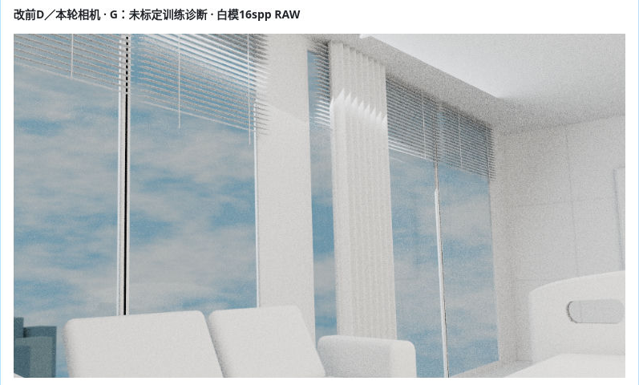

### J1_04_GitHub_display_privacy_crop.png

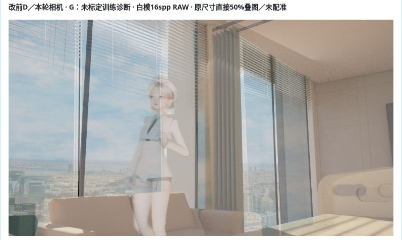

### J1_05_GitHub_display_privacy_crop.png

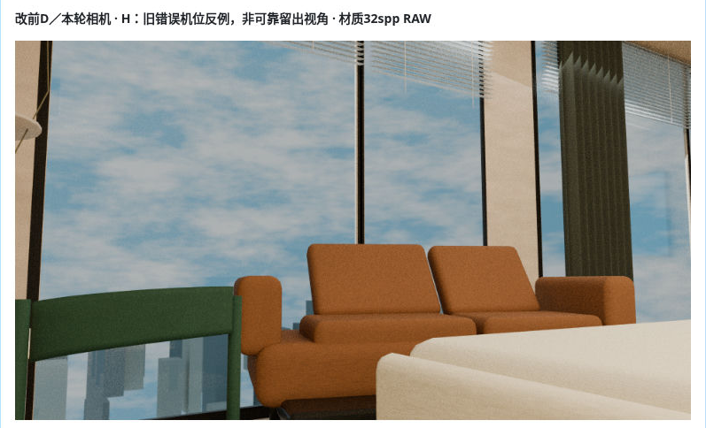

### J1_06_GitHub_display_privacy_crop.png

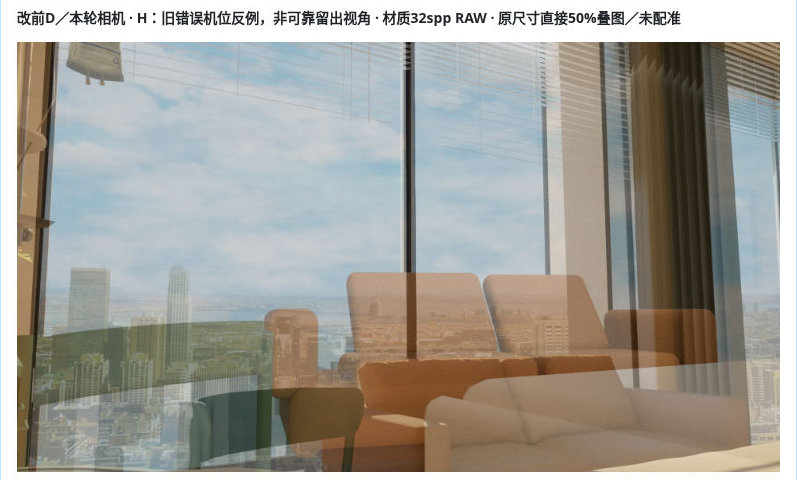

### J1_07_GitHub_display_privacy_crop.png

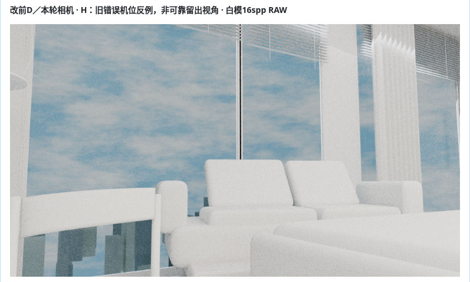

### J1_08_GitHub_display_privacy_crop.png

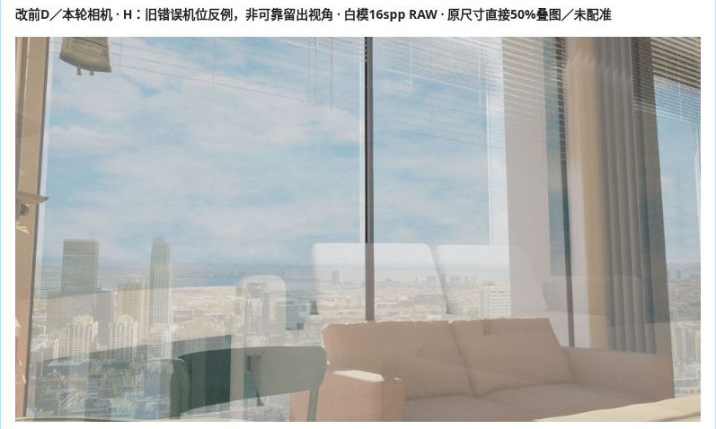

### J1_09_GitHub_display_privacy_crop.png

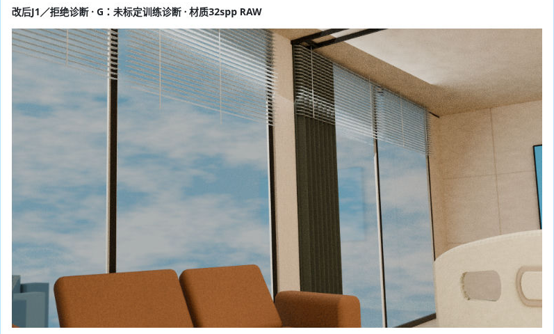

### J1_10_GitHub_display_privacy_crop.png

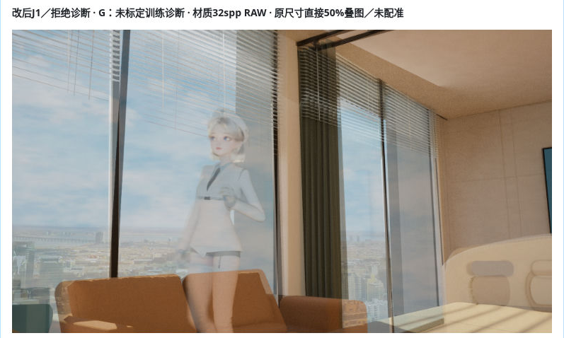

### J1_11_GitHub_display_privacy_crop.png

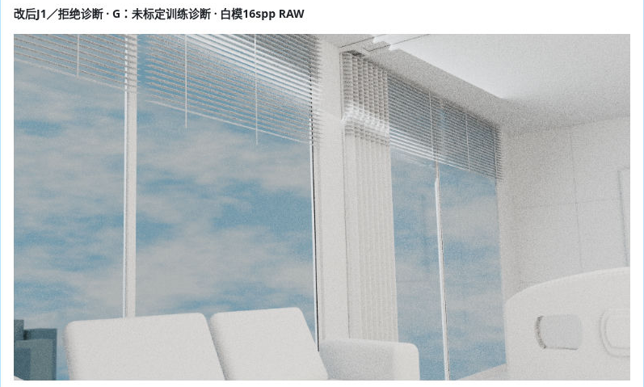

### J1_12_GitHub_display_privacy_crop.png

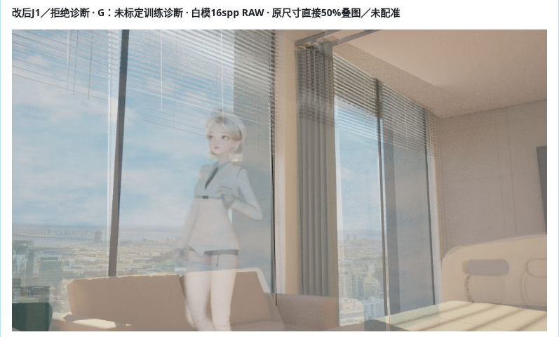

### J1_13_GitHub_display_privacy_crop.png

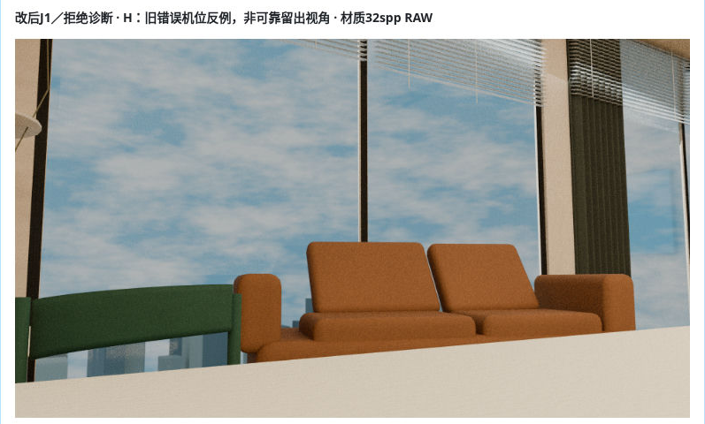

### J1_14_GitHub_display_privacy_crop.png

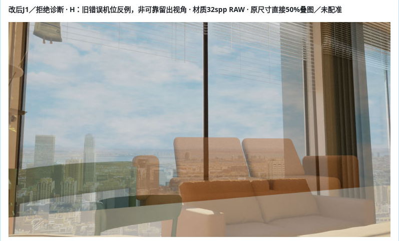

### J1_15_GitHub_display_privacy_crop.png

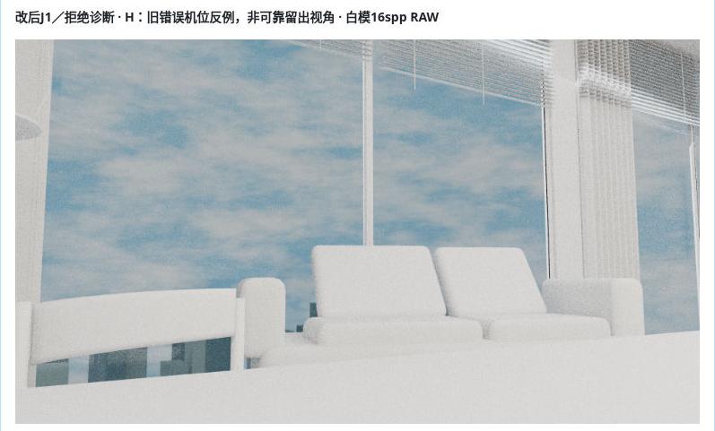

### J1_16_GitHub_display_privacy_crop.png

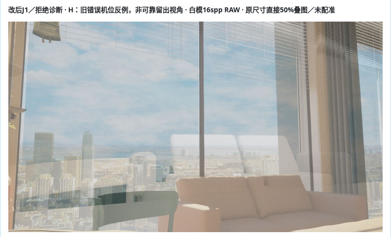

### J1_comment_tail_display_privacy_crop.png

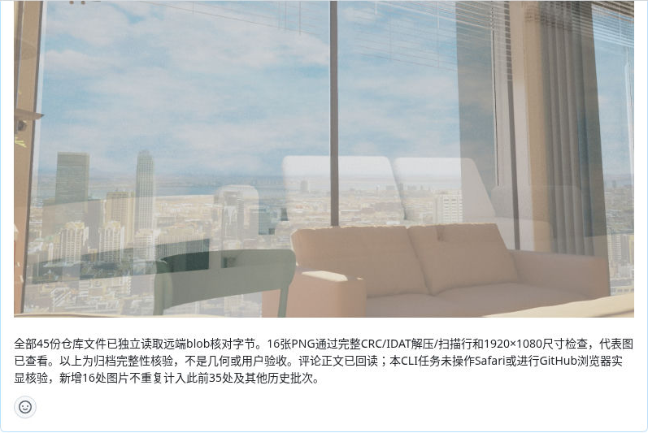

这些新归档屏证不是新增的已核验源图位置；本次18/18结论对应原两评论中的18个固定源图链接。
