# J1联合几何诊断：已拒绝，原件完整归档

<!-- c3-d-origin-correction-20261015 -->

**2026-10-15穿插起点勘误：独立evaluated世界网格和严格三角形横穿复查确认，D基线本身已有bank 3 slat01–21穿入灰折面，不能再把这21片穿插描述为J1首次引入。J1另新增灰折面与ROOM_SHELL、perimeter rail及Window_3上下sill/lintel的穿插。D仍未采纳、J1仍REJECTED_DIAGNOSTIC；H旧85px撤回不变。本轮P0–C3消穿插不构成来源验收，C3仍因柱遮挡和来源形状失败。以下历史文字及原图保留原语境；不倒改旧QA、旧二进制或当时显示核验。**

[本轮D/J1复查原件与图证](../geometry-c3-unaccepted-20261015/versions/D.md)。

<!-- hospital-github-display-18-20261013 -->

**后续云端实显记录：2026-10-13 23:22–23:26:55 UTC，本评论16/16图逐张完整显示通过，包含尾部检查。** 合计运动2+J1 16=18/18，0坏图、0折叠、0可见部分加载；使用云端原生Chromium已登录私有仓库会话。21件屏证/清单/报告及独立索引已按原字节归档。[核验原件与逐图记录](../github-display-check-20261013/README.md)。显示通过不等于几何或用户验收：J1仍REJECTED_DIAGNOSTIC，运动仍PARTIAL_4_OF_14；十件待传和旧65件恢复缺口均不变，不是旧38件屏证恢复。以下原正文的“CLI未做实显”保留为当时历史记录，本Mac本轮也未重跑浏览器。

记录时间：2026-10-13T23:16:24.198169+00:00。状态：**J1_REJECTED_DIAGNOSTIC**。完整归档不代表几何、相机、来源还原、物理可行性或用户验收。

**39件原件与1份权威索引全部在本Mac物化并逐件核验，40件原字节均保持不变。** 共81,948,326字节，其中39件为81,909,162字节，权威索引39,164字节。包含3份BLEND、8张1920×1080 RAW渲染、8张同尺寸直接50%叠图及报告、QA、脚本和参数；没有新增渲染或改模型。

## 拒绝原因与指标更正

- 生产方真实世界坐标网格BVHTree检查确认21个百叶片对象与灰褶网格表面相交，构成实体/遮挡QA失败。G改后图中横片从灰褶上部穿过，不能解释为阴影。此处保留生产方QA，本Mac未重跑Blender几何测试。
- H原报灰褶85px已撤回。沙发上缘误配至整个凸包的下缘，现有H相机不可靠；所有H PNG只作为错误机位反例展示，不称可靠留出结果。
- 冻结几何后指定上包络的H数学诊断仍未通过；虽部分沙发点改善，窗线校准仍不符。没有相应的新渲染，也没有将新相机认定为标定成功。
- B/F旧约125/53px只保留为最近全凸包的历史距离，不作为有效指定分支指标。新定向轮廓检查仍不符；未标定相机下的像素残差不能当作真实物理尺寸误差。
- 柱凸出量、床平移及机位触及参数边界，且最初参数域未编码完整百叶/褶帘遮挡不等式；训练点改善不能证明多视角或物理可行性通过。

## 权威版本与原件保留

以[权威索引原件](provenance/final_consolidated_library_identity_index.json)为版本依据，v0 SHA256：`6919703d3cd9e0694b2d77aa799d69918ec0c99d10bc4454d26dacc9a7fcdc6f`。`joint_candidate_screening.json`与`heldout_camera_validation.json`均为最终v2，`screen_joint_candidate.py`为v1，其余按索引身份接收。逐件版本、文件大小、SHA与路径映射见[交付清单](delivery-status.json)和[SHA256SUMS](SHA256SUMS.txt)。

全部模型、PNG、JSON、脚本、报告及权威索引均按原字节保留；本次没有路径清理派生。原件中的云端绝对路径、Library身份和旧版本回执仅属生产阶段溯源，不代表这些路径在本Mac存在。Library保存时的`render_manifest(5).json`与`direct50_pixel_checks(3).json`依权威相对路径归档为原目录名，字节不变。生产阶段报告中的“没有Git写入”保留为当时状态，当前归档状态以本README及delivery-status为准。

原报告：[关键结论与下一步](files/关键结论与下一步_20261013.txt)。关键核验：[物理相交](files/diagnostic_outputs/independent_physical_qa.json)、[H上包络更正](files/H_camera_upper_edge_correction_audit.json)、[B/F指定分支](files/BF_directed_contour_audit.json)、[渲染清单](files/diagnostic_outputs/render_manifest.json)、[直接50%像素检查](files/diagnostic_outputs/direct50_pixel_checks.json)。

## 与既有版本的关系

已持久化的A/B/F/G/H五个原帧与原D.blend均读取现有Git字节核对SHA，仍作为既有输入引用，未复制为新来源。见[依赖记录](dependencies.json)。G为未标定训练诊断；H为校准错误反例。生产方记录改前/改后共用同一组本轮相机，不按机位隐藏对象。

这是一批新的J1拒绝诊断，不是CP1，也不是失联65件的恢复。失联65件恢复记录、D/E/旧机位/顶轨/A-B版本、CURRENT和既有拒绝状态均不变。先前[运动观察PR #52](https://github.com/Shuang-su/metaxingtong/pull/52)仍为PARTIAL_4_OF_14，十件待传不会因J1完整交付而被视作已补齐；其[独立评论](https://github.com/Shuang-su/metaxingtong/issues/4#issuecomment-6157101462)保留。

连续运动检查只支持所观察范围内未见硬切或床独立平移，TV内容变化不计房间切镜头；变焦、固定内参和跨12分钟同布局仍未证，床双侧缘/护栏/枕位同框缺口仍在。不能把J1或运动观察当作模型验收。

## 图证：16张原尺寸展开

以下8张实际RAW渲染与8张原尺寸逐像素50%叠图全部入Git，均为1920×1080。生产方清单记录材质32spp、白模16spp；ViewLayer降噪关闭，不能因全局开关为True而称已降噪。叠图保持未裁切、未缩放、未配准状态；生产方direct50像素核验记录一并保留，本Mac未重做叠图或渲染。

### 改前D／本轮相机 · G：未标定训练诊断 · 材质32spp RAW

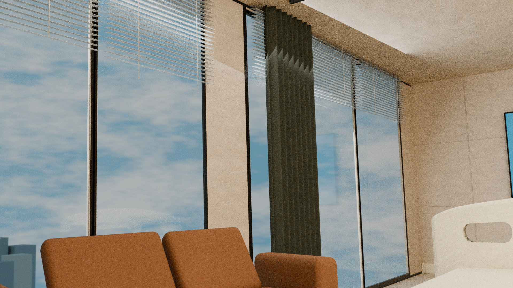

### 改前D／本轮相机 · G：未标定训练诊断 · 材质32spp RAW · 原尺寸直接50%叠图／未配准

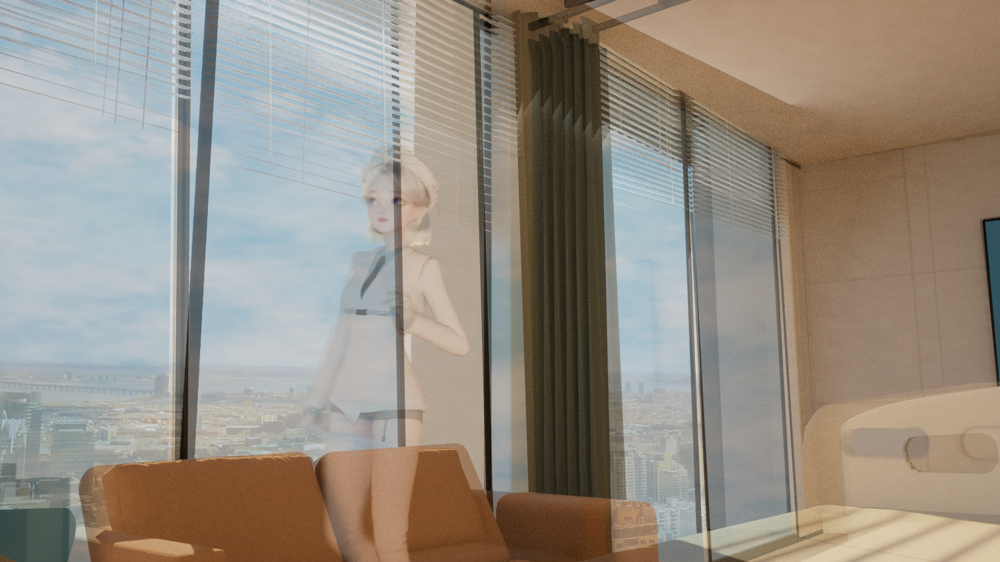

### 改前D／本轮相机 · G：未标定训练诊断 · 白模16spp RAW

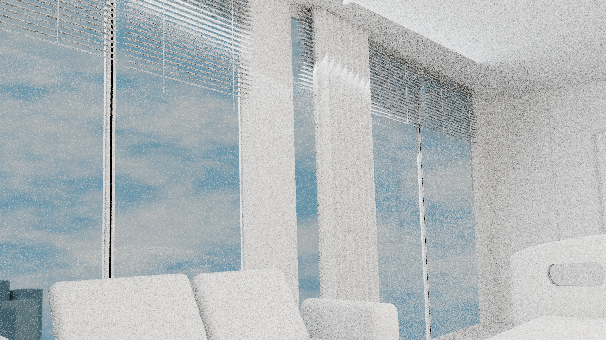

### 改前D／本轮相机 · G：未标定训练诊断 · 白模16spp RAW · 原尺寸直接50%叠图／未配准

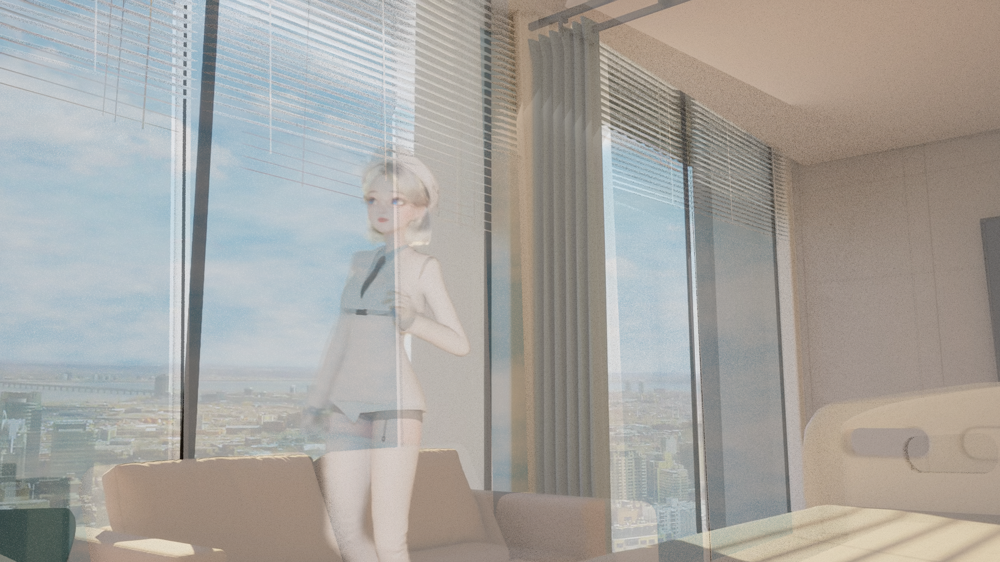

### 改前D／本轮相机 · H：旧错误机位反例，非可靠留出视角 · 材质32spp RAW

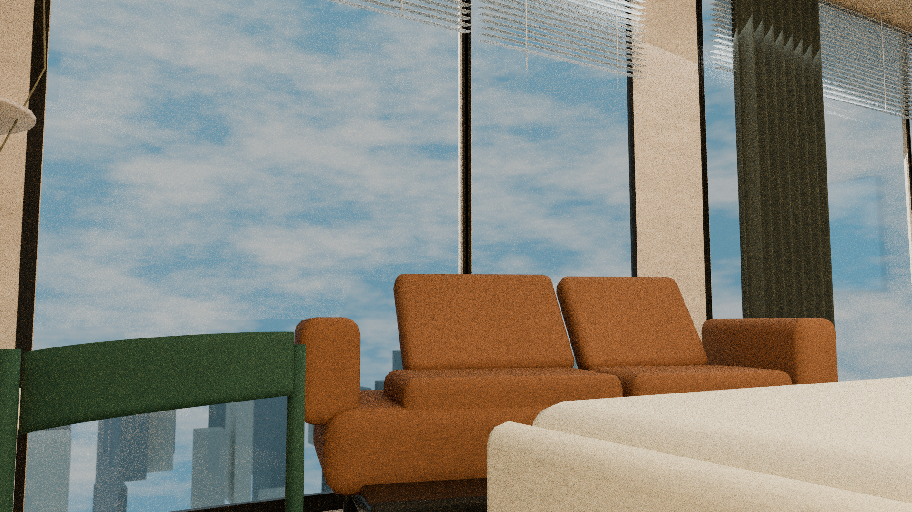

### 改前D／本轮相机 · H：旧错误机位反例，非可靠留出视角 · 材质32spp RAW · 原尺寸直接50%叠图／未配准

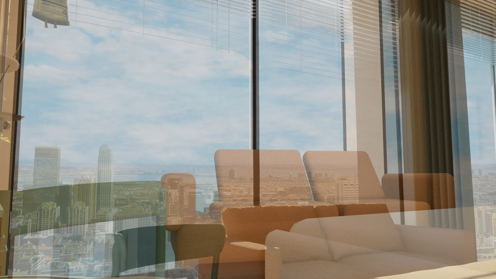

### 改前D／本轮相机 · H：旧错误机位反例，非可靠留出视角 · 白模16spp RAW

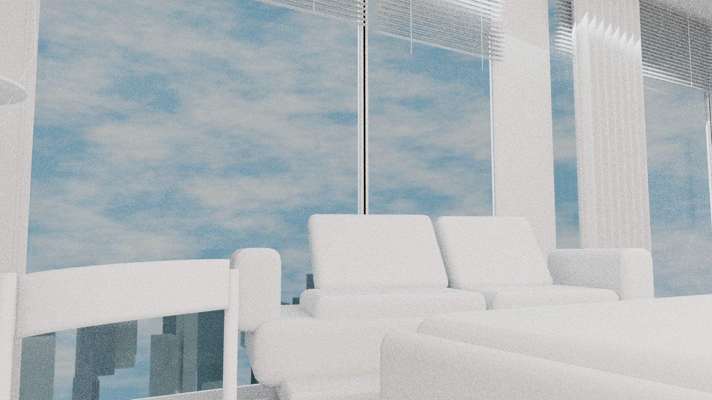

### 改前D／本轮相机 · H：旧错误机位反例，非可靠留出视角 · 白模16spp RAW · 原尺寸直接50%叠图／未配准

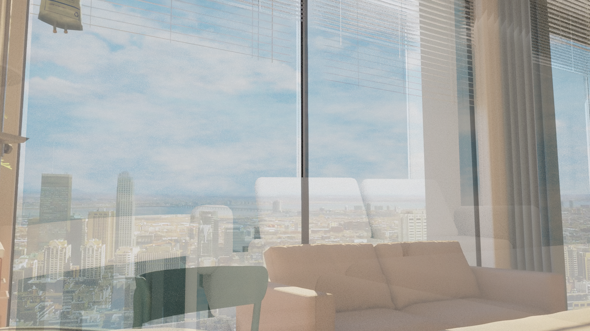

### 改后J1／拒绝诊断 · G：未标定训练诊断 · 材质32spp RAW

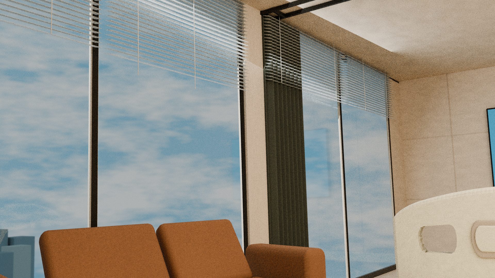

### 改后J1／拒绝诊断 · G：未标定训练诊断 · 材质32spp RAW · 原尺寸直接50%叠图／未配准

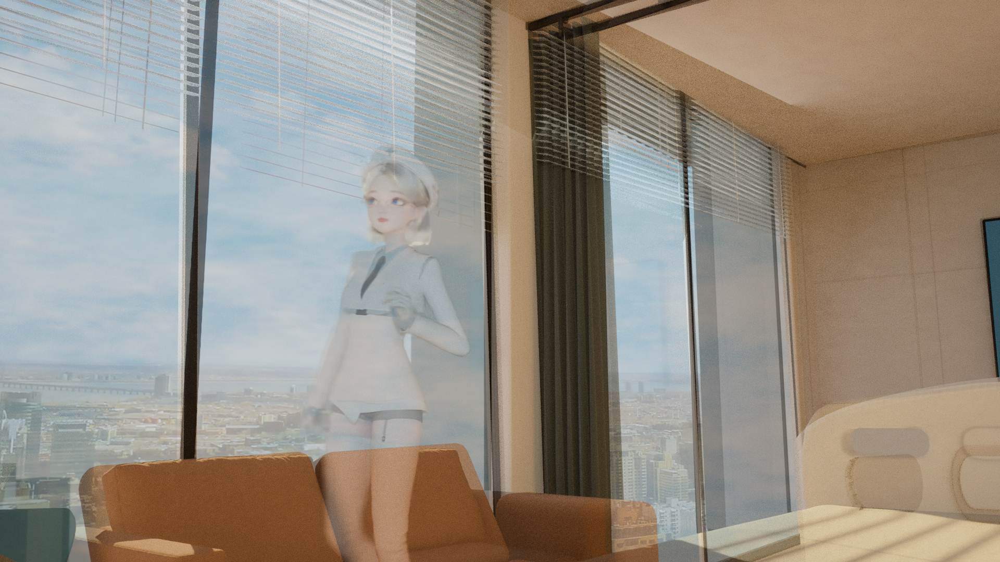

### 改后J1／拒绝诊断 · G：未标定训练诊断 · 白模16spp RAW

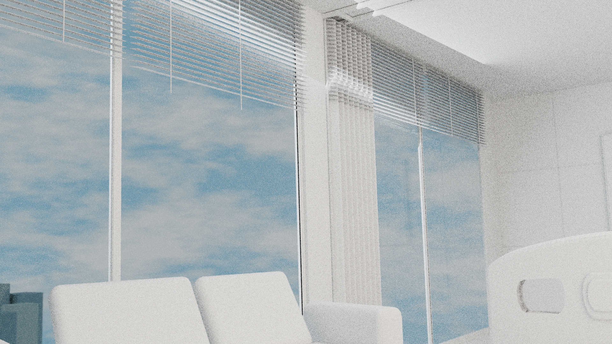

### 改后J1／拒绝诊断 · G：未标定训练诊断 · 白模16spp RAW · 原尺寸直接50%叠图／未配准

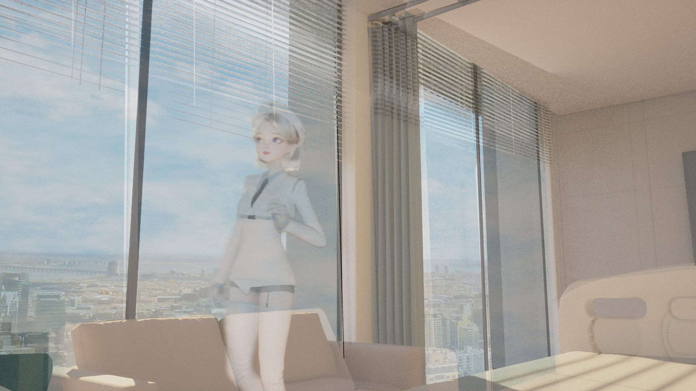

### 改后J1／拒绝诊断 · H：旧错误机位反例，非可靠留出视角 · 材质32spp RAW

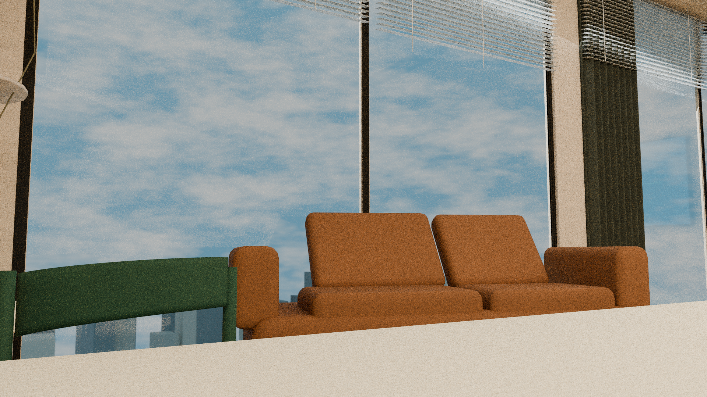

### 改后J1／拒绝诊断 · H：旧错误机位反例，非可靠留出视角 · 材质32spp RAW · 原尺寸直接50%叠图／未配准

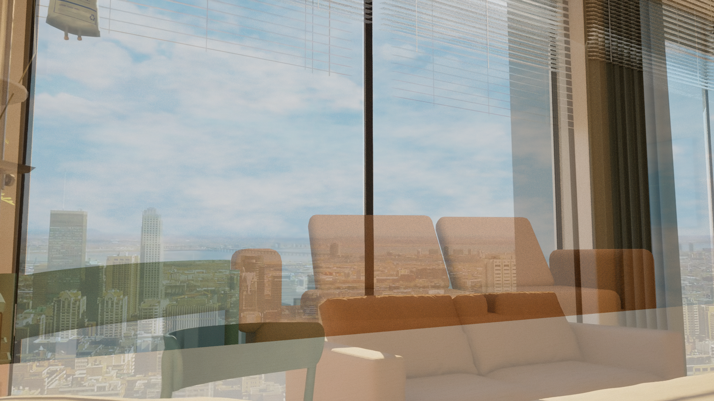

### 改后J1／拒绝诊断 · H：旧错误机位反例，非可靠留出视角 · 白模16spp RAW

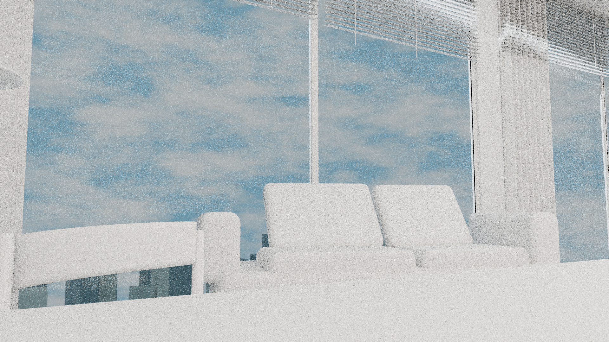

### 改后J1／拒绝诊断 · H：旧错误机位反例，非可靠留出视角 · 白模16spp RAW · 原尺寸直接50%叠图／未配准

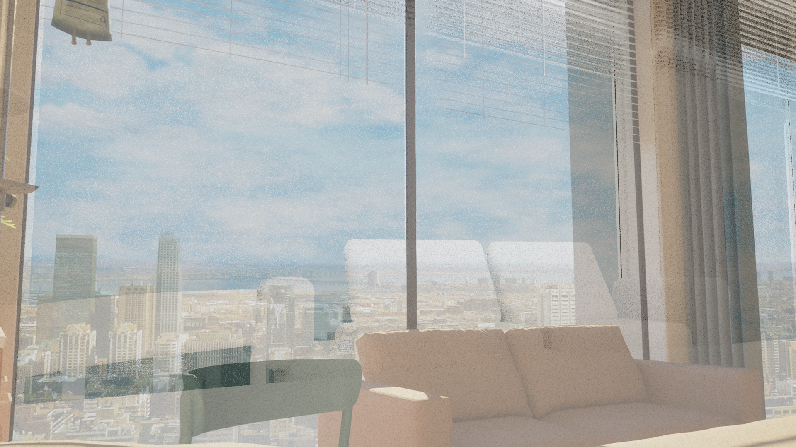

## 本机归档核验范围

40件源字节与权威SHA/大小/版本全部匹配。16张PNG均通过全部chunk CRC、完整IDAT解压及扫描行长度/过滤类型检查，尺寸均1920×1080；两张代表图已打开查看。所有已引用源输入的现有Git字节与来源SHA匹配。完整记录见[archive-verification.json](archive-verification.json)。

这些检查验证交付与文件完整性；原报告内的拟合、真实网格检查和直接50%像素检查属于生产方记录。本Mac未运行交付脚本、拟合、重渲染或Safari；GitHub评论浏览器实显核验尚未执行。Issue4为本J1独立阶段展开全部16张已入Git图，不折叠、不改变旧版本评论。
