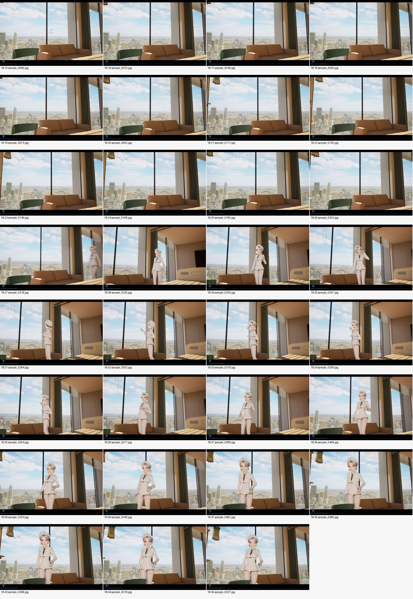
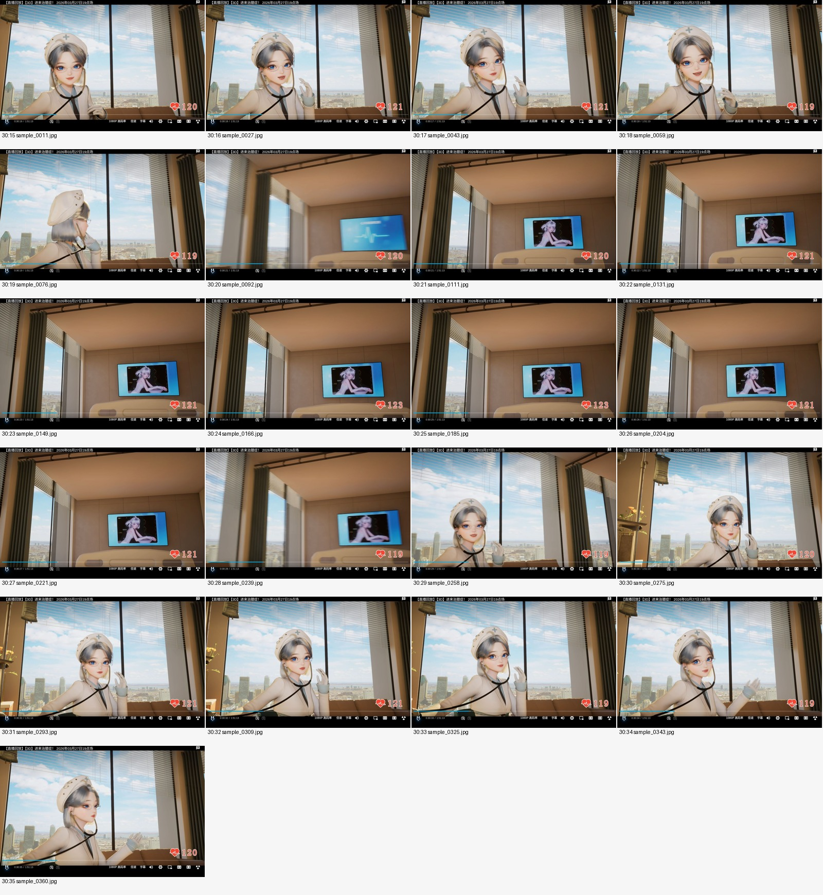

# 医院新运动观察：PARTIAL_4_OF_14

<!-- hospital-github-display-18-20261013 -->

**后续云端实显记录：2026-10-13 23:22–23:26:55 UTC，本评论2/2图逐张完整显示通过，包含尾部检查。** 合计运动2+J1 16=18/18，0坏图、0折叠、0可见部分加载；使用云端原生Chromium已登录私有仓库会话。21件屏证/清单/报告及独立索引已按原字节归档。[核验原件与逐图记录](../github-display-check-20261013/README.md)。显示通过不等于几何或用户验收：J1仍REJECTED_DIAGNOSTIC，运动仍PARTIAL_4_OF_14；十件待传和旧65件恢复缺口均不变，不是旧38件屏证恢复。以下原正文的“CLI未做实显”保留为当时历史记录，本Mac本轮也未重跑浏览器。

记录时间：2026-10-13T23:05:48.714972+00:00。本版本为2026-10-13新发生的运动/遮挡观察阶段。

**Library已成功持久化全14件，但本Mac目前仅4件可读并核验；本提交仅归档这4件，状态为`PARTIAL_4_OF_14`。** 剩10件待支持的传输流程恢复后，在同一版本目录通过新Git提交追加，并原位更新本阶段Issue评论。当前不能声称14件已完成Git归档。

本批不是CP1 27件或旧验图38件（合计65件）的恢复，也不含J1联合模型。65件“当前原件不可取得／恢复待查”记录保持原样；J1仍为拒绝诊断、另批交接，不随本观察归档获得验收。CURRENT、旧模型和未采纳状态不变。

## 本次已入库的四件

| 文件 | 字节 | 角色 |
|---|---:|---|
| [BV1GqXMByE1s_motion_evidence_index.json](files/BV1GqXMByE1s_motion_evidence_index.json) | 5737 | 完整Library交付的原始索引；不是完整Git归档声明 |
| [BV1GqXMByE1s_连续运镜证据短报告.md](files/BV1GqXMByE1s_连续运镜证据短报告.md) | 4533 | 原始观察报告；方法和局限保持原文 |
| [BV1GqXMByE1s_18m15_to_18m45_timeline.jpg](files/BV1GqXMByE1s_18m15_to_18m45_timeline.jpg) | 898339 | 18分钟段逐秒派生概览 |
| [BV1GqXMByE1s_30m15_to_30m35_timeline.jpg](files/BV1GqXMByE1s_30m15_to_30m35_timeline.jpg) | 648103 | 30分钟段逐秒派生概览 |

四件原始字节合计1,556,712，索引和报告不改写。逐件SHA见[校验清单](SHA256SUMS.txt)，当前交付状态和十件待传列表见[delivery-status.json](delivery-status.json)。Library身份与本机路径留在本机接收记录，不将内部下载地址写入仓库。

## 观察结论与边界

原视频：[BV1GqXMByE1s](https://www.bilibili.com/video/BV1GqXMByE1s/)。以下发现来自已交付报告和本轮云端观察；本Mac仅核对文件及打开两张概览，未重跑视频采样、相机拟合或渲染。两张概览保留为已发生运动检查的可审阅依据，不替代未交付的快速转向联系图或逐个源视频帧。

- 18:15–18:45报告有效观察532，30:15–30:35报告有效观察350；均不是本提交的原始图片数。其余连续样本也不在本次14件小批交付内。
- 段内快速转向观察到中间视角，未观察到明确房间硬切或床独立平移；不等于证明床绝对静止，也不能排除未采到的单帧异常。30:20附近TV屏幕内部内容变化不计为房间切镜头。
- 变焦与固定镜头内参均未证；跨约12分钟的布局、床位置及内参一致性未证，不能强制两段共用固定布局/固定内参。
- 床双侧长缘、侧护栏连接、枕位/头端未获得清楚同框证据，床宽深、头脚方向及护栏拓扑仍不确定。可见宽板暂称端板。
- 保留病人躺床、左侧百叶窗、中柱及横向拉帘杆接柱的用户语义；不把阴影条纹直接建成实体板缝，也不借任意调床位置掩盖机位不确定性。

播放器报告源流1920×1080；原浏览器观察JPEG为1180×757，含黑边、播放器控件和直播叠层。这些是动作及遮挡证据，不是1920×1080原生导出帧。下列概览分别为1600×2320与1600×1740的缩小派生拼图，不能把其像素坐标直接用于几何拟合。

## 已交付概览（两张展开，不折叠）

### 18:15–18:45

### 30:15–30:35

## 同版本待传十件

以下文件已在Library精确找到成功身份，但Mac标准下载流程目前不可用。这里仅列文件名，不创建缺失文件或不存在的图片链接。索引中的六个原始观察SHA属于生产方期望值，尚未在Mac用其原件验证。

- `BV1GqXMByE1s_observation_18m27.763s.jpg`：待传；精选原始观察JPEG。
- `BV1GqXMByE1s_observation_18m31.011s.jpg`：待传；精选原始观察JPEG。
- `BV1GqXMByE1s_observation_18m35.006s.jpg`：待传；精选原始观察JPEG。
- `BV1GqXMByE1s_observation_30m20.534s.jpg`：待传；精选原始观察JPEG。
- `BV1GqXMByE1s_observation_30m23.029s.jpg`：待传；精选原始观察JPEG。
- `BV1GqXMByE1s_observation_30m27.494s.jpg`：待传；精选原始观察JPEG。
- `BV1GqXMByE1s_30m15_to_30m35_transition_0.jpg`：待传；快速转向派生联系图。
- `BV1GqXMByE1s_18m15_to_18m45_transition_1.jpg`：待传；快速转向派生联系图。
- `BV1GqXMByE1s_30m15_to_30m35_transition_1.jpg`：待传；快速转向派生联系图。
- `BV1GqXMByE1s_18m15_to_18m45_transition_0.jpg`：待传；快速转向派生联系图。

本版本Issue仅展开以上两张已入Git的概览。Git blob字节核验和评论正文回读不等于浏览器实显核验；本CLI任务未操作Safari，也不宣称已完成该评论的浏览器显示检查。
