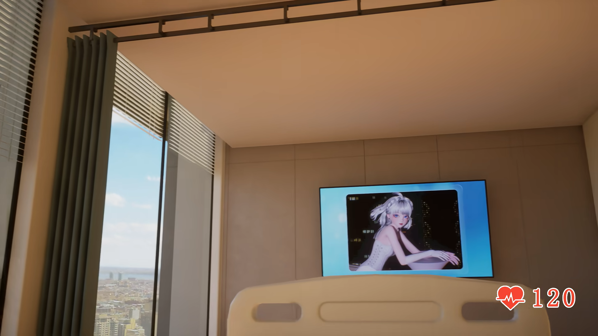
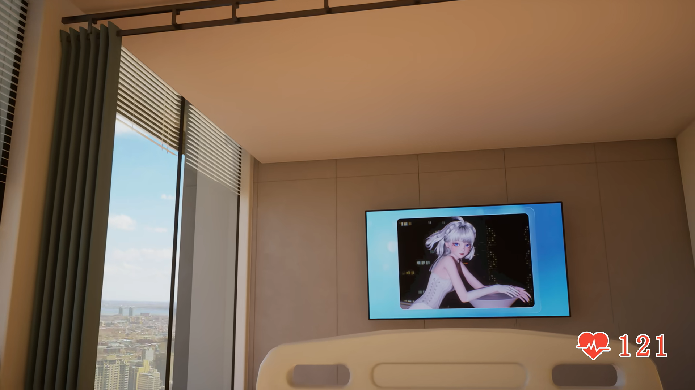

# 病房：2026-10-13原生A/B来源归档

<!-- cloud-originals-recovery-65-20261013 -->

**2026-10-13 22:07–22:12 UTC恢复检查补充：CP1的27件与验图38件（合计65件）当前原件不可取得／恢复待查。** 云端环境重建后，原目录及待传清单不在当前workspace/shared；Library完整清单及65精确文件名检查未找到成功身份。上传超时结果仍未定、无会话可恢复，两批均未在本Mac物化或进入Git。下文“待交付/待传输”为此前历史状态，不表示仍有可用本地待传原件。35/35实显曾真实完成，PR #50结论仍有效；不以补图或新模型冒充旧证据/CP1。已Git保存的D/E/机位诊断/顶轨6件/A/B不受影响，CURRENT及拒绝/未采纳状态不变。后续从持久化D及5原帧开始的联合重建将另立新版本。[恢复状态记录](../../../../docs/research-display-20261013/cloud-originals-recovery-65/README.md)。

<!-- cloud-issue4-display-35-20261013 -->

2026-10-13显示状态更新：本版本2张图已由独立云端浏览器逐张完整显示核验通过。本批合计A/B2+D15+E11+机位7=35，A/B已含，不是37；无坏图、折叠或部分显示。显示通过不等于几何或用户验收，CURRENT/未采纳状态不变。38份云端截图/说明原件仍待可验证Library交付，尚未物化到本Mac、尚未Git；CP1也未交付。[独立核验记录](../../../../docs/research-display-20261013/cloud-issue4-35/README.md)。

以下原正文保留归档时的核验状态；此前Mac/Safari技术阻塞和待验语句属于历史，不改写为当时通过。

状态：来源帧归档 / 相机与几何未验收。正式原生帧仅A、B两张；本次不产生新模型版本。

来源：[BV1GqXMByE1s](https://www.bilibili.com/video/BV1GqXMByE1s/)。保留两张PNG、原来源清单、更新后的采集操作说明和运动/视角证据JSON，5份原文件均保持字节不变。[归档大小与SHA](archive-verification.json) · [逐帧来源记录](source-manifest_A_B.json) · [采集操作说明](原生PNG采集操作说明.md) · [运动与视角证据](motion-and-perspective-evidence.json)。

| 原生帧 | 实际currentTime（秒） | PNG尺寸 | 字节数 |
| --- | --- | --- | --- |
| A | 1820.867783 | 1920×1080 | 1,381,295 |
| B | 1826.978388 | 1920×1080 | 1,337,972 |

已在接收端实际物化并核验原文件大小、SHA256、Git blob和PNG解码；两张本地原图已查看，无播放器边框。原图内TV人物及心率层保留。浏览器采集时的登录、画质、暂停和前后currentTime由原采集记录提供，本归档没有重新操作浏览器或冒称重做采集。

本视频当时菜单未列2K/4K，虽然列有1080P高码率，保存状态和实际解码为1080P高清1920×1080；不能据菜单存在认定高码率生效。后续按现行采集标准选实际可用的最高画质，支持且实际解码4K时取得原生4K，禁止插值冒充。

## 原生图证

### A · 1820.867783秒

### B · 1826.978388秒

## 运动、语义与待办

- A到B有20次自然连续播放观测，中间未seek、采样中未观察到切换；采样不能排除间隙事件，也没有证明纯横移或确定相机基线。
- 18:18–18:40的运动观察记录来自低分辨率视口JPEG，只作连续运动证据，未算作新增原生帧。本归档保存其清洁JSON记录，不声称已保存全部302张有效JPEG观测原件。
- AI字幕中照护、挂水和护士站相关短句支持医护照护剧情。时间是播放器时刻首次观察值，不是官方字幕入点；未听取音频，AI转写可能有误。躺在病床上的病人第一视角来自用户明确说明，不由字幕独立证明。
- 相机待办：按用户明确的病人躺床第一视角重新审查机位与床垫的空间关系。重建任务已报告现有D及像素拟合机位落在床垫外，因此新对比不能标为通过。该问题在本归档中记录为未通过/待修正，未重新运行模型审查或更改任何模型。
- 用户结构纠正（2026-10-13）：顶部是横向拉帘；左侧落地窗都配百叶窗帘，中间有一个“类似承重柱”的柱状构件，横向拉帘杆插接到该处。这是用户提供的结构/功能说明，不等于柱子承重属性已证；具体截面、轨数、尺寸、连接深度及两侧窗/百叶帘前后关系仍待图证核验。旧称“帘头/灰帘”可能混淆该柱状构件，应重核对应关系，尚未证明几何修复。失败的同X上下悬挂框假设不作为真实结构。
- 1111.096417秒另一次导出只有浏览器完成提示，接收原字节未取得/核验，不是已交付原生帧。运动模糊的1873.914989秒功能测试帧也不属于这两张正式参考，不作几何拟合锚点。
- 保持CURRENT、既有失败方案和NOT_ADOPTED状态。新的共享场景、相机、同机位叠图和用户验收需另按真实阶段记录。
