# 病房共享空间候选D：未采纳及标注勘误

状态：`D_SHARED_SPATIAL_RESEARCH_NOT_ADOPTED`。真实归档提交日期使用当前日期，不回填历史提交日期。

D是共享空间研究候选，保留4份最终模型、D0/D1两份拒绝检查点、13张当前PNG及2张撤回旧标题板。G/H旧左扶手指标混入光斑和内部接合，已撤回，不能重用G 328.2→264.0或H181.4指标作为几何精度；D没有替代分数。当前G/H标题已纠正，旧标题板仅作SUPERSEDED历史。原报告仍列出F窗顶退化、G绿椅缺席、H扶手和床垫错位等失败。技术QA不等于来源或用户验收。

本版42份原件共92,440,296字节已在接收端实际物化并校验SHA256/Git blob。模型、PNG、脚本和报告均原字节；4份JSON仅清理检索ID或继承绝对路径，保留原件SHA、仓库SHA与逐字段派生记录。原delivery_manifest仍描述输入原件；仓库文件哈希以archive-verification.json为准。

[原报告](%E5%85%A8%E5%9C%BA%E7%A9%BA%E9%97%B4%E5%80%99%E9%80%89D_%E6%9C%AA%E9%AA%8C%E6%94%B6.md) · [原件与仓库核验](archive-verification.json) · [JSON派生记录](metadata-derivations.json) · [依赖固定提交](dependencies.json)

本CLI归档没有重跑Blender、拟合、渲染或浏览器采集。原报告技术检查是该研究阶段的记录，不冒称本次重跑或模型来源验收。CURRENT及以前全部原文件保持不变；本次Git合并只是独立归档。

2026-10-13后续约束（单列，不重写旧研究结论）：用户明确病人躺床第一视角；顶部横向拉帘、带百叶的两侧落地窗及中央柱状构件接杆。柱的承重性、准确截面/尺寸与灰条身份未证实。现有D及自由像素拟合机位与床垫关系存在冲突，后续诊断不能标为通过。

## 模型原件

- [D0_screening.blend](D0_screening.blend) · SHA256 `24560f3d07891fef8af3388cf5d18ad6c9792ce133b96f52bd44212e4022a522`
- [D1_screening.blend](D1_screening.blend) · SHA256 `a71288315451e197a167b35e030712758e2e7249ae0a2139e061aaa945d11c6b`
- [hospital_spatial_D.blend](hospital_spatial_D.blend) · SHA256 `3c00994ea7532fd3646534814d27489c18a1c642833836197bd2a888c6eb7b53`
- [hospital_spatial_D.glb](hospital_spatial_D.glb) · SHA256 `71a5b0c2bfe5db375b6f89180cacd7b2414a29d29ffc48ebc7b33e901e9bffe7`
- [hospital_spatial_D_white.blend](hospital_spatial_D_white.blend) · SHA256 `8cee1b80d6b6af7716c9cd29846ed5358b1cfa9165fb4384e9950b07c608bff1`
- [hospital_spatial_D_white.glb](hospital_spatial_D_white.glb) · SHA256 `1284797d37abb1a30f94fb46c0b0f9fae6f7f576bc824f662e7748762d44e1e3`

## 本版全部PNG图证

图证直接展开，未折叠。撤回的旧标题板单独标记，只保留历史，不作当前几何精度证据。

### F_D_full_1920_16spp_raw.png

SHA256 `00c146ee9720f3d796f37c5e4eaf4beb73304c51620f9a8d46b506ba35838f30`；尺寸1920×1080。

### F_D_full_1920_16spp_raw_oidn.png

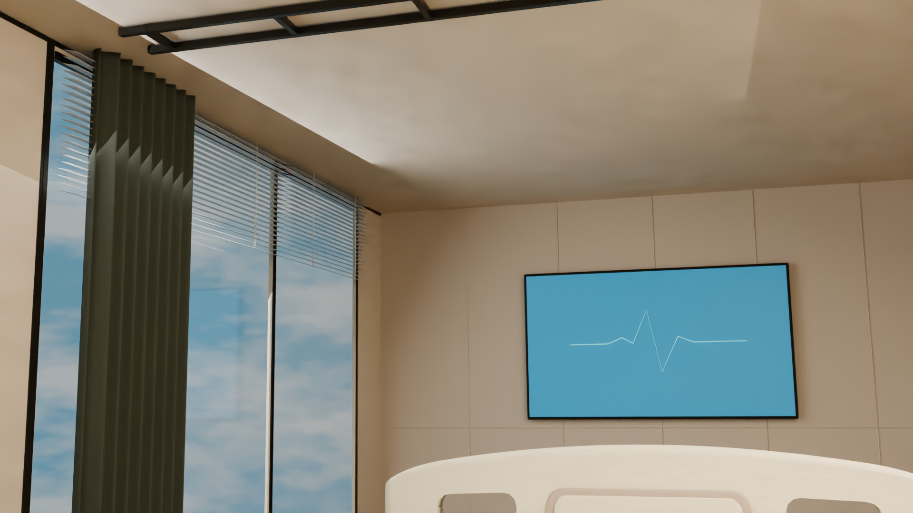

SHA256 `7526b96c83962e5c978b83a5b54a1e31142d3f77d79b2852030797a831ecd5fc`；尺寸1920×1080。

### F_source_B_D_fullframe_review.png

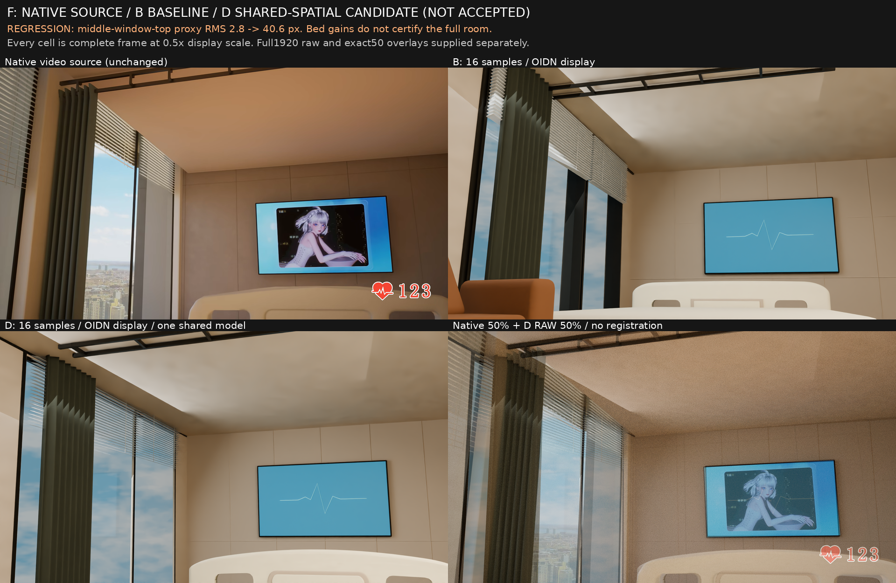

SHA256 `82274bd819fa5b38626e2e7cbb180e398fe04d5b01ba510ba9d330e221113c59`；尺寸1920×1250。

### F_source_D_direct50_UNREGISTERED.png

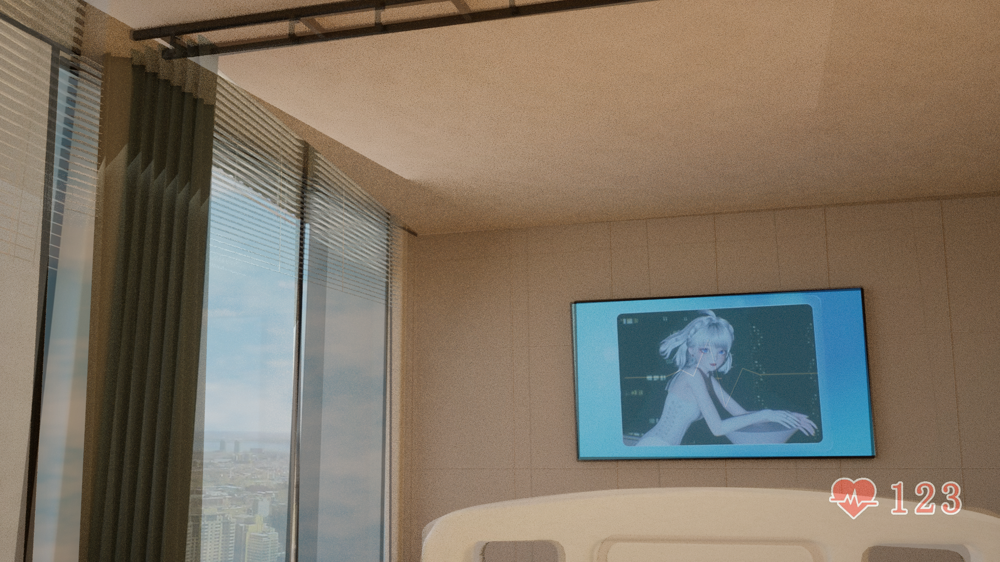

SHA256 `4b675f79958d252c50ccc58d657977d568f1118c4d0411ced420ec93b052b18a`；尺寸1920×1080。

### G_D_full_1920_16spp_raw.png

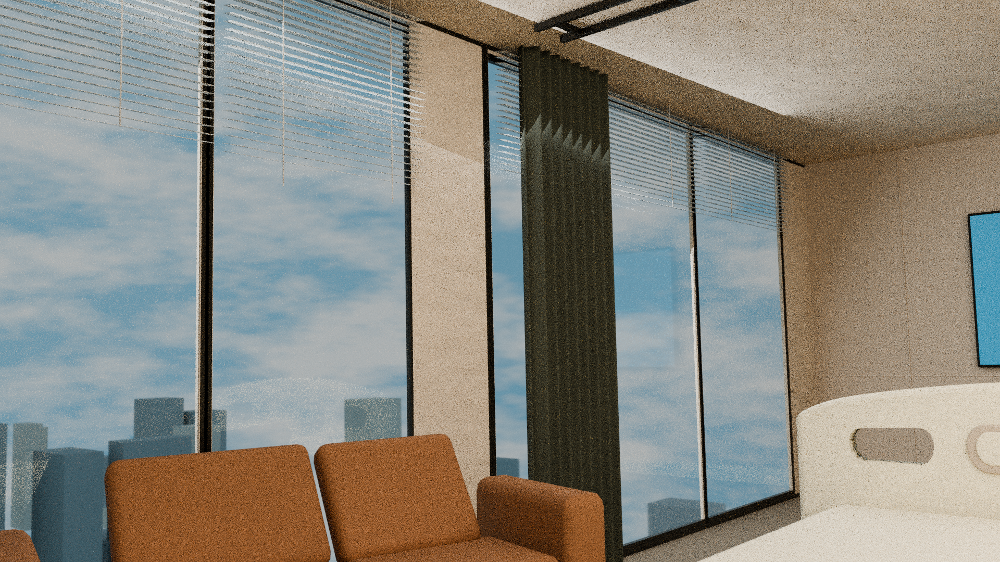

SHA256 `d361e0cde96165edae9c03c55016b07b638e38f5d117597ec428daa55c21ade4`；尺寸1920×1080。

### G_D_full_1920_16spp_raw_oidn.png

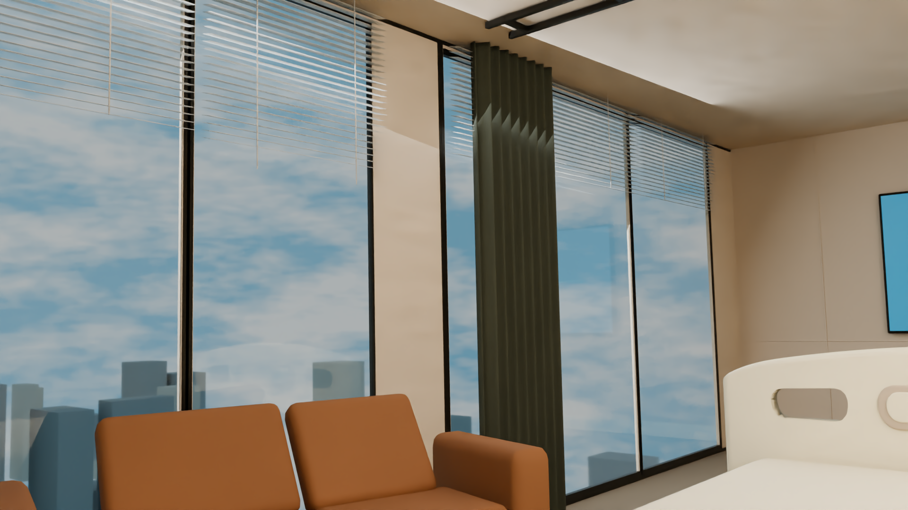

SHA256 `ee21196b5da482aa758f9f454488a242a5525ae8823559979a0a7824127f1802`；尺寸1920×1080。

### G_source_B_D_fullframe_review.png

SHA256 `c0bf61ca0165c3badd47d046e62f15332391c1c4ca14c8dfc0a81ce9a604daa0`；尺寸1920×1250。

### 撤回历史标题，禁止作为当前指标：G_source_B_D_fullframe_review_SUPERSEDED_UNVERIFIED_ARM_CLAIM.png

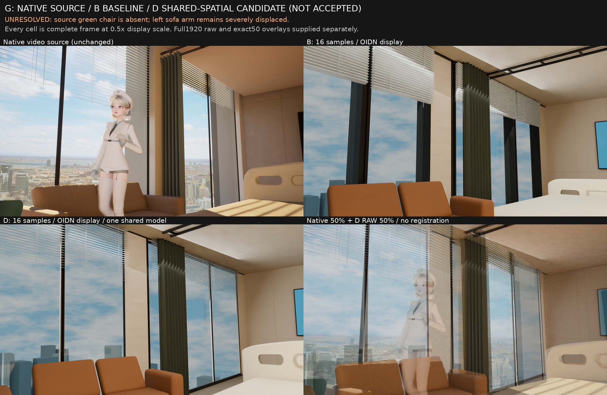

SHA256 `d5baba50dc5f7fed9e9c505b6e0564f3cf2b4806c9070331353f4a4941035804`；尺寸1920×1250。

### G_source_D_direct50_UNREGISTERED.png

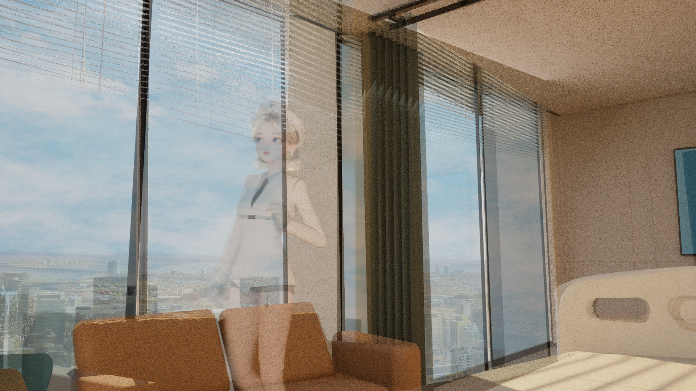

SHA256 `24eabdad53f8d19a6b4100af019d2421873346e1f59258a80069ae6887b2b0f4`；尺寸1920×1080。

### H_B_full_1920_16spp_raw.png

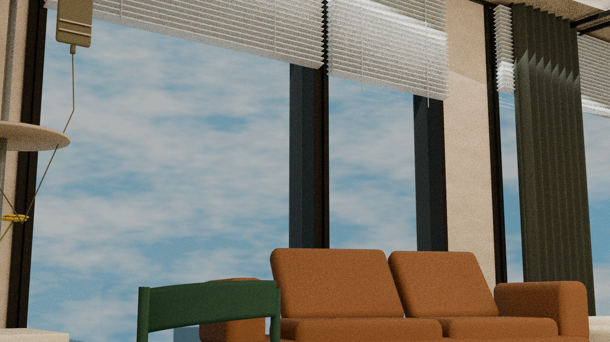

SHA256 `098bc08d63b72492744a0041c007dd21b53f53066c63225a1be1bb059e1b72a7`；尺寸1920×1080。

### H_D_full_1920_16spp_raw.png

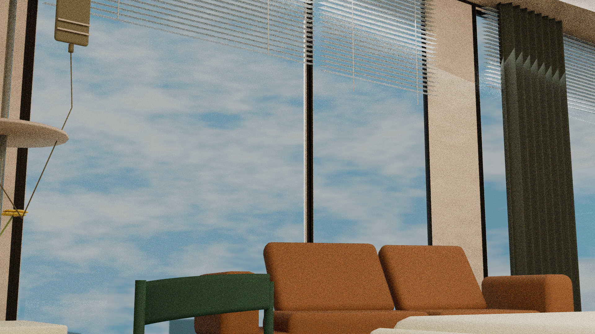

SHA256 `9e288cdb92bd466ddf3bcfd02a682e3bcb035d7ee4145113da3b0165b818e021`；尺寸1920×1080。

### H_D_full_1920_16spp_raw_oidn.png

SHA256 `8e5f5944c804ab966058bd5360bc92bd11161f70d13d32a2cf00628b2b438ea8`；尺寸1920×1080。

### H_source_B_D_fullframe_review.png

SHA256 `56730e9e4d51664d8ee6e585b5403da9a71db43542011052c6187feae46c098c`；尺寸1920×1250。

### 撤回历史标题，禁止作为当前指标：H_source_B_D_fullframe_review_SUPERSEDED_INVALID_181PX.png

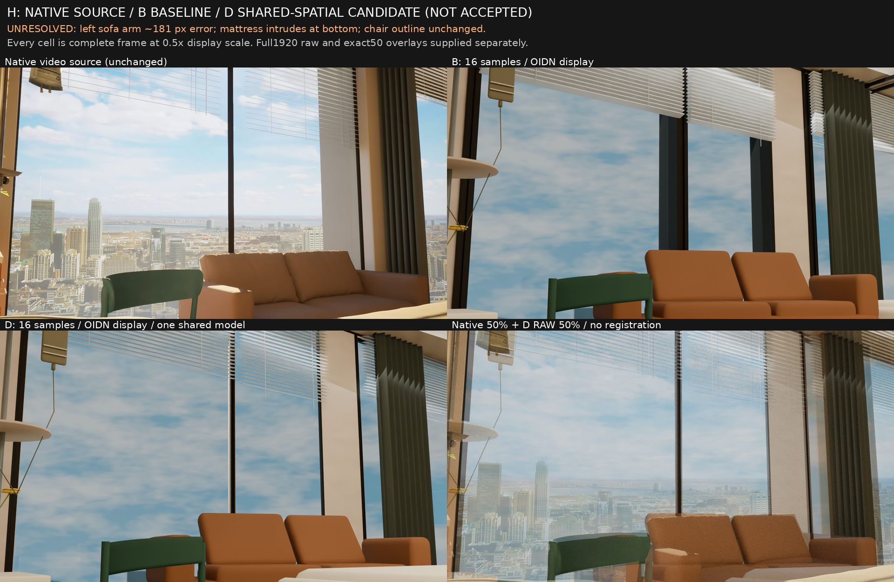

SHA256 `3fb264aac1551daf50381b7b82960cb87b439baee703370f4b77ee65bda3bab9`；尺寸1920×1250。

### H_source_D_direct50_UNREGISTERED.png

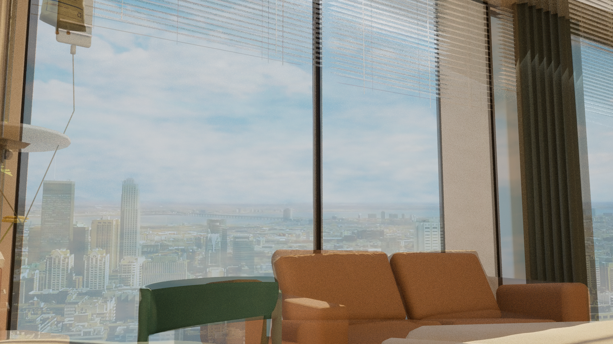

SHA256 `b4abe0820f561e0dbf7885f464d3e97c3d4c8a515dce23ab46cda34f01019438`；尺寸1920×1080。
