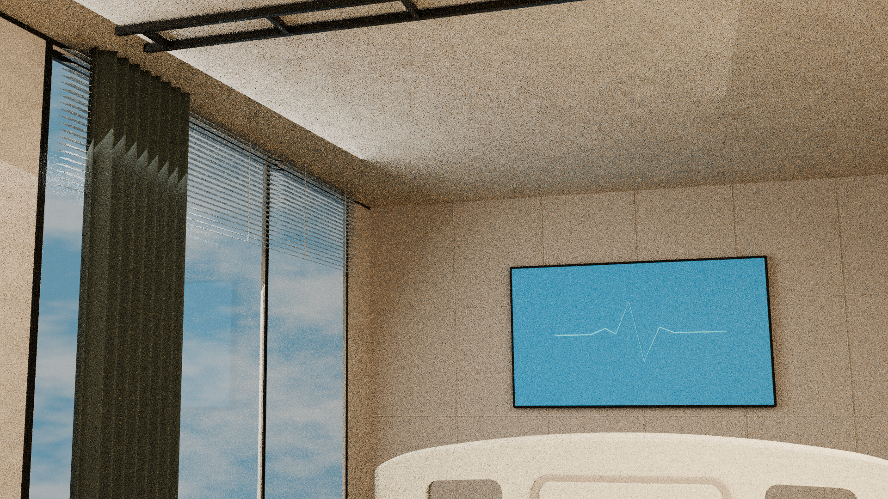
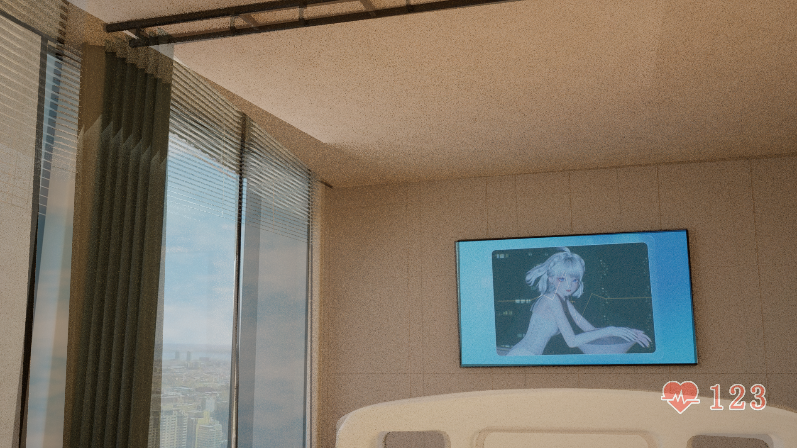
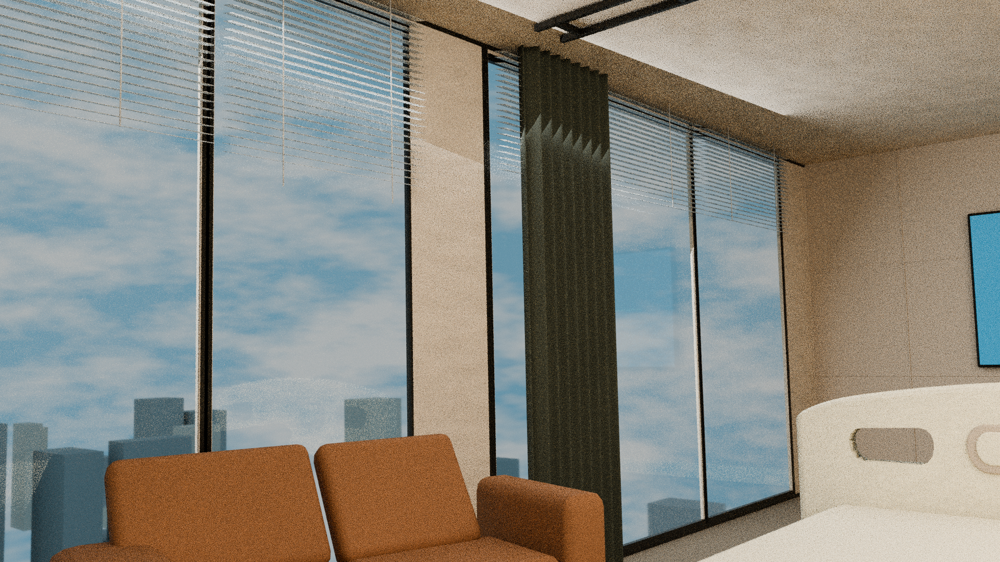
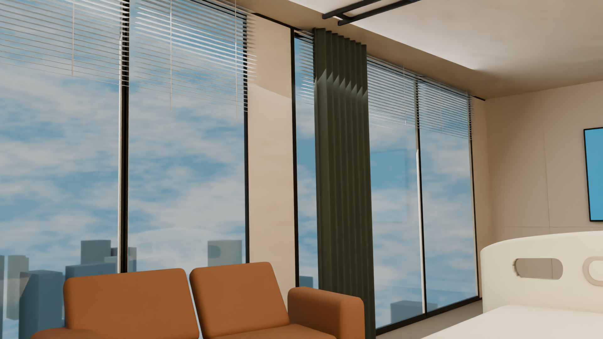
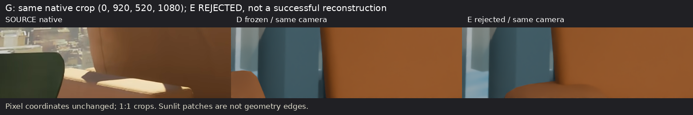
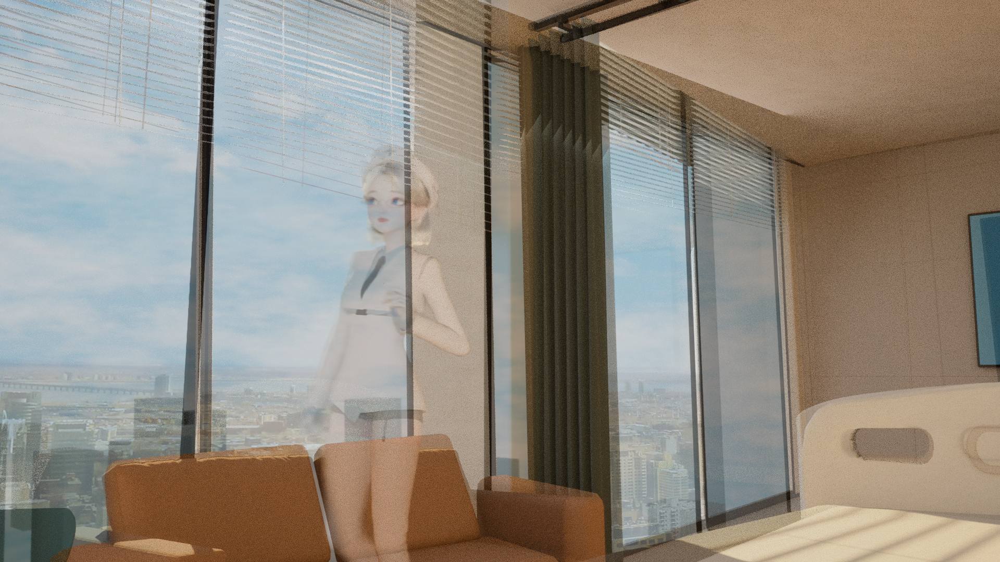
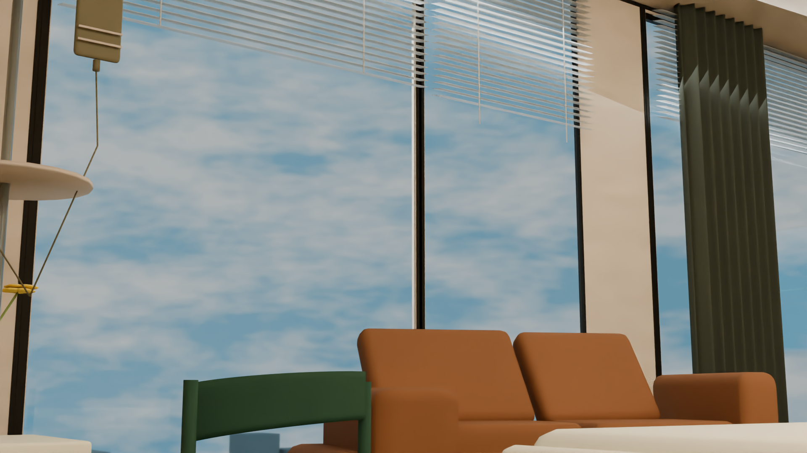
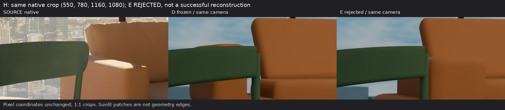
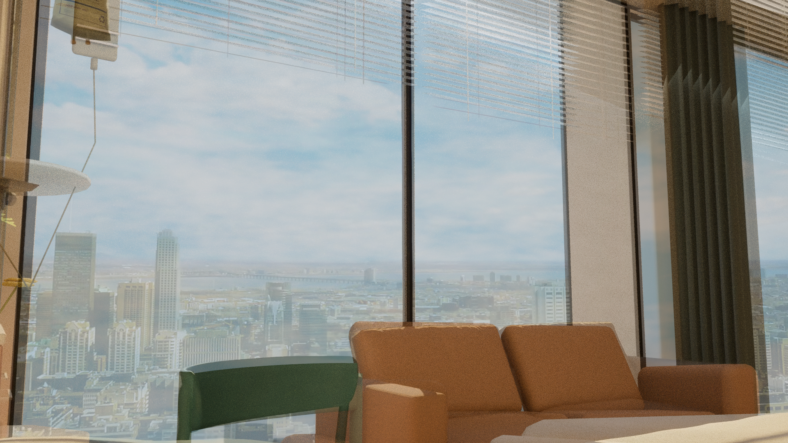

# 病房沙发左扶手E：拒绝实验

<!-- cloud-issue4-display-35-20261013 -->

2026-10-13显示状态更新：本版本11张图已由独立云端浏览器逐张完整显示核验通过。本批合计A/B2+D15+E11+机位7=35，A/B已含，不是37；无坏图、折叠或部分显示。显示通过不等于几何或用户验收，CURRENT/未采纳状态不变。38份云端截图/说明原件仍待可验证Library交付，尚未物化到本Mac、尚未Git；CP1也未交付。[独立核验记录](../../../../docs/research-display-20261013/cloud-issue4-35/README.md)。

以下原正文保留归档时的核验状态；此前Mac/Safari技术阻塞和待验语句属于历史，不改写为当时通过。

状态：`E_REJECTED_DO_NOT_ADOPT`。真实归档提交日期使用当前日期，不回填历史提交日期。

E在冻结D相机、整场几何及沙发其余网格的条件下，仅改变左扶手。H前端更接近来源，但G仍有百像素级差异；新增左座垫55对、左靠背50对相交三角，因实际穿插拒绝采用。原始4份模型与11张PNG保留，技术网格/UV/GLB检查不代表物理接合或来源通过。D原件未变。

本版33份原件共59,111,959字节已在接收端实际物化并校验SHA256/Git blob。模型、PNG、脚本和报告均原字节；2份JSON仅清理检索ID或继承绝对路径，保留原件SHA、仓库SHA与逐字段派生记录。原delivery_manifest仍描述输入原件；仓库文件哈希以archive-verification.json为准。

[原报告](%E6%B2%99%E5%8F%91%E5%B7%A6%E6%89%B6%E6%89%8B%E6%9D%A1%E4%BB%B6%E5%80%99%E9%80%89E_%E6%8B%92%E7%BB%9D.md) · [原件与仓库核验](archive-verification.json) · [JSON派生记录](metadata-derivations.json) · [依赖固定提交](dependencies.json)

本CLI归档没有重跑Blender、拟合、渲染或浏览器采集。原报告技术检查是该研究阶段的记录，不冒称本次重跑或模型来源验收。CURRENT及以前全部原文件保持不变；本次Git合并只是独立归档。

2026-10-13后续约束（单列，不重写旧研究结论）：用户明确病人躺床第一视角；顶部横向拉帘、带百叶的两侧落地窗及中央柱状构件接杆。柱的承重性、准确截面/尺寸与灰条身份未证实。现有D及自由像素拟合机位与床垫关系存在冲突，后续诊断不能标为通过。

## 模型原件

- [hospital_sofa_arm_E_REJECTED.blend](hospital_sofa_arm_E_REJECTED.blend) · SHA256 `2933020c03087bbb32c70a22c3fb0874a24e5b5570d88ba27fa754737dc0d73e`
- [hospital_sofa_arm_E_REJECTED.glb](hospital_sofa_arm_E_REJECTED.glb) · SHA256 `1e267e635e8d957069e0e891df31483e803767c0e2d55faf8d902cc2fe1bd826`
- [hospital_sofa_arm_E_REJECTED_white.blend](hospital_sofa_arm_E_REJECTED_white.blend) · SHA256 `f48a39f81ed11cdd9bae98d3dc4e70f83ae8f76a2fee2a6400862825ba3f8d95`
- [hospital_sofa_arm_E_REJECTED_white.glb](hospital_sofa_arm_E_REJECTED_white.glb) · SHA256 `cc73ea63d4dceef30268bb02b10ed76d7e6f85d1d9339f432e180d1b456dacac`

## 本版全部PNG图证

图证直接展开，未折叠。撤回的旧标题板单独标记，只保留历史，不作当前几何精度证据。

### F_E_full_1920_16spp_raw.png

SHA256 `1bd045858e2ad3233fd0ee5803d9fd5247cd6ca705a64068d4e2b935d1283c2f`；尺寸1920×1080。

### F_E_full_1920_16spp_raw_oidn.png

SHA256 `b7a9ed9506eb4eea09a256bb1c70291200d4ddfc4ce972ea836d6900b984db42`；尺寸1920×1080。

### F_source_E_direct50_UNREGISTERED.png

SHA256 `f87d9dd25a73ac714cf77487197d6f040ad63919c68d7a48849a4725d85c0b4e`；尺寸1920×1080。

### G_E_full_1920_16spp_raw.png

SHA256 `b2c2ec3aff0ed4a525f1a9feb8b7a06a39302d4fb8121a68bf88ea485d203e0c`；尺寸1920×1080。

### G_E_full_1920_16spp_raw_oidn.png

SHA256 `506d00cfe0e74efa6be318a6f148b70cd68395c5927c4b7177e23a25dab4cd9a`；尺寸1920×1080。

### G_source_D_E_same_coordinate_crop.png

SHA256 `bfbe54e89f513aa7e6b022309a3ca574349efc7d370677f82d1eee21eaf6b4fd`；尺寸1560×260。

### G_source_E_direct50_UNREGISTERED.png

SHA256 `77d1035804cafaeae8c8e19f4bd466734d63860df4ca863196e80025bf6926ab`；尺寸1920×1080。

### H_E_full_1920_16spp_raw.png

SHA256 `7ffb000413efa00df25426f10486470397fca8b8d04d28f281904eff8d3d34ce`；尺寸1920×1080。

### H_E_full_1920_16spp_raw_oidn.png

SHA256 `a07b223c49de0daa0e56763d1442ecb033517c7c29f5ebb602feecad162a94af`；尺寸1920×1080。

### H_source_D_E_same_coordinate_crop.png

SHA256 `8137ab8ca3ffb6859867753c1b0efcb8ba41e9dc43490fbda49a3348915786f2`；尺寸1830×400。

### H_source_E_direct50_UNREGISTERED.png

SHA256 `f74942b82563698e3109416bc7c3004779f5afc076e69e40e673dde4b1c6ae36`；尺寸1920×1080。
