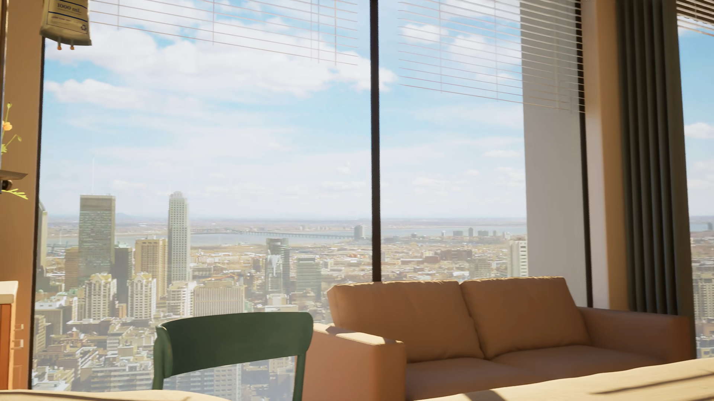

# 病房新采集阶段：准备包与首张新增原生帧

记录时间：2026-10-14T03:49:12.448525+00:00。本版本完整归档本次交接的21件原文件，共2,317,715字节：18件采样准备文件（324,117字节）、1件权威Library索引（12,215字节）、1张新PNG（1,980,785字节）及其元数据（598字节）。全部通过支持的Library流程在本Mac物化、核验身份/大小/SHA，并保留原字节。

本阶段仅增加采样准备和新源图。没有新模型、拟合或渲染，没有几何或用户验收；D未验收，J1仍为REJECTED_DIAGNOSTIC，H旧85px误配统计仍撤回。CURRENT及所有旧文件保持原样。

## 采样准备与验证器的边界

[采样锚点与结构分支](preparation/采样锚点与结构分支_20261014.md)和[source_anchor_catalog.json](preparation/source_anchor_catalog.json)整理既有A/B/F/G/H原生帧的60项锚点；默认全部禁止直接进入几何残差，需先核实物件、部位、轮廓分支及可见范围。新640.406589秒帧并未被这份旧源图锚点目录评分。

[验证器说明](preparation/validation/README.md)要求同一命名部位和轮廓分支对应，禁止用全物体凸包最近点或另一分支替代；软明暗过渡、遮挡及画外范围不能当实体角或补作观测。物理相交与连接关系需另行检查。

生产方[验证报告](preparation/validation/verification_report.json)记录71项合成输入契约/定向屏幕空间计算测试、0失败、0错误；**这些辅助工具测试不是医院实际观测评分，不代表几何通过。** 本Mac仅归档并核对报告与输入，未重跑这些测试、源检查脚本或任何模型渲染。D/J1检查表是生产方只读模型检查结果，包围盒投影不是经过遮挡测试的实体可见轮廓。

## 首张新增无人医院原帧（展开）

来源：[BV1GqXMByE1s](https://www.bilibili.com/video/BV1GqXMByE1s/)，精确播放时间 **640.406589秒（10:40.406589）**。生产方元数据记录UTC `2026-10-14T03:35:28Z`、方法“Chromium native Save video frame as”；本Mac没有重新采帧或操作浏览器。

PNG为1920×1080、1,980,785字节，SHA-256：`9f56d9774d8745b832917a3923b43a24a99488e5eee2cc443161edf0b4c3e79c`。元数据见[原始JSON](frames/BV1GqXMByE1s_640.406589_empty_hospital_native.json)。本Mac已打开图像并核验PNG全部chunk CRC、完整IDAT解压、扫描行尺寸和过滤器值，未缩放、裁切或重编码。

新图能直接补充无人遮挡的沙发扶手、上缘和绿椅背景。**床双侧长缘、护栏/端板连接与枕位仍未解**，不能从画面底部少量床缘补造连接拓扑。下一步仍需床连接同框或连续中间视角、窗轨另一侧/接头背面、可靠的静态遮挡与深度证据；先判定语义与可见性，再判断是否足以进入有限参数修正。

扩大视频粗覆盖的交接指出医院、校园与舞台片段交替，性质与边界仍核对中；校园/舞台插段不得作为医院机位或连续几何证据。本批只包含上述明确识别的一张医院帧，未将未交接画面加入证据集。

## 原件、依赖与交付状态

- [18件权威身份索引](provenance/confirmed_library_identity_index.json)、[全部21件SHA](SHA256SUMS.txt)、[交付状态](delivery-status.json)、[本机核验](archive-verification.json)随版本保存；另有本README，共25件新增仓库文件。
- 准备包使用既有A/B/F/G/H、D/J1及审查文件。[restoration_dependencies.json](preparation/restoration_dependencies.json)是原生产方恢复依赖清单；其中云工作区路径和ZIP恢复来源属于原始出处，不表示本机存在或本轮交付。源文件路径及脚本原字节不改写，不重复归档旧模型/旧图，也不制作ZIP。
- 本批不是CP1 27件及旧实显38件（合计65件）的恢复；65件仍为“当前原件不可取得／恢复待查”。旧运动观察仍为PARTIAL_4_OF_14，余10件仍待支持的传输流程；本次不重试、不虚构缺失文件或图链。
- Issue #4的新采集阶段只展开本次已入Git的这一张新PNG。远端blob核验及评论回读不等于浏览器实显核验；本CLI任务不宣称此新图已纳入此前18/18结果。后续此版本状态在同一评论原位更新。
