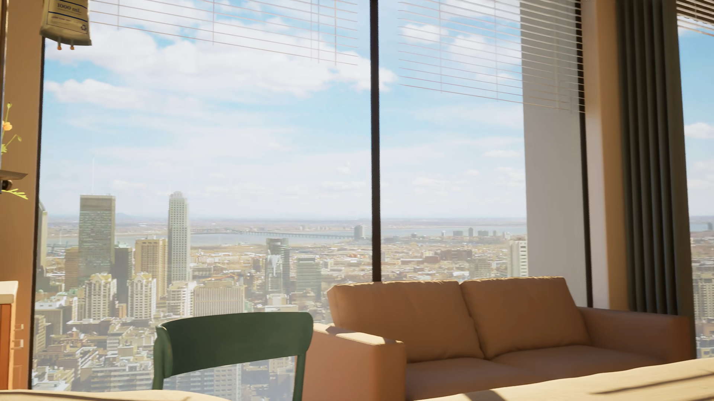
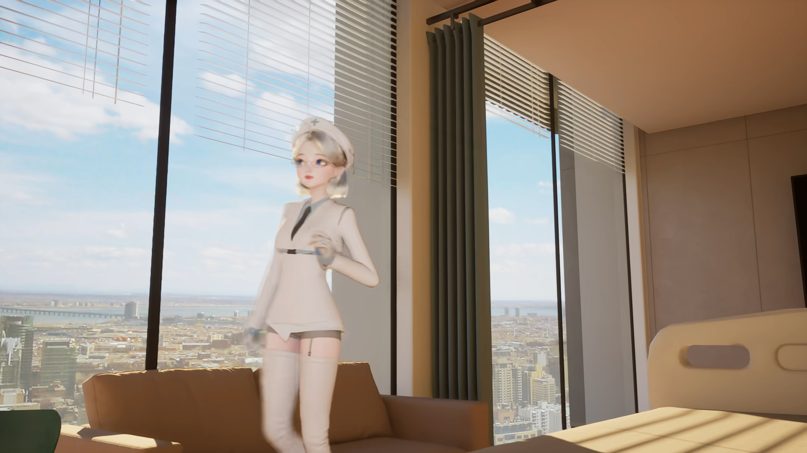
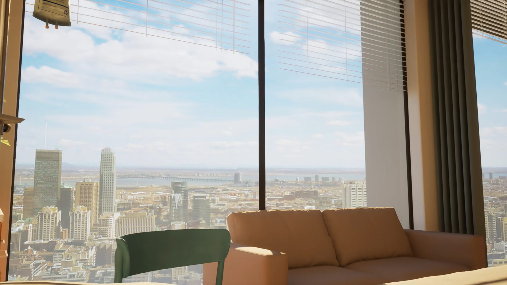

# N640、G、H源图标注：29分支、143点

本版本独立保存11件源图标注文件及权威索引1件，共12件原文件、254,906字节；另有本README、交付状态、本机核验及SHA清单4份，共16件新增仓库文件。所有原字节不改写；原PNG、准备阶段验证器及旧模型均通过已有Git依赖引用，不重复复制。

[原报告](新640帧_轮廓与床上相机约束.md) · [权威索引](provenance/confirmed_annotation_library_index.json) · [SHA清单](SHA256SUMS.txt) · [实际依赖与交付状态](delivery-status.json)。此前Library技能不可用只影响当时本机接收；本次恢复后使用当前流程完成原件物化与身份/字节/SHA核验。

标注范围仅N640（640.406589秒）、旧G（1116.180816秒）、旧H（1101.728114秒）：**29条命名轮廓分支、143个原生像素采样点，所有geometry_use_allowed=false，projections与comparisons均为空。** N642和N665仅作补充视觉审查，不属于这143点，不是新训练或留出评分。

两块沙发靠背、右扶手和绿椅背/面板分别命名上缘、侧缘和下缘。左扶手只有短小后上沿可见且身份条件性；白色日照斑、软明暗过渡、人物/椅子/HUD遮挡不能变成角点。圆肩与相邻直边分开，绿椅面板下缘不能替代沙发下缘。人工不确定度4–6px；点序或相同名称不建立跨帧三维点对应。

本Mac静态检查了实际JSON：分支数、采样点数、禁用标志及空投影/比较均一致。生产方source_only_lint_result.json为metadata_lint_ok、model_validation=not_performed，其SHA/尺寸校验是合同检查，明确没有由该lint独立做原生像素完整解码；生产方另外在source_checks.json记录三源图完整PNG解码。这两层记录保持原样，不能写成几何评分或验收。本Mac未执行归档的标注生成脚本、拟合或渲染。

N665补充看到靠背下缘→座面→圆鼓前缘；下面暗带并非已证底座。床两条完整长侧缘、枕/头端和端板—侧护栏接合仍未齐，不能先假定D/J1床范围为真，再以它包含相机作为证明。保留用户“躺在病床上”语义；没有改用床外自由相机，没有把640秒与1100秒段默认设为相同内参/布局。新三帧仍未露出帘杆实际入柱点。

D未验收、J1仍拒绝、H原85px误配说法仍撤回；没有新模型、投影残差、拟合、渲染或验收结论。之前71项验证器合成工具测试也不构成本阶段几何通过。

## 原图对照（引用既有Git原件，全部展开）

以下是原帧对照；没有新生成标注叠加图。29分支和143点以本版JSON保存。G/H/N640已存原件的字节/SHA在本次依赖核验中再次确认。

### N640 · 640.406589秒 · 本阶段29分支来源之一

### 旧G · 1116.180816秒 · 人物遮挡范围必须排除

### 旧H · 1101.728114秒 · 不恢复旧85px统计

## 状态与未解决问题

本阶段不修改CURRENT、旧资产、D未验收/J1拒绝/H85px撤回结论；不恢复旧65件，也不重试旧10件待传。床侧缘、枕位、端板/护栏接点仍缺证，没有新拟合或渲染。所有图证展开，未使用折叠。Git原件、Issue正文回读与浏览器实显是不同核验；本Mac没有操作Safari，不将本批图像计入此前实显通过数。后续本版本状态在同一Issue评论原位更新。
