# 病房后段视口观察与原生保存失败记录

6张主观察原图全部为1180×757 JPEG视口截图，新增原生PNG为0；另有5张上下文/诊断/联系JPEG及日志，共22件原件2,649,842字节。91:16.6低机位可见床垫外侧、窄托边、斜撑和一处轮脚；94分钟两张床端/电视图支持端板与室内关系；101分钟木纹硬桌面不能当床面。只作定性关系核对，不作为原生像素残差或精确机位标定。

来源BV1GqXMByE1s，采集在dot云端Chromium。本机没有操作浏览器或重采集。82分钟到片尾的状态范围4921.881982–6672.011秒，1712条读取、1356张readyState=4不同观察，其中1214张2×、142张1×；末尾ended=true。这里只归档所交付的22件，不声称未交付的全部观察JPEG已入Git。16处大于4秒间隔仍存在，最大13.680610秒；观察链跨度1657.348557秒不等于无遗漏观看时长。优先段556张观察仅交付索引和日志，保留README中的空隙与readyState缺口。5480后演出、校园/黑场/混剪及同室/同实例未证边界均保留。两次原生保存UI显示完成，但正式下载事件超时，没有可读PNG字节；5688.438110及5447.781358尝试不能记为原生交付。

22件原件与1份权威索引共2,676,463字节，全部从当前Library正规流程物化，在本机核对精确版本、身份、大小和SHA。所有原相对路径及字节保留。云端绝对路径只是溯源，原报告“未Git”是生产当时状态。

[原报告](files/README_coverage_and_limits.md) · [逐件核验](archive-verification.json) · [完整SHA](SHA256SUMS.txt) · [冻结交接索引](provenance/viewport_evidence_library_git_handoff_index_20261015.json)

## 全部原图展开

### selected_contact_sheet.jpg — 联系图/缩略展示，不作为原生残差

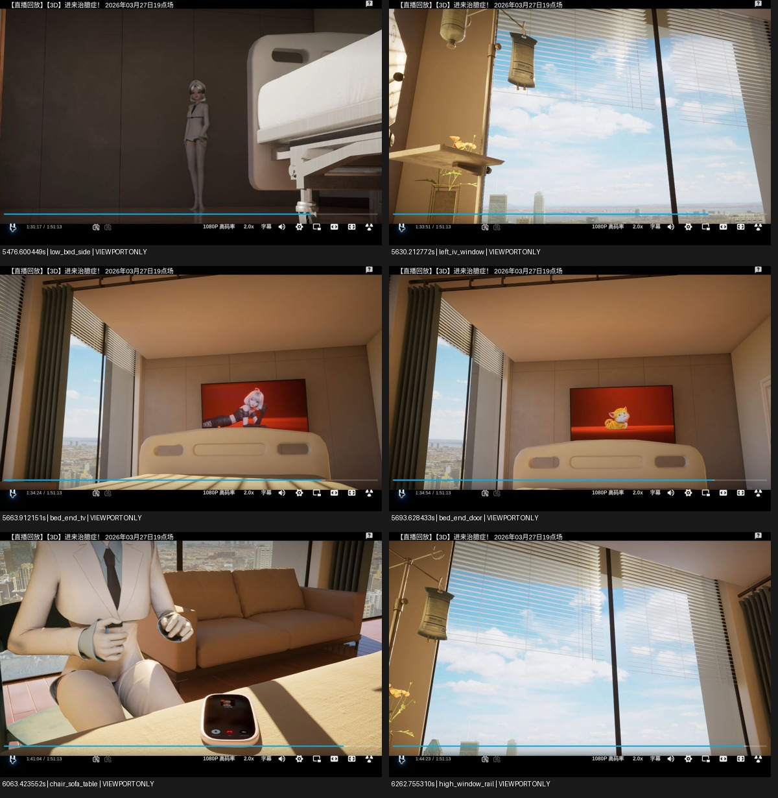

### OBS_viewport_5476.600449_low_bed_side.jpg — 视口JPEG或保存状态UI证据，非原生帧

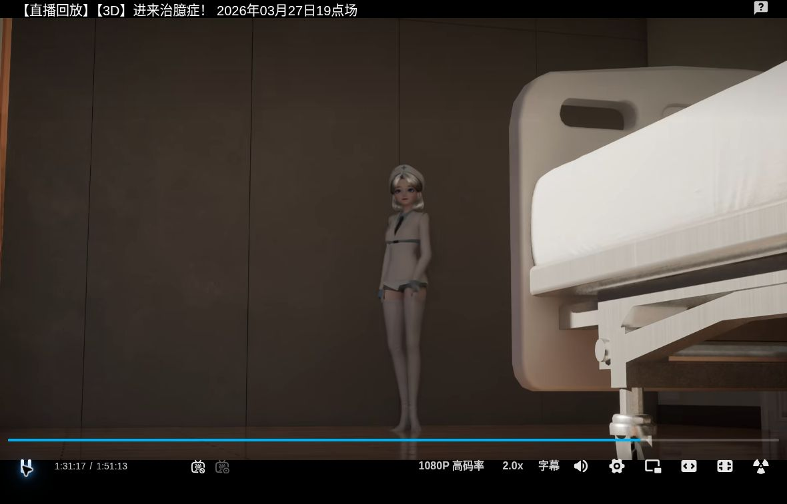

### OBS_viewport_5630.212772_left_iv_window.jpg — 视口JPEG或保存状态UI证据，非原生帧

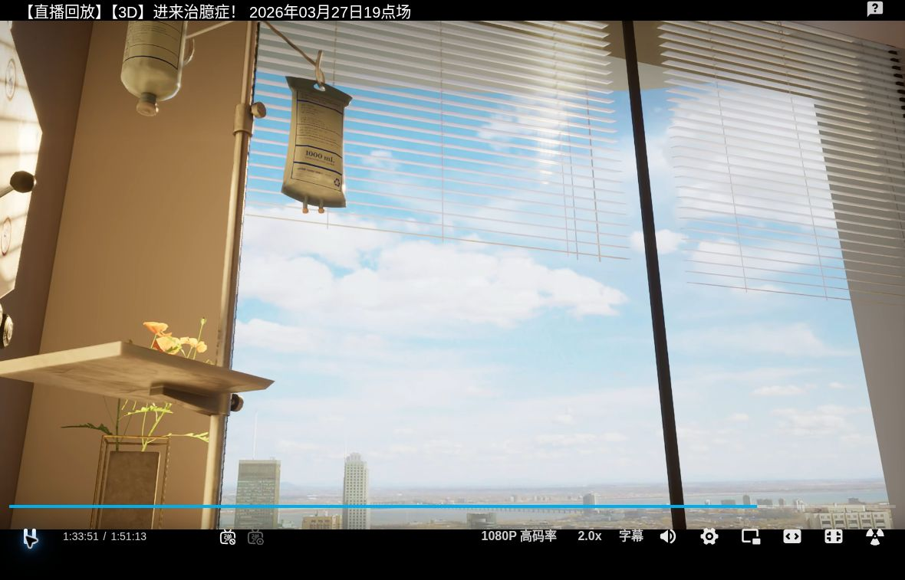

### OBS_viewport_5663.912151_bed_end_tv.jpg — 视口JPEG或保存状态UI证据，非原生帧

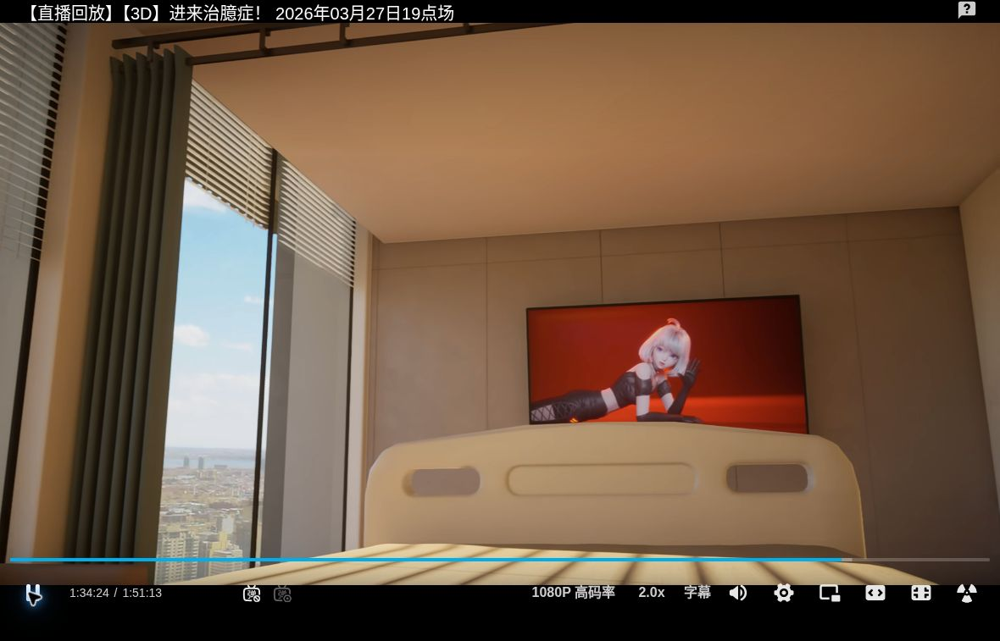

### OBS_viewport_5693.628433_bed_end_door.jpg — 视口JPEG或保存状态UI证据，非原生帧

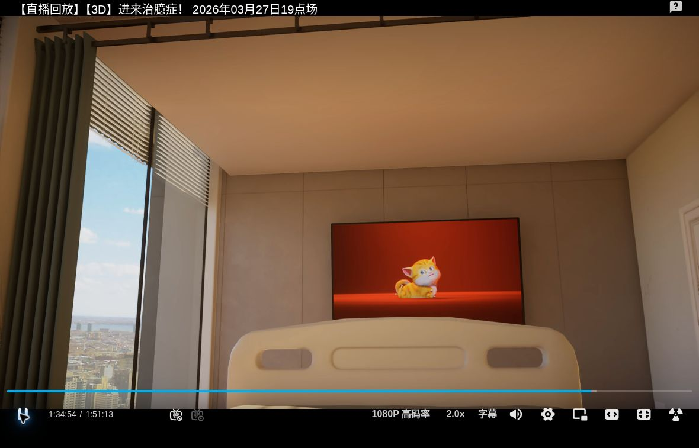

### OBS_viewport_6063.423552_chair_sofa_table.jpg — 视口JPEG或保存状态UI证据，非原生帧

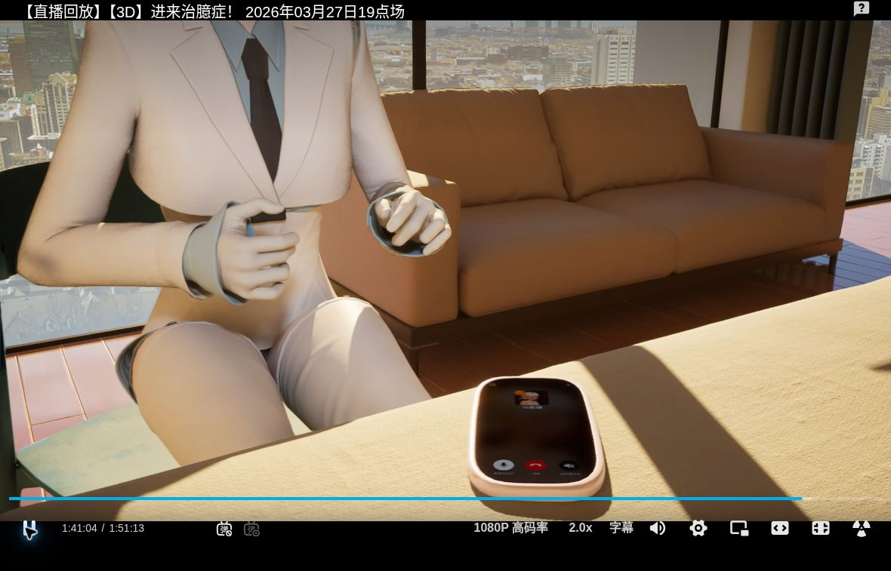

### OBS_viewport_6262.755310_high_window_rail.jpg — 视口JPEG或保存状态UI证据，非原生帧

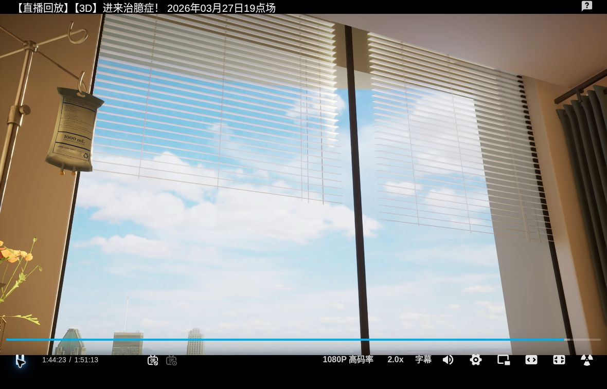

### diagnostics/OBS_viewport_5477.528817_low_bed_side.jpg — 视口JPEG或保存状态UI证据，非原生帧

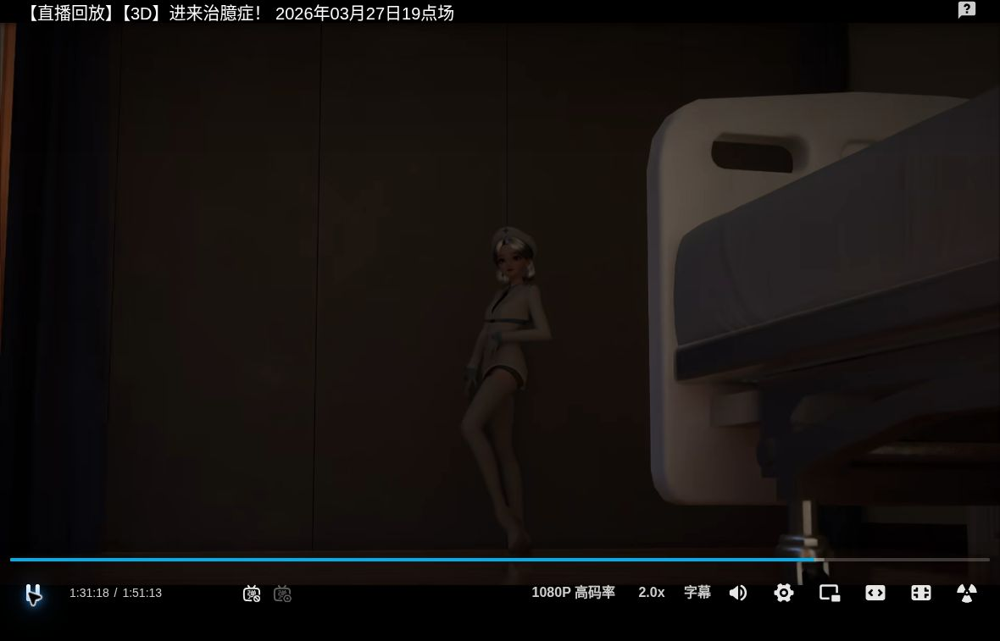

### diagnostics/native_attempt_5688.438110_viewport.jpg — 视口JPEG或保存状态UI证据，非原生帧

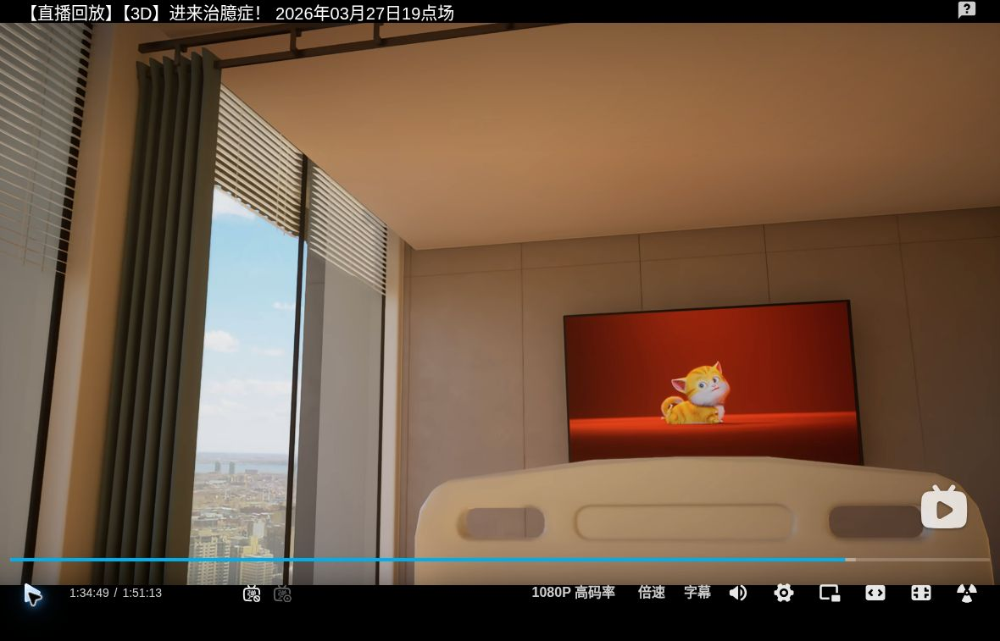

### diagnostics/native_download_ui.jpg — 视口JPEG或保存状态UI证据，非原生帧

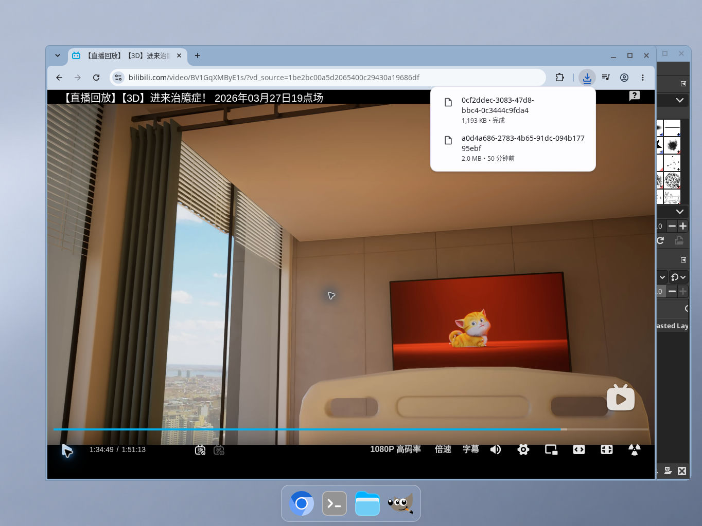

### low_bed_transition_contact.jpg — 联系图/缩略展示，不作为原生残差

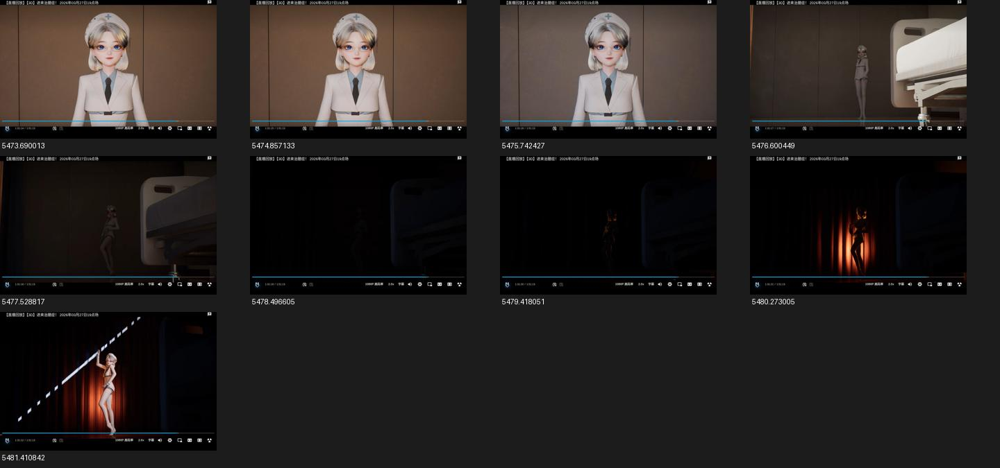

新增评论图证全部展开，GitHub逐位置浏览器实显尚未执行。旧C3的42处实显是另外一批，不涵盖本版本图片。当前所有未采纳/拒绝状态、CURRENT、旧motion10及失联65件缺口不变。
