# PR55/56/57：新增9处GitHub图证实显通过

**2026-10-14云端Chromium实显9/9通过：PR55 1/1、PR56 5/5、PR57 3/3。** 生产方在已登录的私有GitHub Issue页面逐图看到下边缘/图尾，0坏链、0部分加载、0折叠；两张长联系图通过重叠截图覆盖全部内容。截图时间范围04:33:46.682–04:38:19.239 UTC。本Mac接收、检查并归档这些文件，没有操作浏览器、Safari或B站标签。

本次保存14件证据（11张内容区截图、逐图JSON、CSV、原报告）及独立权威索引1件，共15件原文件、5,379,169字节；另有本README、交付状态、核验记录及SHA清单4份，共19件新增仓库文件。所有源字节保持原样，没有再次裁切、重编码或改写原始记录。

[原报告](github_new9_image_display_check_20261014.md) · [逐图JSON](github_new9_image_display_check_20261014.json) · [逐图CSV](github_new9_image_display_check_20261014.csv) · [权威索引](provenance/github_new9_20261014_Library_Git_handoff_index.json) · [15件SHA](SHA256SUMS.txt) · [当前状态](delivery-status.json) · [本机核验](archive-verification.json)。

| 版本 | 评论内展示位置 | 当前结果 |
|---|---:|---|
| [PR55评论](https://github.com/Shuang-su/metaxingtong/issues/4#issuecomment-6160480385) | 1 | 全部完整显示通过 |
| [PR56评论](https://github.com/Shuang-su/metaxingtong/issues/4#issuecomment-6160654226) | 5 | 全部完整显示通过 |
| [PR57评论](https://github.com/Shuang-su/metaxingtong/issues/4#issuecomment-6160677630) | 3 | 全部完整显示通过 |

这是9处评论展示位置，不是9张新的独立源图：N640在PR55和PR57各出现一次，对应8个不同源图Git blob。11张证据截图的数量也不等于展示位置数；长图需要多张重叠截图。

第一联系图已看到40格中编号39的末格；第二联系图已看到43格中编号42的末格，最后一行3格属于自然排版。第二图连续黑格是源片整体淡黑/黑画面，后续校园格正常呈现，不能误判为网页未加载。

截图原件已由生产方裁去账户、侧栏、浏览器外框和无关页面范围，仅保留内容区；本Mac逐张打开检查。11张PNG全部chunk CRC、完整IDAT解压、扫描行尺寸与过滤器值通过，15件大小/SHA和Library身份均一致；逐图URL/顺序与三条现有评论逐一吻合，引用Git blob与本次main基线一致。生产方报告注明没有独立核验仓库HEAD，本Mac另行通过正常Git/API只读核验基线，二者职责分开记录。

## 范围与历史保留

显示通过不代表几何、机位、来源忠实度或用户验收。D未验收、J1拒绝、H旧85px撤回继续保持；不新增模型、拟合或渲染，不改CURRENT及任何旧仓库文件。

此前版本文档和评论中的“本CLI未进行浏览器实显”“待独立核验”是当时归档状态，原文保留。当前显示状态由本次独立云端结果及三条原评论的原位状态补充说明。补充不改变原图URL、数量或顺序，不把此前未验记录改写成当时已通过。

本次15件是新的2026-10-14实显证据，不是旧缺失38件截图的恢复；CP1 27件与旧38件合计65件仍“当前原件不可取得／恢复待查”。旧运动观察十件待传状态不变。旧35/18展示集不在本次复查范围，也不重复累计。

## 证据截图（全部展开）

### PR55_01_N640_full.png

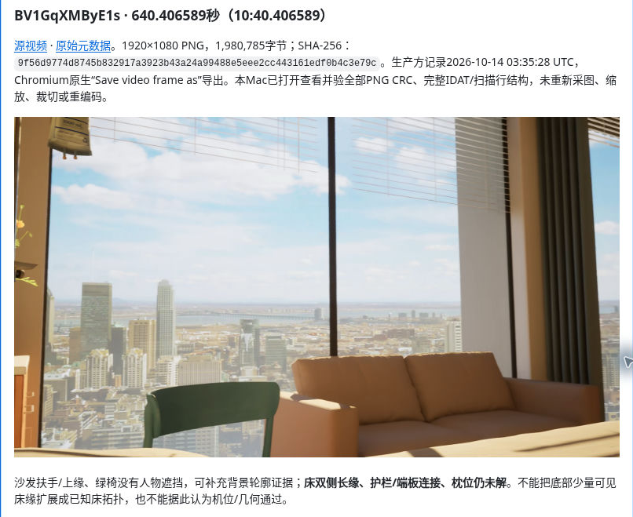

### PR56_01_right_turn.png

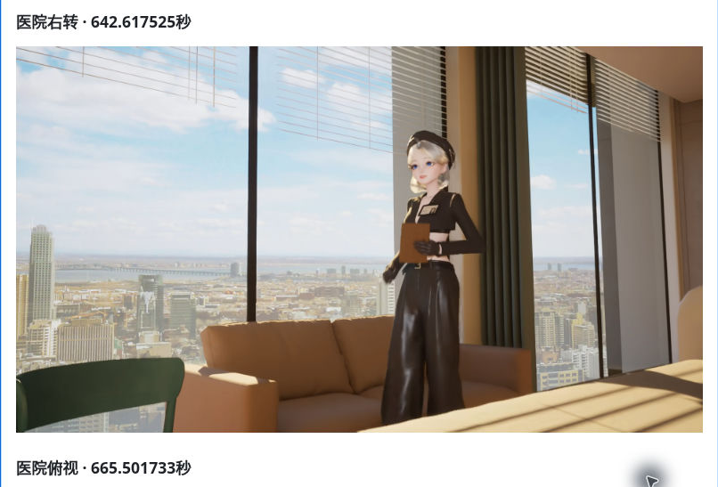

### PR56_02_downward_full.png

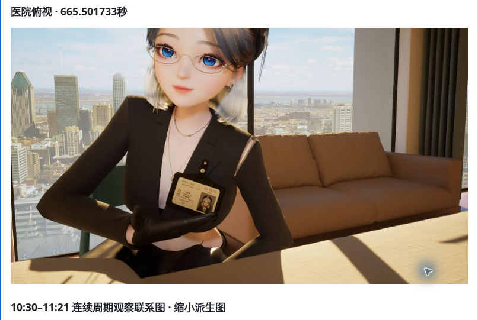

### PR56_03_contact_upper.png

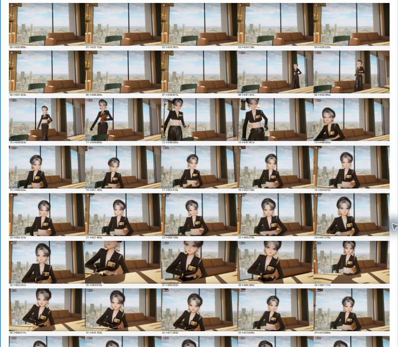

### PR56_03_contact_tail_04_start.png

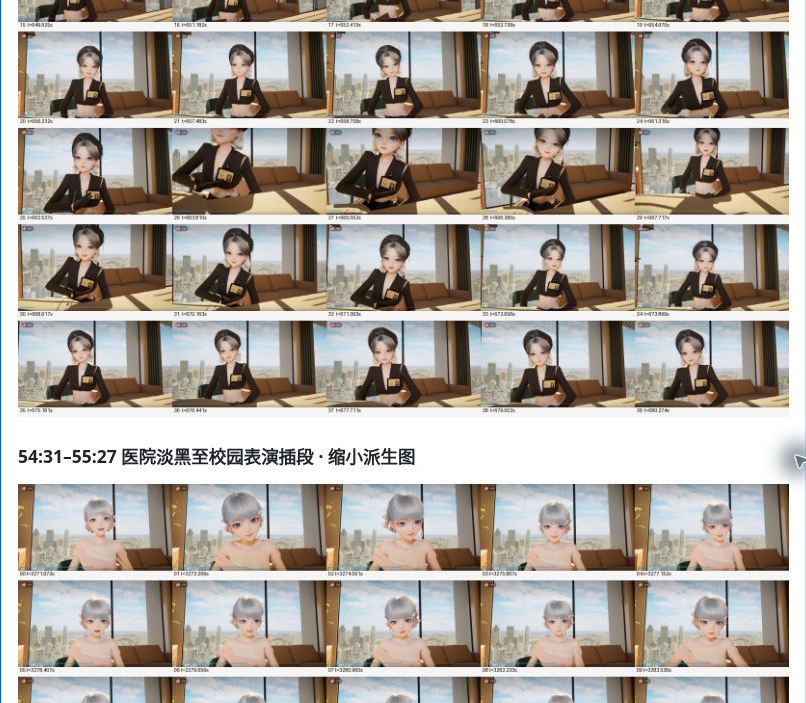

### PR56_04_transition_contact_upper.png

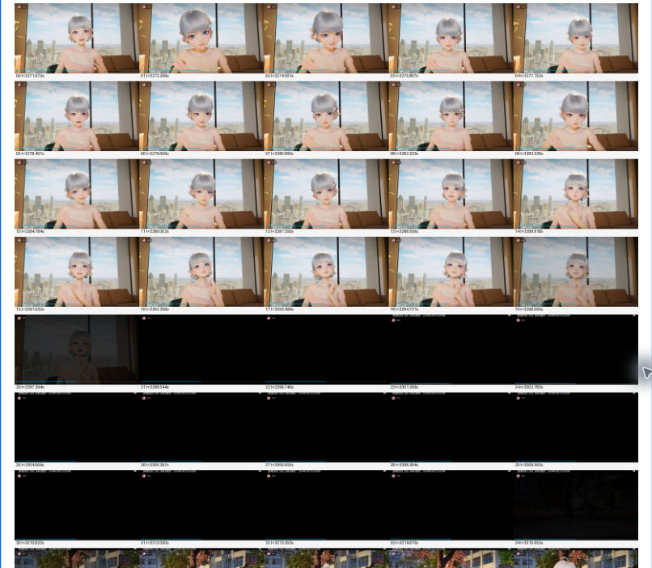

### PR56_04_transition_contact_tail.png

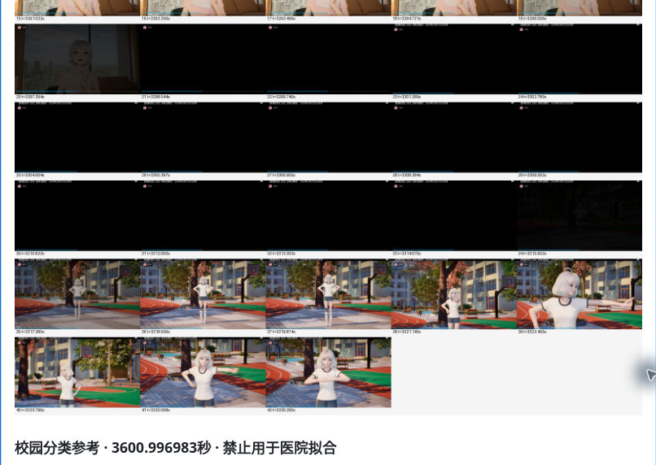

### PR56_05_campus_full.png

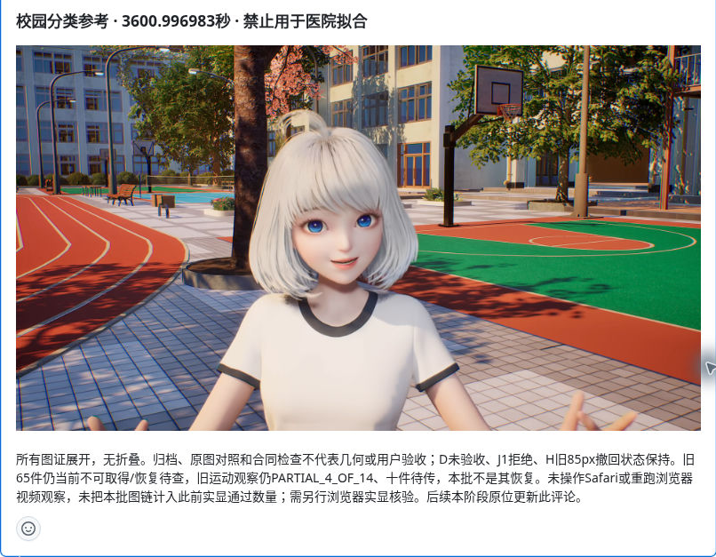

### PR57_01_N640_full.png

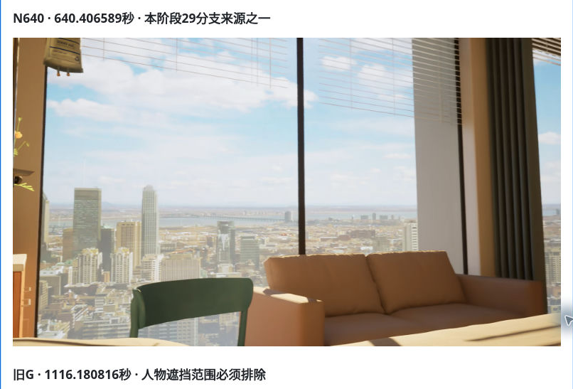

### PR57_02_G_full.png

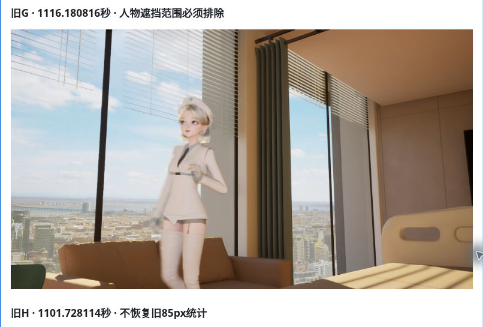

### PR57_03_H_full_tail.png

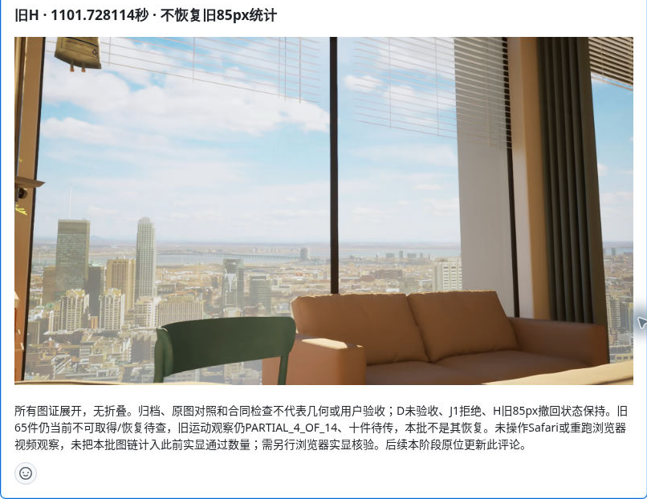
