# D/C2/C3新增42处图证：云端完整显示通过

2026-10-15 UTC 05:35:57.324–05:42:46.608，独立云端Chromium逐位置检查Issue4评论内的全部新增图像：D新增8、C2共8、C3共26，42/42完整显示通过，无坏图、折叠或部分加载。

交付44张干净PNG截图与5份日志清单，共49件14,746,336字节，另附权威Library索引。两张长图分别由有重叠的上下截图覆盖。原浏览器截图是JPEG，PNG仅无损保存裁去账号/侧栏后的像素，没有缩放、拼接、润色或内容修改。第24图首次DOM观察早于加载完成，05:42:46.608复核后的可见全图与元数据通过；中间观察仍在原manifest中。只通过显示检查，D/C2未采纳与C3来源未通过状态、所有几何/用户验收限制和CURRENT不变。

[原manifest](files/manifest.json) · [逐图UTC和链接表](files/manifest.tsv) · [原报告](files/README.md) · [逐件本地核验](archive-verification.json) · [SHA](SHA256SUMS.txt) · [权威交接索引](provenance/issue4_display42_library_git_handoff_index_20261015.json)

本Mac仅使用文件和终端，没有操作Safari或重跑浏览器。旧“待实显”语句保留归档时历史，当前状态按此独立云端核验记录。D旧15图不重复计入42；新viewport评论11图、身份纠错评论20图也不在本轮范围，不能套用此结果。44截图是42个目标的覆盖证据，不能计作44个目标。

## 按原评论与图片顺序展开全部44张证据截图

### 1. G_D_wire_branch_diagnostic.png

[原评论图像](https://github.com/Shuang-su/metaxingtong/raw/99254dbfdb87282ef1e04a656f697a2c04802a81/scenes/hospital-room/research/geometry-c3-unaccepted-20261015/files/G_D_wire_branch_diagnostic.png) · [原评论](https://github.com/Shuang-su/metaxingtong/issues/4#issuecomment-6147605558)；核验UTC 2026-10-15T05:35:57.324Z。

**full**

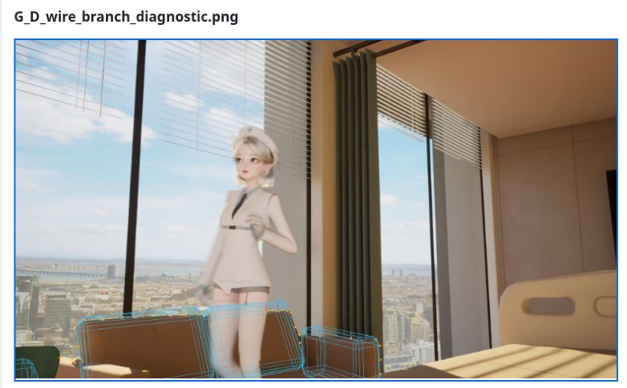

### 2. H_D_wire_branch_diagnostic.png

[原评论图像](https://github.com/Shuang-su/metaxingtong/raw/99254dbfdb87282ef1e04a656f697a2c04802a81/scenes/hospital-room/research/geometry-c3-unaccepted-20261015/files/H_D_wire_branch_diagnostic.png) · [原评论](https://github.com/Shuang-su/metaxingtong/issues/4#issuecomment-6147605558)；核验UTC 2026-10-15T05:35:57.526Z。

**full**

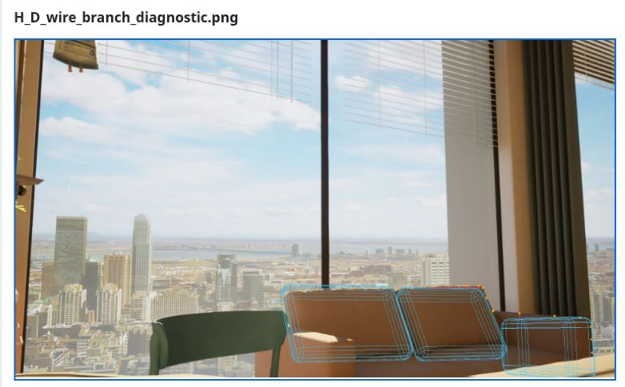

### 3. renders_D_baseline/F_D_RAW_1920x1080.png

[原评论图像](https://github.com/Shuang-su/metaxingtong/raw/99254dbfdb87282ef1e04a656f697a2c04802a81/scenes/hospital-room/research/geometry-c3-unaccepted-20261015/files/renders_D_baseline/F_D_RAW_1920x1080.png) · [原评论](https://github.com/Shuang-su/metaxingtong/issues/4#issuecomment-6147605558)；核验UTC 2026-10-15T05:35:57.732Z。

**full**

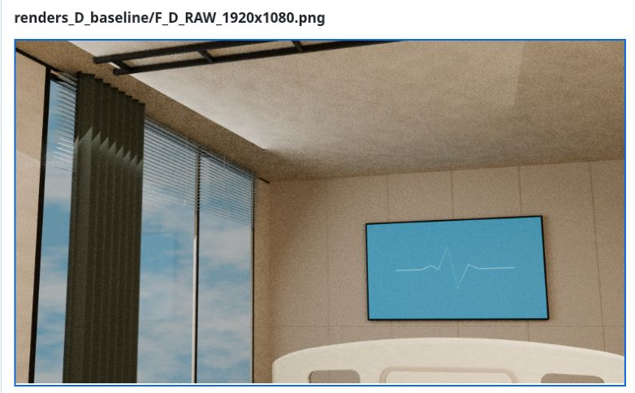

### 4. renders_D_baseline/F_D_direct_50pct_overlay_1920x1080.png

[原评论图像](https://github.com/Shuang-su/metaxingtong/raw/99254dbfdb87282ef1e04a656f697a2c04802a81/scenes/hospital-room/research/geometry-c3-unaccepted-20261015/files/renders_D_baseline/F_D_direct_50pct_overlay_1920x1080.png) · [原评论](https://github.com/Shuang-su/metaxingtong/issues/4#issuecomment-6147605558)；核验UTC 2026-10-15T05:35:58.323Z。

**full**

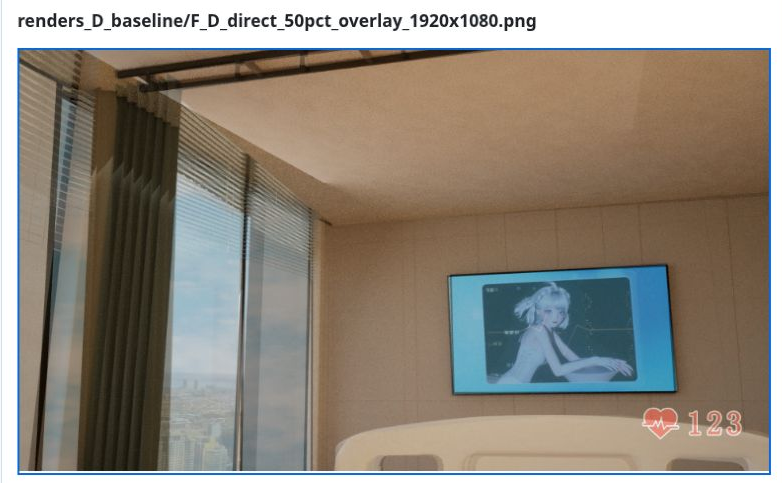

### 5. renders_D_baseline/G_D_RAW_1920x1080.png

[原评论图像](https://github.com/Shuang-su/metaxingtong/raw/99254dbfdb87282ef1e04a656f697a2c04802a81/scenes/hospital-room/research/geometry-c3-unaccepted-20261015/files/renders_D_baseline/G_D_RAW_1920x1080.png) · [原评论](https://github.com/Shuang-su/metaxingtong/issues/4#issuecomment-6147605558)；核验UTC 2026-10-15T05:36:12.835Z。

**full**

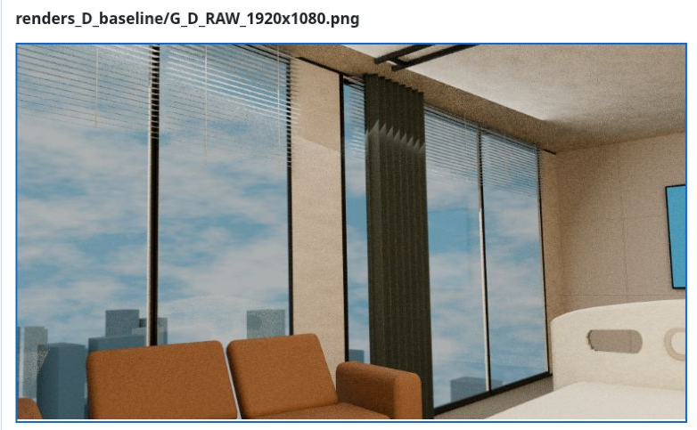

### 6. renders_D_baseline/G_D_direct_50pct_overlay_1920x1080.png

[原评论图像](https://github.com/Shuang-su/metaxingtong/raw/99254dbfdb87282ef1e04a656f697a2c04802a81/scenes/hospital-room/research/geometry-c3-unaccepted-20261015/files/renders_D_baseline/G_D_direct_50pct_overlay_1920x1080.png) · [原评论](https://github.com/Shuang-su/metaxingtong/issues/4#issuecomment-6147605558)；核验UTC 2026-10-15T05:36:13.002Z。

**full**

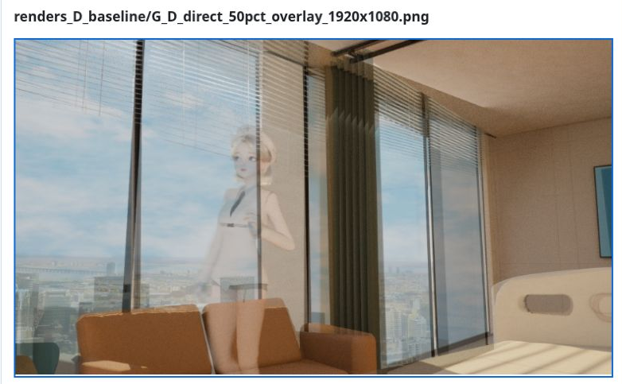

### 7. renders_D_baseline/H_D_RAW_1920x1080.png

[原评论图像](https://github.com/Shuang-su/metaxingtong/raw/99254dbfdb87282ef1e04a656f697a2c04802a81/scenes/hospital-room/research/geometry-c3-unaccepted-20261015/files/renders_D_baseline/H_D_RAW_1920x1080.png) · [原评论](https://github.com/Shuang-su/metaxingtong/issues/4#issuecomment-6147605558)；核验UTC 2026-10-15T05:36:13.210Z。

**full**

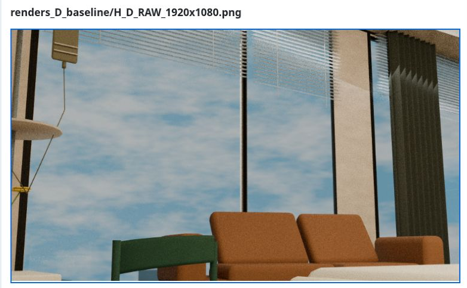

### 8. renders_D_baseline/H_D_direct_50pct_overlay_1920x1080.png

[原评论图像](https://github.com/Shuang-su/metaxingtong/raw/99254dbfdb87282ef1e04a656f697a2c04802a81/scenes/hospital-room/research/geometry-c3-unaccepted-20261015/files/renders_D_baseline/H_D_direct_50pct_overlay_1920x1080.png) · [原评论](https://github.com/Shuang-su/metaxingtong/issues/4#issuecomment-6147605558)；核验UTC 2026-10-15T05:36:13.430Z。

**full**

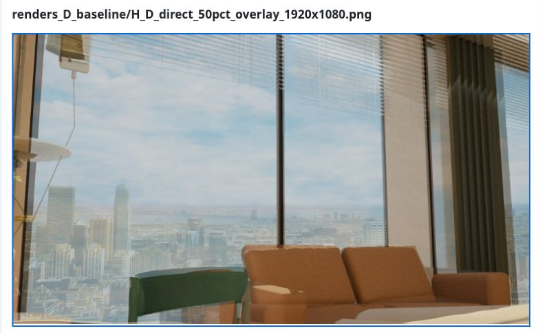

### 9. renders_C2/F_C2_RAW_1920x1080.png

[原评论图像](https://github.com/Shuang-su/metaxingtong/raw/3b62e7fa31f1cfdcbc3b5420b2af7663d5cabb91/scenes/hospital-room/research/geometry-c3-unaccepted-20261015/files/renders_C2/F_C2_RAW_1920x1080.png) · [原评论](https://github.com/Shuang-su/metaxingtong/issues/4#issuecomment-6185128438)；核验UTC 2026-10-15T05:36:28.274Z。

**full**

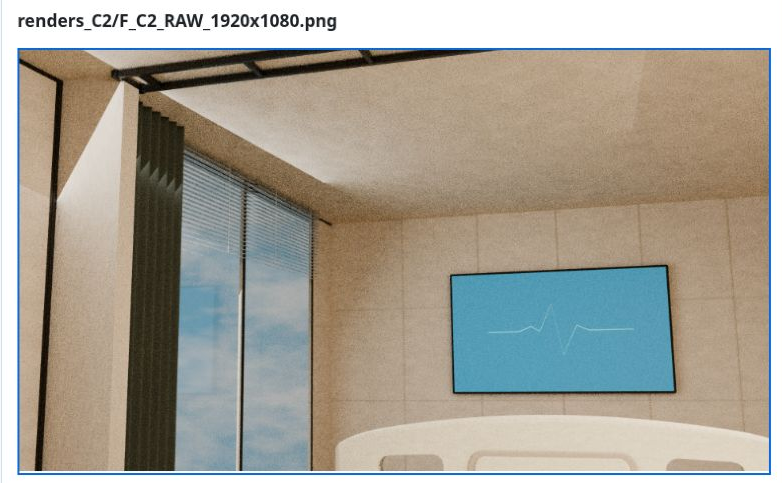

### 10. renders_C2/F_C2_direct_50pct_overlay_1920x1080.png

[原评论图像](https://github.com/Shuang-su/metaxingtong/raw/3b62e7fa31f1cfdcbc3b5420b2af7663d5cabb91/scenes/hospital-room/research/geometry-c3-unaccepted-20261015/files/renders_C2/F_C2_direct_50pct_overlay_1920x1080.png) · [原评论](https://github.com/Shuang-su/metaxingtong/issues/4#issuecomment-6185128438)；核验UTC 2026-10-15T05:36:28.523Z。

**full**

### 11. renders_C2/G_C2_RAW_1920x1080.png

[原评论图像](https://github.com/Shuang-su/metaxingtong/raw/3b62e7fa31f1cfdcbc3b5420b2af7663d5cabb91/scenes/hospital-room/research/geometry-c3-unaccepted-20261015/files/renders_C2/G_C2_RAW_1920x1080.png) · [原评论](https://github.com/Shuang-su/metaxingtong/issues/4#issuecomment-6185128438)；核验UTC 2026-10-15T05:36:28.727Z。

**full**

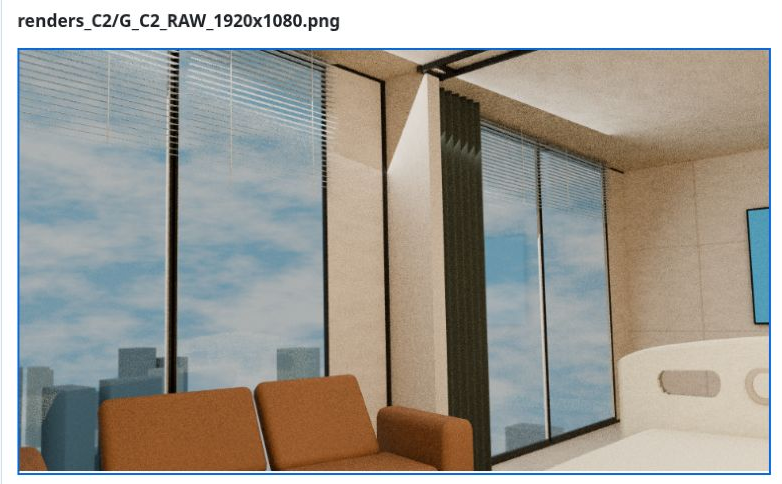

### 12. renders_C2/G_C2_direct_50pct_overlay_1920x1080.png

[原评论图像](https://github.com/Shuang-su/metaxingtong/raw/3b62e7fa31f1cfdcbc3b5420b2af7663d5cabb91/scenes/hospital-room/research/geometry-c3-unaccepted-20261015/files/renders_C2/G_C2_direct_50pct_overlay_1920x1080.png) · [原评论](https://github.com/Shuang-su/metaxingtong/issues/4#issuecomment-6185128438)；核验UTC 2026-10-15T05:36:28.930Z。

**full**

### 13. renders_C2/H_C2_RAW_1920x1080.png

[原评论图像](https://github.com/Shuang-su/metaxingtong/raw/3b62e7fa31f1cfdcbc3b5420b2af7663d5cabb91/scenes/hospital-room/research/geometry-c3-unaccepted-20261015/files/renders_C2/H_C2_RAW_1920x1080.png) · [原评论](https://github.com/Shuang-su/metaxingtong/issues/4#issuecomment-6185128438)；核验UTC 2026-10-15T05:36:42.482Z。

**full**

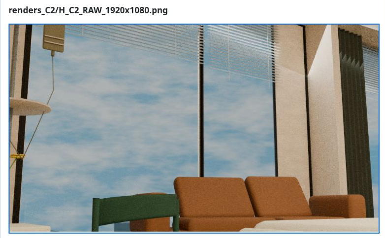

### 14. renders_C2/H_C2_direct_50pct_overlay_1920x1080.png

[原评论图像](https://github.com/Shuang-su/metaxingtong/raw/3b62e7fa31f1cfdcbc3b5420b2af7663d5cabb91/scenes/hospital-room/research/geometry-c3-unaccepted-20261015/files/renders_C2/H_C2_direct_50pct_overlay_1920x1080.png) · [原评论](https://github.com/Shuang-su/metaxingtong/issues/4#issuecomment-6185128438)；核验UTC 2026-10-15T05:36:42.665Z。

**full**

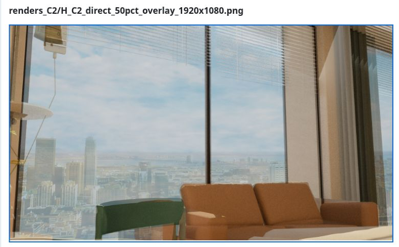

### 15. renders_C2/N640_C2_RAW_1920x1080.png

[原评论图像](https://github.com/Shuang-su/metaxingtong/raw/3b62e7fa31f1cfdcbc3b5420b2af7663d5cabb91/scenes/hospital-room/research/geometry-c3-unaccepted-20261015/files/renders_C2/N640_C2_RAW_1920x1080.png) · [原评论](https://github.com/Shuang-su/metaxingtong/issues/4#issuecomment-6185128438)；核验UTC 2026-10-15T05:36:42.850Z。

**full**

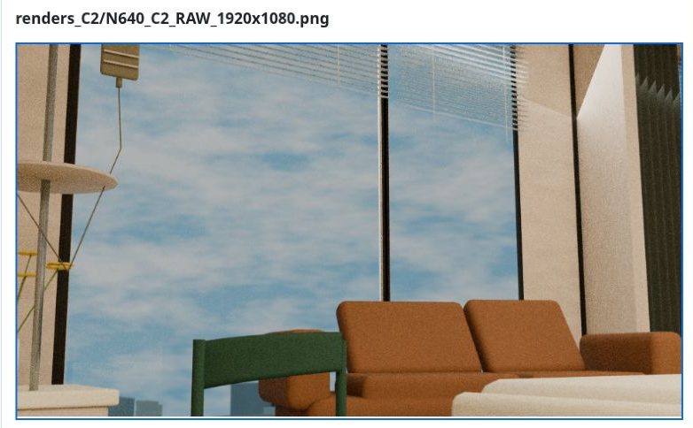

### 16. renders_C2/N640_C2_direct_50pct_overlay_1920x1080.png

[原评论图像](https://github.com/Shuang-su/metaxingtong/raw/3b62e7fa31f1cfdcbc3b5420b2af7663d5cabb91/scenes/hospital-room/research/geometry-c3-unaccepted-20261015/files/renders_C2/N640_C2_direct_50pct_overlay_1920x1080.png) · [原评论](https://github.com/Shuang-su/metaxingtong/issues/4#issuecomment-6185128438)；核验UTC 2026-10-15T05:36:43.145Z。

**full**

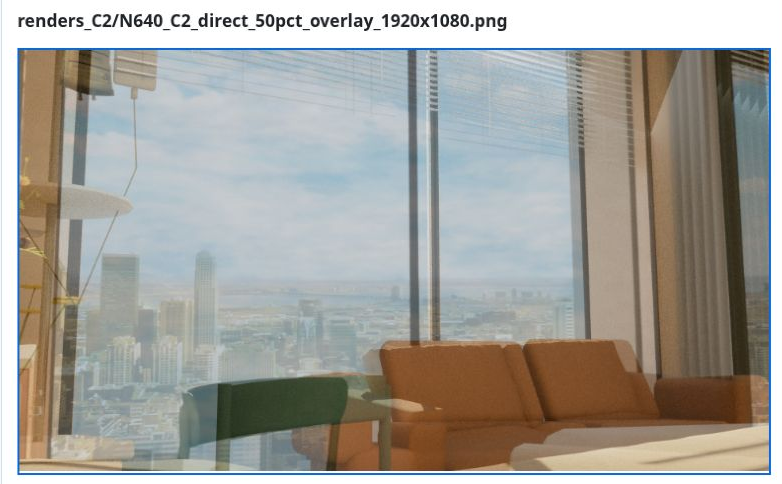

### 17. renders_C3/G_C3_RAW_1920x1080.png

[原评论图像](https://github.com/Shuang-su/metaxingtong/raw/74d897e94254e30f6c96055c107d6407f69b49f1/scenes/hospital-room/research/geometry-c3-unaccepted-20261015/files/renders_C3/G_C3_RAW_1920x1080.png) · [原评论](https://github.com/Shuang-su/metaxingtong/issues/4#issuecomment-6185156544)；核验UTC 2026-10-15T05:37:00.952Z。

**full**

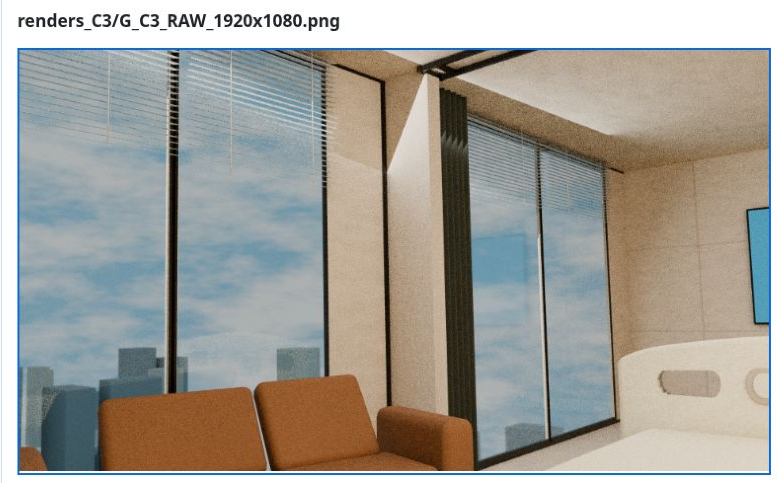

### 18. renders_C3/G_C3_direct_50pct_overlay_1920x1080.png

[原评论图像](https://github.com/Shuang-su/metaxingtong/raw/74d897e94254e30f6c96055c107d6407f69b49f1/scenes/hospital-room/research/geometry-c3-unaccepted-20261015/files/renders_C3/G_C3_direct_50pct_overlay_1920x1080.png) · [原评论](https://github.com/Shuang-su/metaxingtong/issues/4#issuecomment-6185156544)；核验UTC 2026-10-15T05:37:01.428Z。

**full**

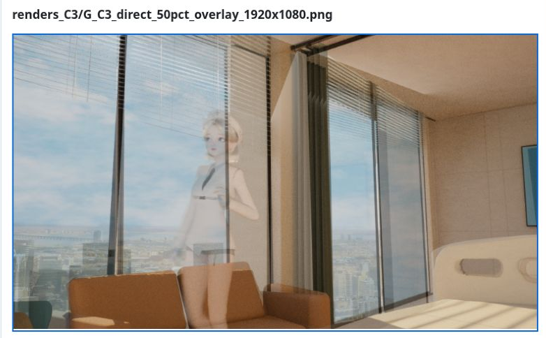

### 19. renders_C3/H_C3_RAW_1920x1080.png

[原评论图像](https://github.com/Shuang-su/metaxingtong/raw/74d897e94254e30f6c96055c107d6407f69b49f1/scenes/hospital-room/research/geometry-c3-unaccepted-20261015/files/renders_C3/H_C3_RAW_1920x1080.png) · [原评论](https://github.com/Shuang-su/metaxingtong/issues/4#issuecomment-6185156544)；核验UTC 2026-10-15T05:37:01.681Z。

**full**

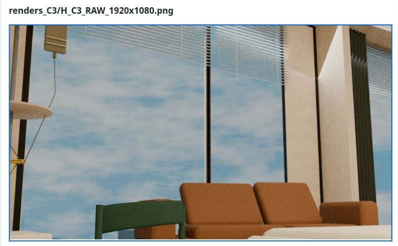

### 20. renders_C3/H_C3_direct_50pct_overlay_1920x1080.png

[原评论图像](https://github.com/Shuang-su/metaxingtong/raw/74d897e94254e30f6c96055c107d6407f69b49f1/scenes/hospital-room/research/geometry-c3-unaccepted-20261015/files/renders_C3/H_C3_direct_50pct_overlay_1920x1080.png) · [原评论](https://github.com/Shuang-su/metaxingtong/issues/4#issuecomment-6185156544)；核验UTC 2026-10-15T05:37:01.899Z。

**full**

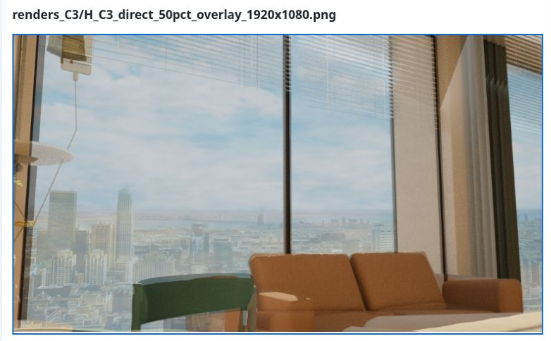

### 21. renders_C3/F_C3_RAW_1920x1080.png

[原评论图像](https://github.com/Shuang-su/metaxingtong/raw/74d897e94254e30f6c96055c107d6407f69b49f1/scenes/hospital-room/research/geometry-c3-unaccepted-20261015/files/renders_C3/F_C3_RAW_1920x1080.png) · [原评论](https://github.com/Shuang-su/metaxingtong/issues/4#issuecomment-6185156544)；核验UTC 2026-10-15T05:37:15.288Z。

**full**

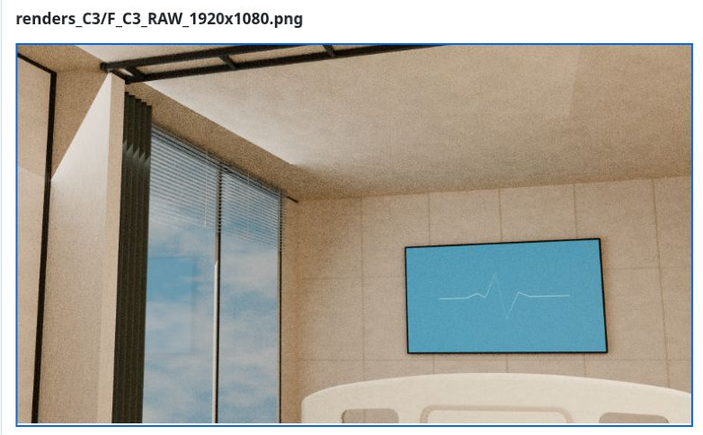

### 22. renders_C3/F_C3_direct_50pct_overlay_1920x1080.png

[原评论图像](https://github.com/Shuang-su/metaxingtong/raw/74d897e94254e30f6c96055c107d6407f69b49f1/scenes/hospital-room/research/geometry-c3-unaccepted-20261015/files/renders_C3/F_C3_direct_50pct_overlay_1920x1080.png) · [原评论](https://github.com/Shuang-su/metaxingtong/issues/4#issuecomment-6185156544)；核验UTC 2026-10-15T05:37:15.490Z。

**full**

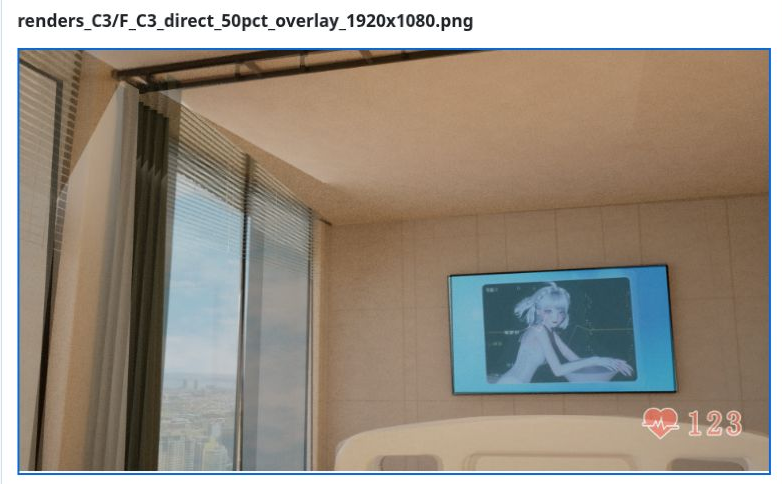

### 23. renders_C3/N640_C3_RAW_1920x1080.png

[原评论图像](https://github.com/Shuang-su/metaxingtong/raw/74d897e94254e30f6c96055c107d6407f69b49f1/scenes/hospital-room/research/geometry-c3-unaccepted-20261015/files/renders_C3/N640_C3_RAW_1920x1080.png) · [原评论](https://github.com/Shuang-su/metaxingtong/issues/4#issuecomment-6185156544)；核验UTC 2026-10-15T05:37:15.698Z。

**full**

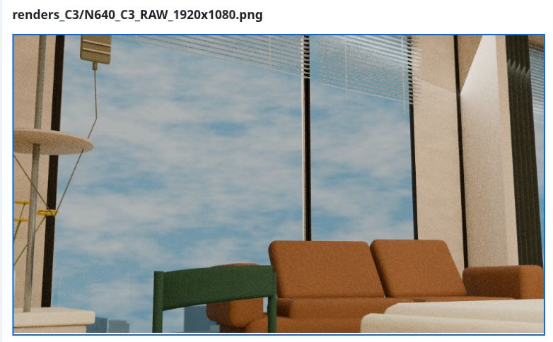

### 24. renders_C3/N640_C3_direct_50pct_overlay_1920x1080.png

[原评论图像](https://github.com/Shuang-su/metaxingtong/raw/74d897e94254e30f6c96055c107d6407f69b49f1/scenes/hospital-room/research/geometry-c3-unaccepted-20261015/files/renders_C3/N640_C3_direct_50pct_overlay_1920x1080.png) · [原评论](https://github.com/Shuang-su/metaxingtong/issues/4#issuecomment-6185156544)；核验UTC 2026-10-15T05:42:46.608Z。

**full**

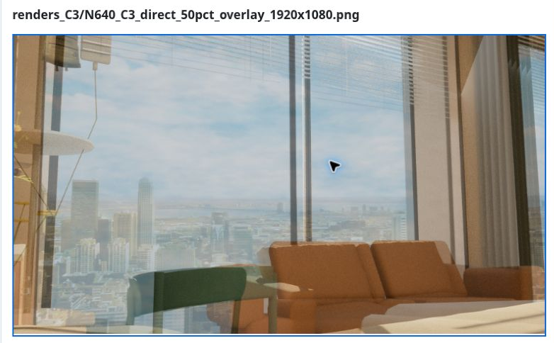

### 25. independent_visual/F_pillar_fold_native_comparison.png

[原评论图像](https://github.com/Shuang-su/metaxingtong/raw/74d897e94254e30f6c96055c107d6407f69b49f1/scenes/hospital-room/research/geometry-c3-unaccepted-20261015/files/independent_visual/F_pillar_fold_native_comparison.png) · [原评论](https://github.com/Shuang-su/metaxingtong/issues/4#issuecomment-6185156544)；核验UTC 2026-10-15T05:37:29.313Z。

**full**

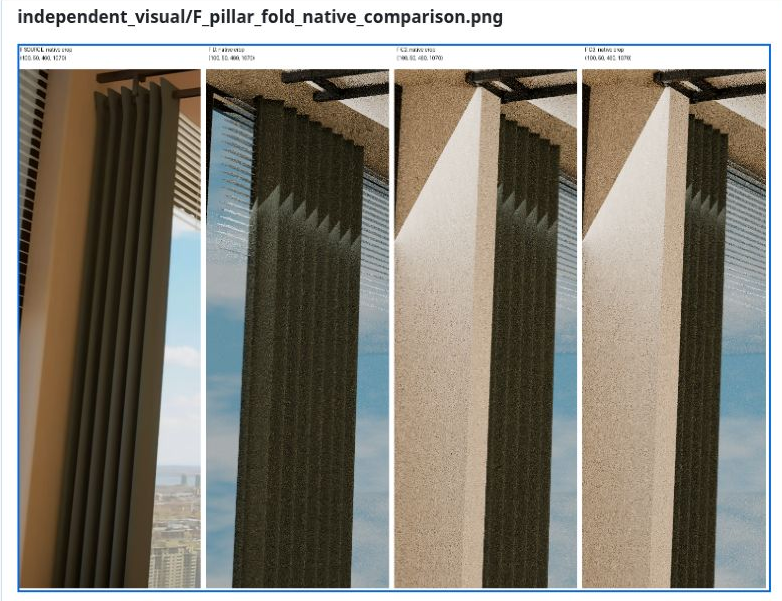

### 26. independent_visual/F_top_connection_native_comparison.png

[原评论图像](https://github.com/Shuang-su/metaxingtong/raw/74d897e94254e30f6c96055c107d6407f69b49f1/scenes/hospital-room/research/geometry-c3-unaccepted-20261015/files/independent_visual/F_top_connection_native_comparison.png) · [原评论](https://github.com/Shuang-su/metaxingtong/issues/4#issuecomment-6185156544)；核验UTC 2026-10-15T05:37:29.565Z。

**full**

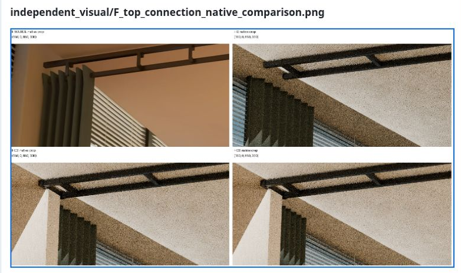

### 27. independent_visual/G_pillar_fold_native_comparison.png

[原评论图像](https://github.com/Shuang-su/metaxingtong/raw/74d897e94254e30f6c96055c107d6407f69b49f1/scenes/hospital-room/research/geometry-c3-unaccepted-20261015/files/independent_visual/G_pillar_fold_native_comparison.png) · [原评论](https://github.com/Shuang-su/metaxingtong/issues/4#issuecomment-6185156544)；核验UTC 2026-10-15T05:37:29.840Z。

**full**

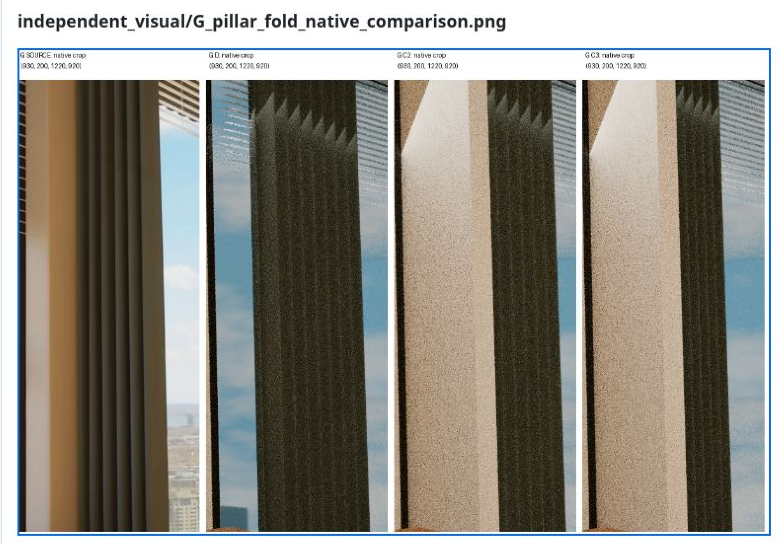

### 28. independent_visual/G_sofa_native_comparison.png

[原评论图像](https://github.com/Shuang-su/metaxingtong/raw/74d897e94254e30f6c96055c107d6407f69b49f1/scenes/hospital-room/research/geometry-c3-unaccepted-20261015/files/independent_visual/G_sofa_native_comparison.png) · [原评论](https://github.com/Shuang-su/metaxingtong/issues/4#issuecomment-6185156544)；核验UTC 2026-10-15T05:37:30.032Z。

**full**

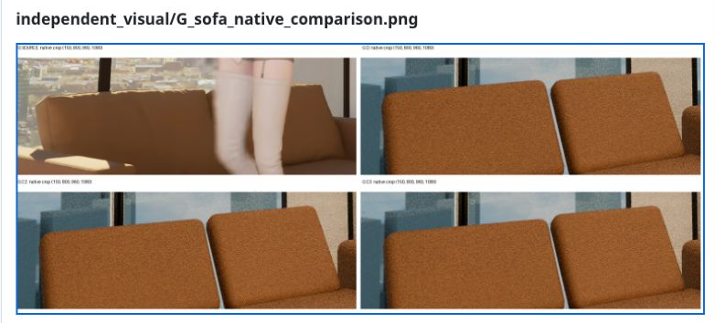

### 29. independent_visual/G_top_connection_native_comparison.png

[原评论图像](https://github.com/Shuang-su/metaxingtong/raw/74d897e94254e30f6c96055c107d6407f69b49f1/scenes/hospital-room/research/geometry-c3-unaccepted-20261015/files/independent_visual/G_top_connection_native_comparison.png) · [原评论](https://github.com/Shuang-su/metaxingtong/issues/4#issuecomment-6185156544)；核验UTC 2026-10-15T05:38:18.387Z。

**top**

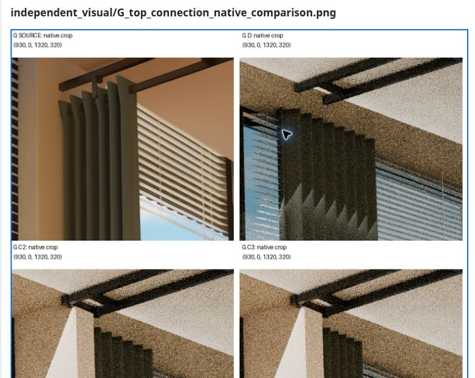

**bottom**

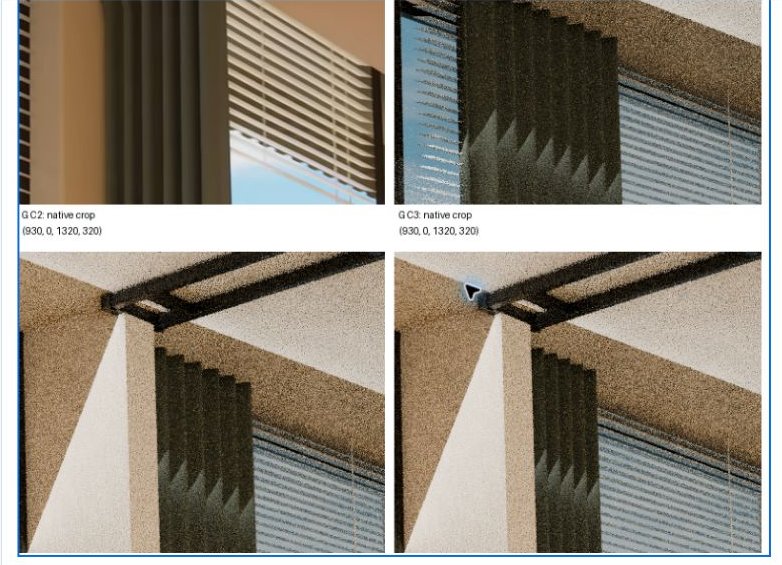

### 30. independent_visual/H_pillar_fold_native_comparison.png

[原评论图像](https://github.com/Shuang-su/metaxingtong/raw/74d897e94254e30f6c96055c107d6407f69b49f1/scenes/hospital-room/research/geometry-c3-unaccepted-20261015/files/independent_visual/H_pillar_fold_native_comparison.png) · [原评论](https://github.com/Shuang-su/metaxingtong/issues/4#issuecomment-6185156544)；核验UTC 2026-10-15T05:38:34.608Z。

**full**

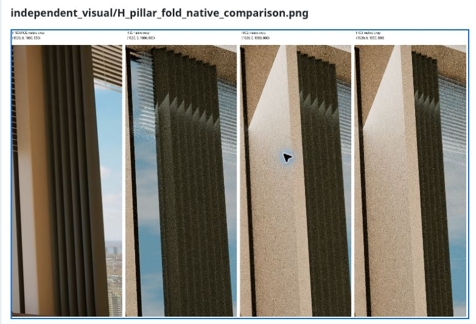

### 31. independent_visual/H_sofa_native_comparison.png

[原评论图像](https://github.com/Shuang-su/metaxingtong/raw/74d897e94254e30f6c96055c107d6407f69b49f1/scenes/hospital-room/research/geometry-c3-unaccepted-20261015/files/independent_visual/H_sofa_native_comparison.png) · [原评论](https://github.com/Shuang-su/metaxingtong/issues/4#issuecomment-6185156544)；核验UTC 2026-10-15T05:38:35.063Z。

**full**

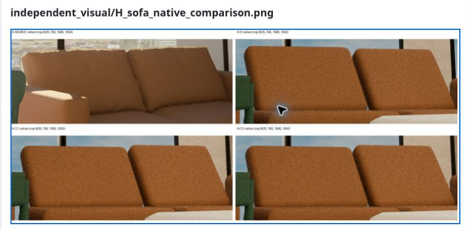

### 32. independent_visual/N640_pillar_fold_native_comparison.png

[原评论图像](https://github.com/Shuang-su/metaxingtong/raw/74d897e94254e30f6c96055c107d6407f69b49f1/scenes/hospital-room/research/geometry-c3-unaccepted-20261015/files/independent_visual/N640_pillar_fold_native_comparison.png) · [原评论](https://github.com/Shuang-su/metaxingtong/issues/4#issuecomment-6185156544)；核验UTC 2026-10-15T05:38:53.861Z。

**top**

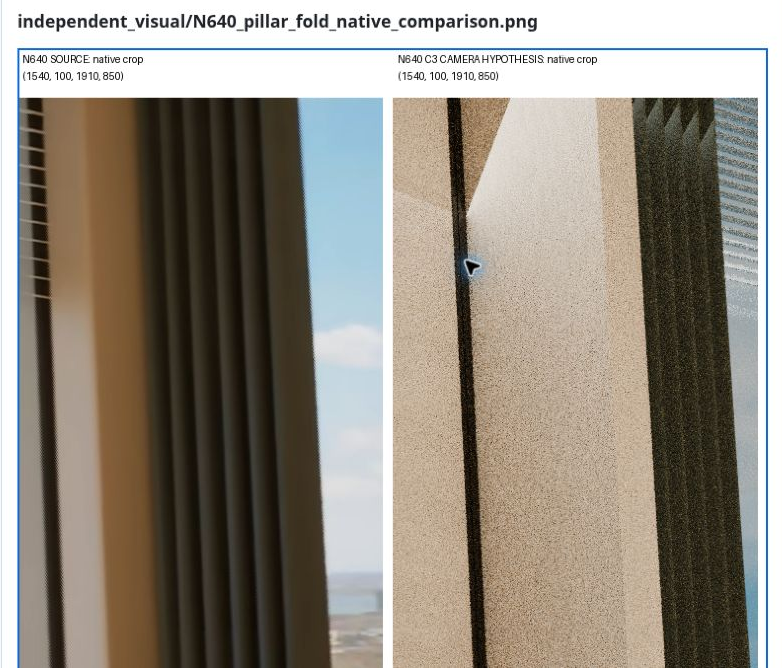

**bottom**

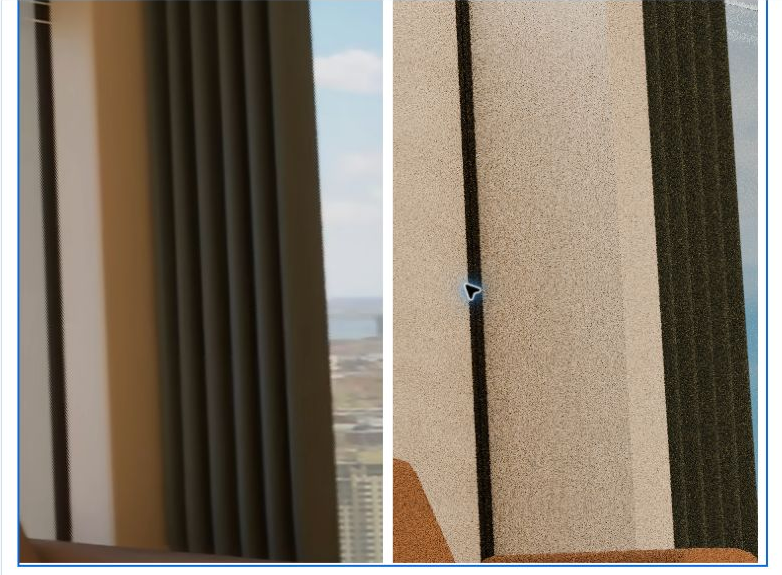

### 33. independent_visual/N640_sofa_native_comparison.png

[原评论图像](https://github.com/Shuang-su/metaxingtong/raw/74d897e94254e30f6c96055c107d6407f69b49f1/scenes/hospital-room/research/geometry-c3-unaccepted-20261015/files/independent_visual/N640_sofa_native_comparison.png) · [原评论](https://github.com/Shuang-su/metaxingtong/issues/4#issuecomment-6185156544)；核验UTC 2026-10-15T05:39:10.390Z。

**full**

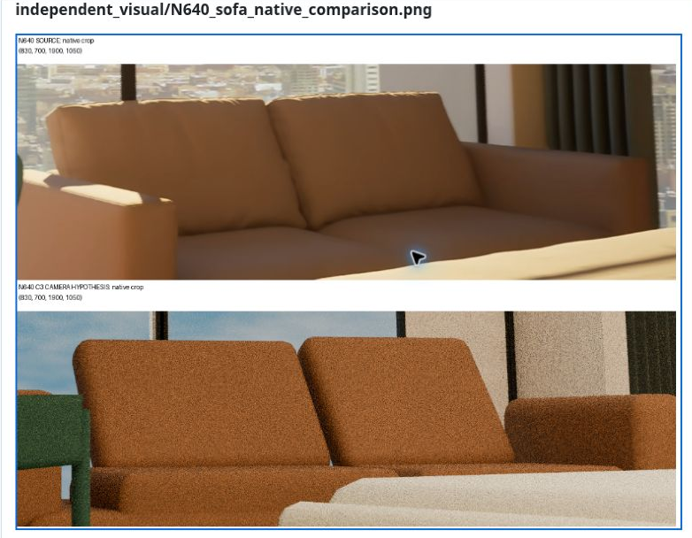

### 34. inspection_C3/VIEW_01_Entrance_Wide_diagnostic_960x540.png

[原评论图像](https://github.com/Shuang-su/metaxingtong/raw/74d897e94254e30f6c96055c107d6407f69b49f1/scenes/hospital-room/research/geometry-c3-unaccepted-20261015/files/inspection_C3/VIEW_01_Entrance_Wide_diagnostic_960x540.png) · [原评论](https://github.com/Shuang-su/metaxingtong/issues/4#issuecomment-6185156544)；核验UTC 2026-10-15T05:39:10.858Z。

**full**

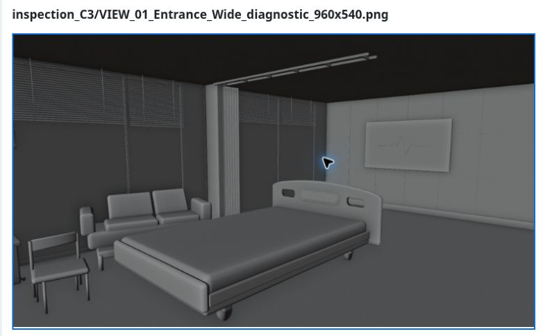

### 35. inspection_C3/VIEW_02_Rear_Right_diagnostic_960x540.png

[原评论图像](https://github.com/Shuang-su/metaxingtong/raw/74d897e94254e30f6c96055c107d6407f69b49f1/scenes/hospital-room/research/geometry-c3-unaccepted-20261015/files/inspection_C3/VIEW_02_Rear_Right_diagnostic_960x540.png) · [原评论](https://github.com/Shuang-su/metaxingtong/issues/4#issuecomment-6185156544)；核验UTC 2026-10-15T05:39:11.284Z。

**full**

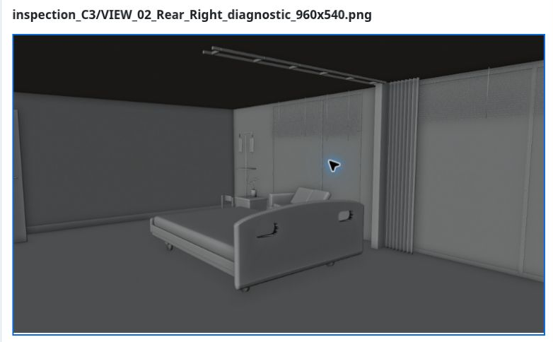

### 36. inspection_C3/VIEW_03_Left_Mid_diagnostic_960x540.png

[原评论图像](https://github.com/Shuang-su/metaxingtong/raw/74d897e94254e30f6c96055c107d6407f69b49f1/scenes/hospital-room/research/geometry-c3-unaccepted-20261015/files/inspection_C3/VIEW_03_Left_Mid_diagnostic_960x540.png) · [原评论](https://github.com/Shuang-su/metaxingtong/issues/4#issuecomment-6185156544)；核验UTC 2026-10-15T05:39:11.720Z。

**full**

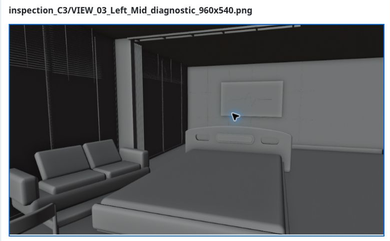

### 37. inspection_C3/VIEW_04_TV_End_diagnostic_960x540.png

[原评论图像](https://github.com/Shuang-su/metaxingtong/raw/74d897e94254e30f6c96055c107d6407f69b49f1/scenes/hospital-room/research/geometry-c3-unaccepted-20261015/files/inspection_C3/VIEW_04_TV_End_diagnostic_960x540.png) · [原评论](https://github.com/Shuang-su/metaxingtong/issues/4#issuecomment-6185156544)；核验UTC 2026-10-15T05:39:27.730Z。

**full**

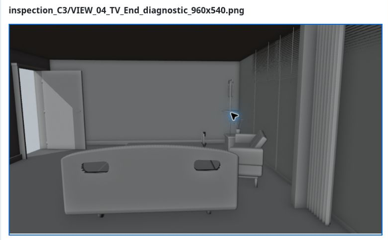

### 38. inspection_C3/VIEW_05_Window_Left_diagnostic_960x540.png

[原评论图像](https://github.com/Shuang-su/metaxingtong/raw/74d897e94254e30f6c96055c107d6407f69b49f1/scenes/hospital-room/research/geometry-c3-unaccepted-20261015/files/inspection_C3/VIEW_05_Window_Left_diagnostic_960x540.png) · [原评论](https://github.com/Shuang-su/metaxingtong/issues/4#issuecomment-6185156544)；核验UTC 2026-10-15T05:39:28.165Z。

**full**

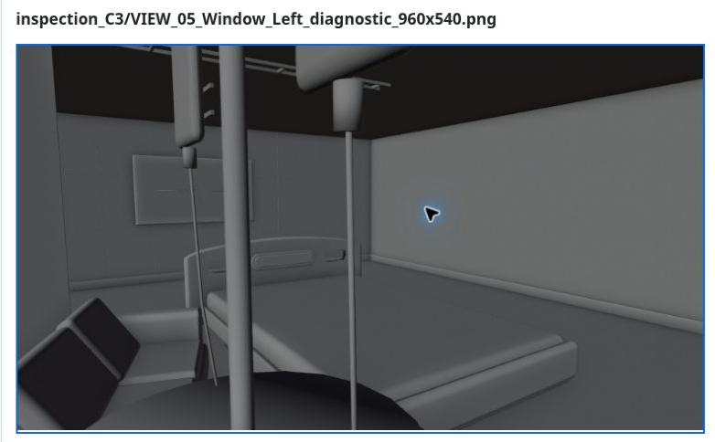

### 39. inspection_C3/VIEW_06_Window_Right_diagnostic_960x540.png

[原评论图像](https://github.com/Shuang-su/metaxingtong/raw/74d897e94254e30f6c96055c107d6407f69b49f1/scenes/hospital-room/research/geometry-c3-unaccepted-20261015/files/inspection_C3/VIEW_06_Window_Right_diagnostic_960x540.png) · [原评论](https://github.com/Shuang-su/metaxingtong/issues/4#issuecomment-6185156544)；核验UTC 2026-10-15T05:39:28.601Z。

**full**

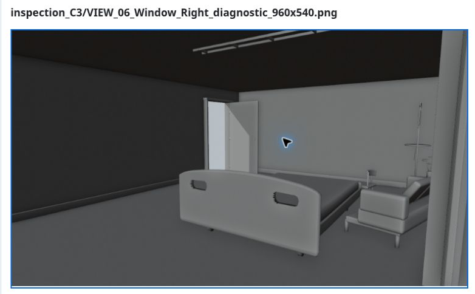

### 40. inspection_C3/VIEW_07_Rear_Centre_diagnostic_960x540.png

[原评论图像](https://github.com/Shuang-su/metaxingtong/raw/74d897e94254e30f6c96055c107d6407f69b49f1/scenes/hospital-room/research/geometry-c3-unaccepted-20261015/files/inspection_C3/VIEW_07_Rear_Centre_diagnostic_960x540.png) · [原评论](https://github.com/Shuang-su/metaxingtong/issues/4#issuecomment-6185156544)；核验UTC 2026-10-15T05:39:29.025Z。

**full**

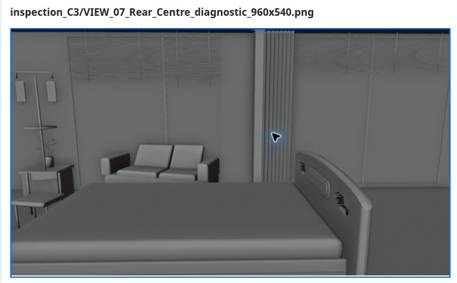

### 41. inspection_C3/VIEW_08_Bed_Support_diagnostic_960x540.png

[原评论图像](https://github.com/Shuang-su/metaxingtong/raw/74d897e94254e30f6c96055c107d6407f69b49f1/scenes/hospital-room/research/geometry-c3-unaccepted-20261015/files/inspection_C3/VIEW_08_Bed_Support_diagnostic_960x540.png) · [原评论](https://github.com/Shuang-su/metaxingtong/issues/4#issuecomment-6185156544)；核验UTC 2026-10-15T05:39:46.362Z。

**full**

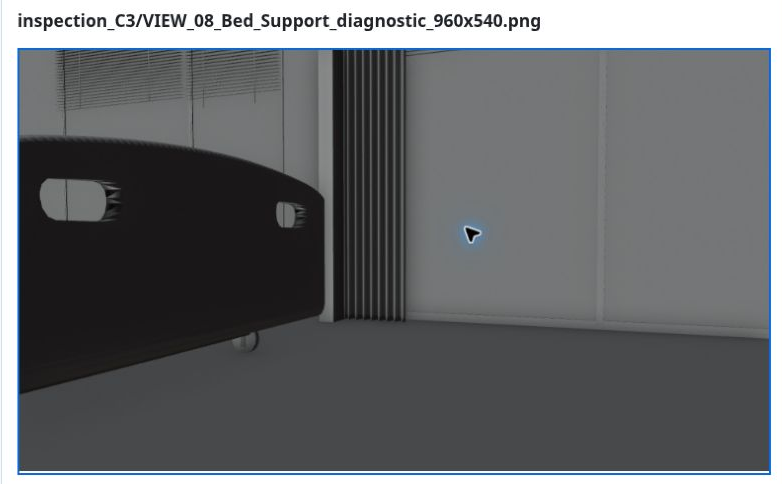

### 42. inspection_C3_contact_sheet_display_only.png

[原评论图像](https://github.com/Shuang-su/metaxingtong/raw/74d897e94254e30f6c96055c107d6407f69b49f1/scenes/hospital-room/research/geometry-c3-unaccepted-20261015/files/inspection_C3_contact_sheet_display_only.png) · [原评论](https://github.com/Shuang-su/metaxingtong/issues/4#issuecomment-6185156544)；核验UTC 2026-10-15T05:39:46.892Z。

**full**

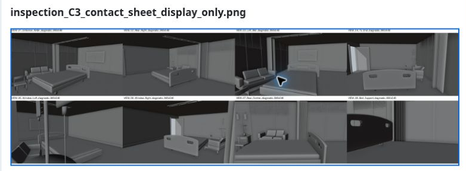
