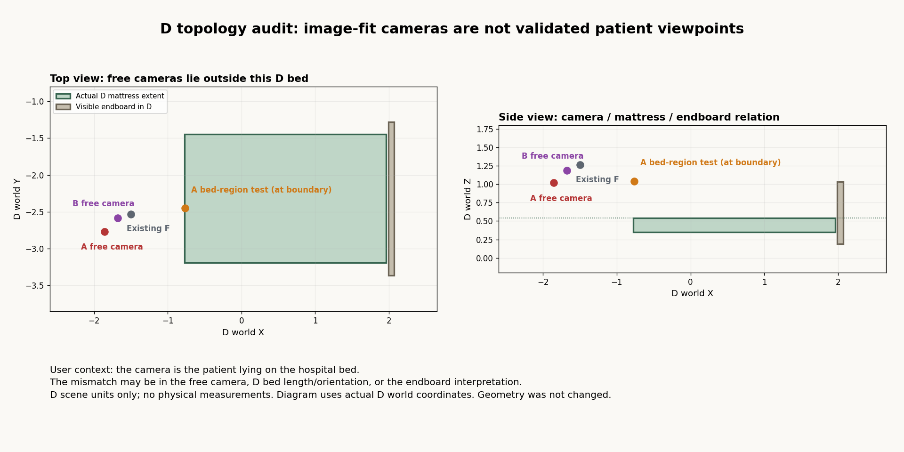
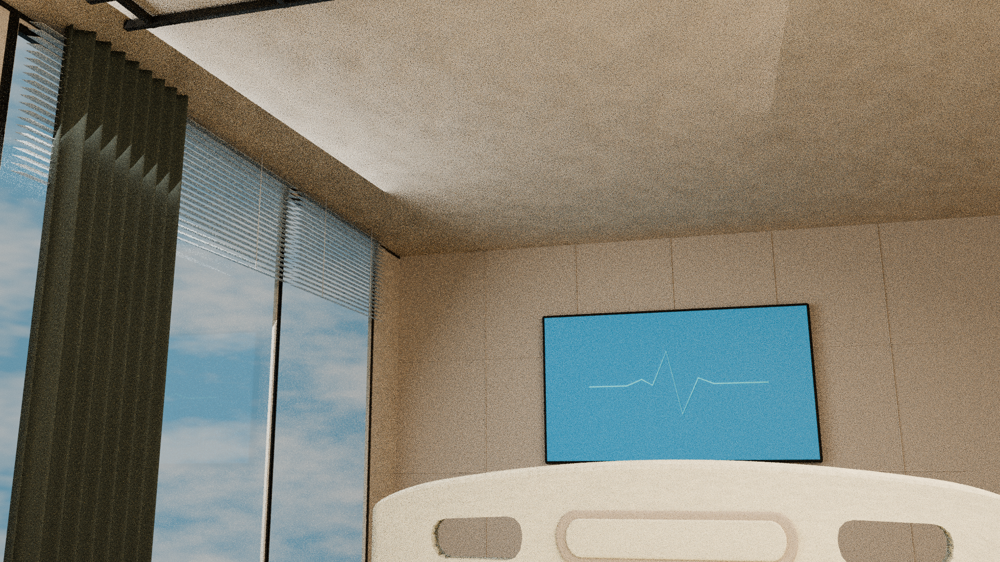
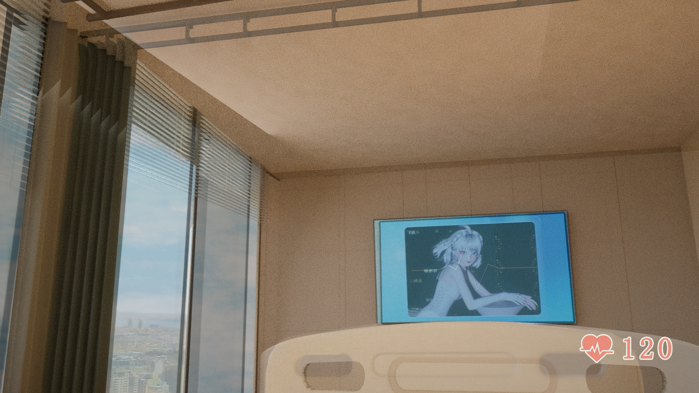
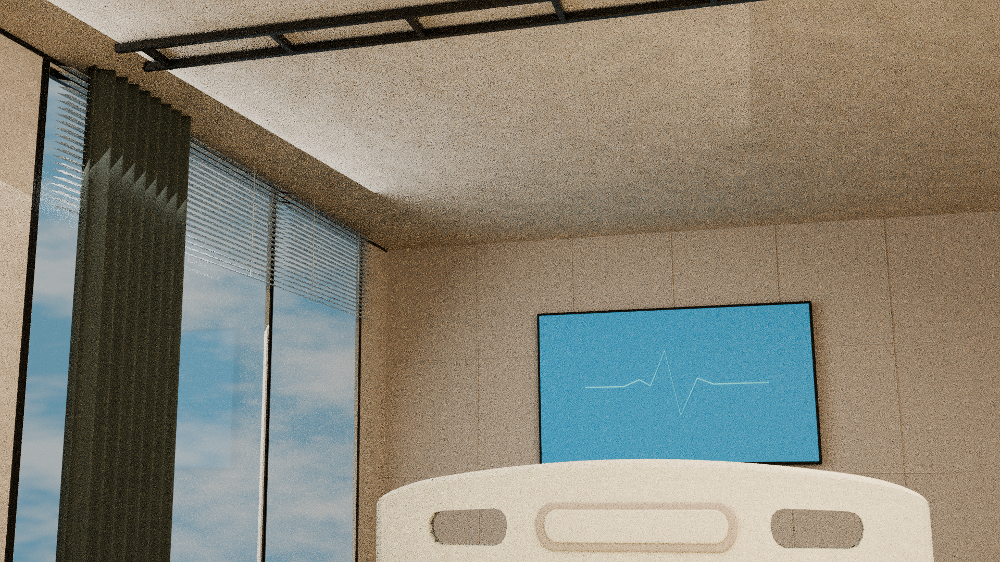
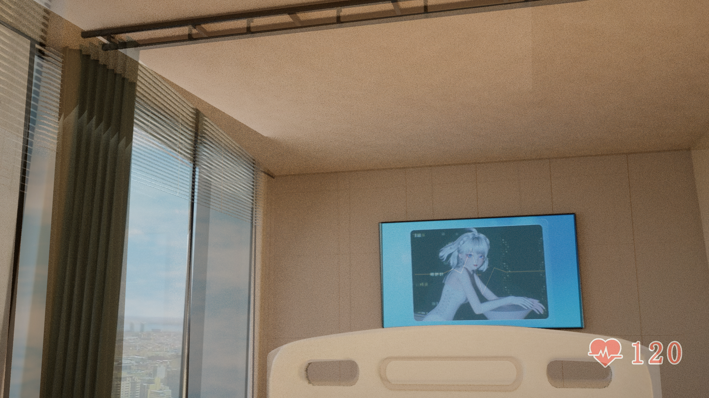
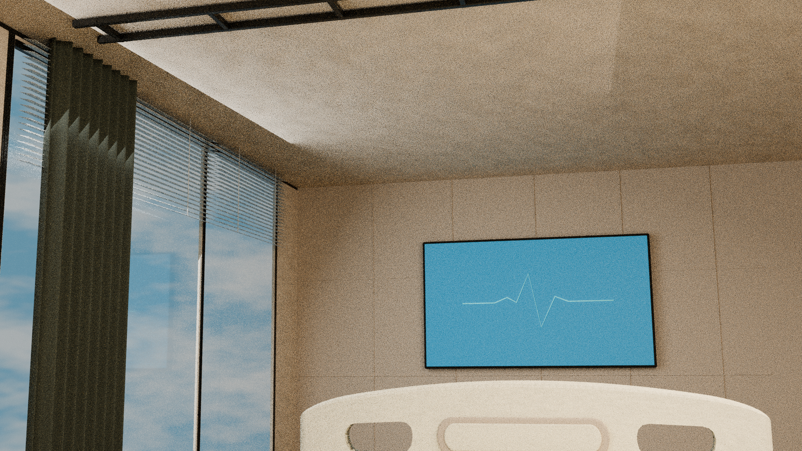
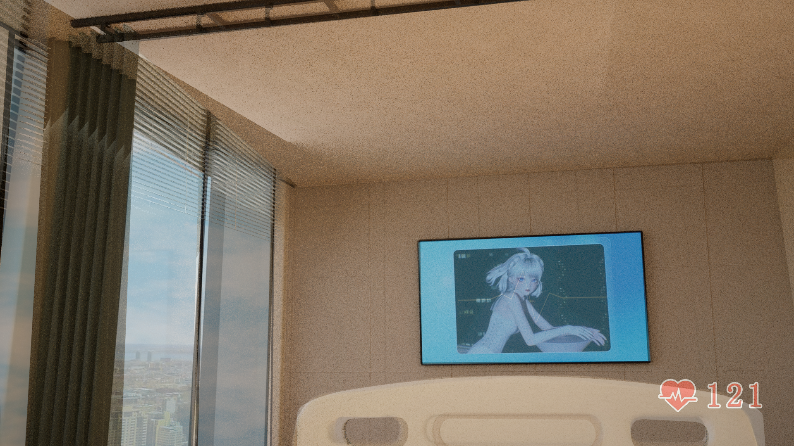

# 病房原生A/B与冻结D病人机位诊断：未通过

<!-- cloud-originals-recovery-65-20261013 -->

**2026-10-13 22:07–22:12 UTC恢复检查补充：CP1的27件与验图38件（合计65件）当前原件不可取得／恢复待查。** 云端环境重建后，原目录及待传清单不在当前workspace/shared；Library完整清单及65精确文件名检查未找到成功身份。上传超时结果仍未定、无会话可恢复，两批均未在本Mac物化或进入Git。下文“待交付/待传输”为此前历史状态，不表示仍有可用本地待传原件。35/35实显曾真实完成，PR #50结论仍有效；不以补图或新模型冒充旧证据/CP1。已Git保存的D/E/机位诊断/顶轨6件/A/B不受影响，CURRENT及拒绝/未采纳状态不变。后续从持久化D及5原帧开始的联合重建将另立新版本。[恢复状态记录](../../../../docs/research-display-20261013/cloud-originals-recovery-65/README.md)。

<!-- cloud-issue4-display-35-20261013 -->

2026-10-13显示状态更新：本版本7张图已由独立云端浏览器逐张完整显示核验通过。本批合计A/B2+D15+E11+机位7=35，A/B已含，不是37；无坏图、折叠或部分显示。显示通过不等于几何或用户验收，CURRENT/未采纳状态不变。38份云端截图/说明原件仍待可验证Library交付，尚未物化到本Mac、尚未Git；CP1也未交付。[独立核验记录](../../../../docs/research-display-20261013/cloud-issue4-35/README.md)。

以下原正文保留归档时的核验状态；此前Mac/Safari技术阻塞和待验语句属于历史，不改写为当时通过。

状态：`DIAGNOSTIC_NOT_ACCEPTED_INVALID_PATIENT_POV`。真实归档提交日期使用当前日期，不回填历史提交日期。

使用已独立归档的原生A/B及冻结D进行诊断。自由六自由度相机落在床垫之外，像素拟合不能作为病人躺床机位通过证据；宽松床内压力测试也未同时解释所有画面。保留2份诊断BLEND、7张真实诊断PNG及脚本/参数；未修改D共享几何、材质和可见性。本版主报告为最新v2，撤回把窗上宽暗带解释为厚梁的判断；实际窗洞顶到天花实体差约0.04375个D单位，阴影/实体仍需分离。报告早期提及的别名hospital_D_frozen_new_camera_hypotheses.blend不是额外交付件，以本目录明确INVALID_PATIENT_POV文件名和核验清单为准。

本版27份原件共44,618,701字节已在接收端实际物化并校验SHA256/Git blob。模型、PNG、脚本和报告均原字节；3份JSON仅清理检索ID或继承绝对路径，保留原件SHA、仓库SHA与逐字段派生记录。原delivery_manifest仍描述输入原件；仓库文件哈希以archive-verification.json为准。

[原报告](%E6%96%B0%E5%8E%9F%E7%94%9F%E8%A7%86%E8%A7%92_%E5%86%BB%E7%BB%93D%E7%9B%B8%E6%9C%BA%E6%A0%B8%E9%AA%8C_20261013.txt) · [原件与仓库核验](archive-verification.json) · [JSON派生记录](metadata-derivations.json) · [依赖固定提交](dependencies.json)

本CLI归档没有重跑Blender、拟合、渲染或浏览器采集。原报告技术检查是该研究阶段的记录，不冒称本次重跑或模型来源验收。CURRENT及以前全部原文件保持不变；本次Git合并只是独立归档。

2026-10-13后续约束（单列，不重写旧研究结论）：用户明确病人躺床第一视角；顶部横向拉帘、带百叶的两侧落地窗及中央柱状构件接杆。柱的承重性、准确截面/尺寸与灰条身份未证实。现有D及自由像素拟合机位与床垫关系存在冲突，后续诊断不能标为通过。

## 模型原件

- [hospital_D_patient_region_STRESS_TEST.blend](hospital_D_patient_region_STRESS_TEST.blend) · SHA256 `b77e3ab253d98d9f67c8b8924b639241153194ccefe6e22ecaad3b6964dd83e3`
- [hospital_D_free6dof_DIAGNOSTIC_INVALID_PATIENT_POV.blend](hospital_D_free6dof_DIAGNOSTIC_INVALID_PATIENT_POV.blend) · SHA256 `1319325e3adb3b752654a02eb747ad97989057b4b8f94a6d9910648d90ff1d79`

## 本版全部PNG图证

图证直接展开，未折叠。撤回的旧标题板单独标记，只保留历史，不作当前几何精度证据。

### D_bed_camera_topology_DIAGNOSTIC.png

SHA256 `1917ee3f71a794a920a692bfde177135cc4cc9e254fec723fa027d6efb8ffc03`；尺寸1920×960。

### A_patient_region_STRESS_TEST_1920x1080_16spp_RAW.png

SHA256 `a52726d768a00aa134c77f18a9ac1455388dd5a10e06496bff17efef929a9b40`；尺寸1920×1080。

### A_patient_region_STRESS_TEST_direct50_UNREGISTERED.png

SHA256 `c430fa610ce7b5d24ff16a9b1e8da2c80dbb5bf0c067e978c26ab68b31aabd55`；尺寸1920×1080。

### A_frozenD_camera_candidate_1920x1080_16spp_RAW.png

SHA256 `0ae3e07de914b299d11d6dd6b651b1ab6503999b2000fa122ae9753514c05447`；尺寸1920×1080。

### A_source_frozenD_direct50_UNREGISTERED.png

SHA256 `dd16d11c708395291a3ad05b4f05f8939c85218ad9d43cda769b8b7f747dba3c`；尺寸1920×1080。

### B_frozenD_camera_candidate_1920x1080_16spp_RAW.png

SHA256 `8e81f8f0b01cce37877e84c18f896978e19a0e8e18d5314ceb59fe2552cc9127`；尺寸1920×1080。

### B_source_frozenD_direct50_UNREGISTERED.png

SHA256 `fb106761ec1cc095dc2cd196184d1b7c0f6c6b0cc7ecbbf8db3939229394d1ff`；尺寸1920×1080。
