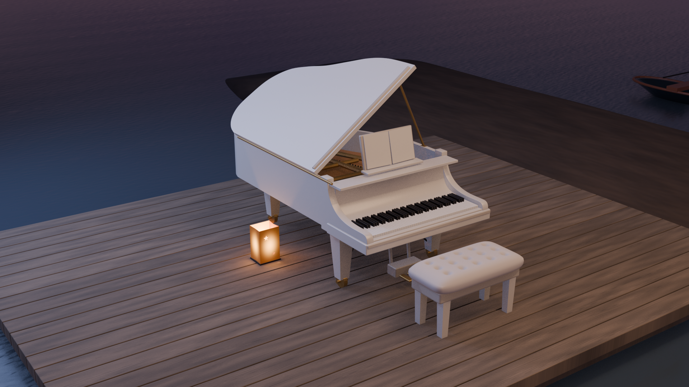
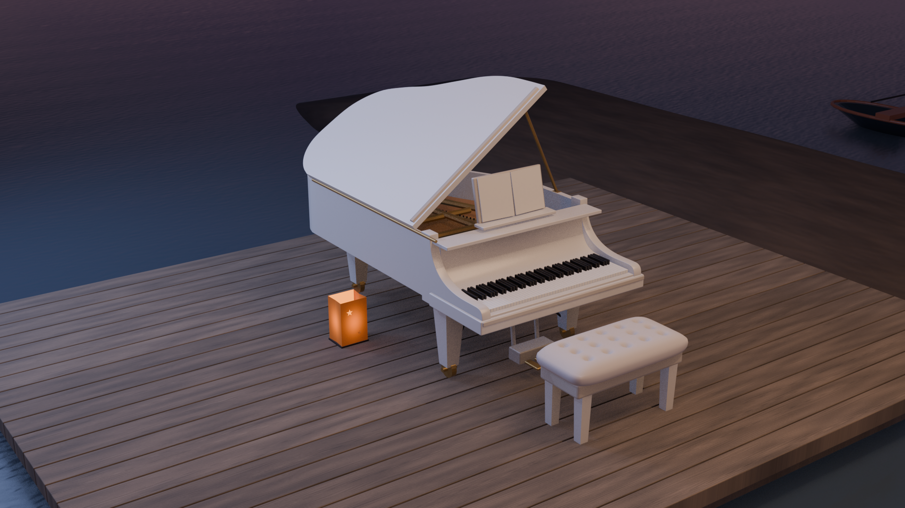

# 海边钢琴外景：2026-10-29 新建候选

**重建候选 / 待来源复核 / 未经用户接受。** 今日在独立`scene/piano-seaside`分支实际新建，不是已有钢琴门廊或海边吧台改名。暂称第17场景候选，不等于新增场景已验收。R01–R06制作阶段仅本地操作；后续按明确授权正常Git发布到当前私库，并建立[Issue #76](https://github.com/Shuang-su/metaxingtong/issues/76)与[Draft PR #77](https://github.com/Shuang-su/metaxingtong/pull/77)。未合并，未改变私有可见性。详见[发布报告](report.md)。

R08仅更新N6766近景相机，几何/有效材质/灯光及其他17机位保持R07；校准仍未通过。[小联系图](qa/r08/N6766-camera-comparison.jpg) · [R08说明与不变项](qa/r08/review.md) · [主图JPEG预览（R07原PNG派生，无缩放）](qa/r08/main_R07_retained_preview.jpg)。其余主图、检查图、GLB保留R07原件，未重渲。

## R11 纸灯发光与接地照明修正

R11 实际排查出两点光源埋在不透明灯芯内：关闭点灯与基线诊断逐像素一致。仅将点灯移出灯芯、调整共享纸面发光，并以固定且带阴影的纸面面积光近似透纸照明；保留 R10 全部 614 个网格、18 相机、天空、海岸、其他物件材质和曝光。纸灯仍是两件，没有添加物理灯具。

[主图 JPEG](qa/r11/main_preview.jpg) · [纸灯前后原像素对照](qa/r11/main-lamp-before-after.jpg) · [来源局部对照及限制](qa/r11/source-lamp-local-comparison.jpg) · [五源/直接叠图](qa/r11/source-render-overlay-contact.jpg) · [九角检查](qa/r11/inspection-contact.jpg) · [报告](qa/r11/review.md) · [独立复核](qa/r11/independent-final-review.md) · [材质 BLEND](models/r11/piano_seaside_material.blend) · [白模 BLEND](models/r11/piano_seaside_white.blend) · [材质 GLB](models/r11/piano_seaside_material.glb) · [白模 GLB](models/r11/piano_seaside_white.glb)。GLB 不含世界和灯光；纸面发光贴图与强度已导出，整场照明以 BLEND 为准。仍为未验收候选。

R10 曾记录的 N6318 灯口“明显变暗”已由原审查者在重读 Git 原始像素后撤回：原裁区最大差只有 1/255，未复现显著变暗。[追加勘误](qa/r11/prior-review-correction.md)，旧报告和旧图原样保留。

## R10 本地天空窄修正版

R10 只修 R09 引入的云边阶梯瑕疵，保留全部几何、物件材质、灯光和 18 个相机。使用同一云层场的抗锯齿采样与 Cubic 插值；纸灯、甲板和其他 R09 改进保持。

[主图预览](qa/r10/main_preview.jpg) · [五源/主图前后对照](qa/r10/before-after-source-main.jpg) · [N6766 天空原像素裁区](qa/r10/N6766-sky-before-after.jpg) · [范围与旧残差](qa/r10/review.md) · [最终独立复核](qa/r10/independent-final-review.md) · [保存后不变项](qa/r10/sky-only-saved-invariants.json) · [材质 BLEND](models/r10/piano_seaside_material.blend) · [白模 BLEND](models/r10/piano_seaside_white.blend)。GLB 保留 R09 原件；本轮不声称旧来源问题已解决。

## R09 本地环境候选

R09 冻结 R08 琴体和全部相机，更新两盏开口星孔纸袋灯、共同木纹/粗糙度、有限沙岸及双时间状态的天空/海面。614 个网格，仍待来源复核。当前主图和全尺寸叠图统一使用 S40；S105 另对全部来源输出。详见 [R09 范围与失败记录](qa/r09/review.md)。

[材质 BLEND](models/r09/piano_seaside_material.blend) · [材质 GLB](models/r09/piano_seaside_material.glb) · [白模 BLEND](models/r09/piano_seaside_white.blend) · [白模 GLB](models/r09/piano_seaside_white.glb) · [5 源联系图](qa/r09/source-render-overlay-contact.jpg) · [9 角检查](qa/r09/inspection-contact.jpg) · [全尺寸 JPEG 展示预览](qa/r09/main_preview.jpg) · [保存后不变项检查](qa/r09/saved-environment-checks.json)。

## R08 / R07 保留原文件

| 文件 | 作用 |
|---|---|
| [材质BLEND](models/r08/piano_seaside_material.blend) | 可编辑对象、材质、修饰器，木纹PNG已打包 |
| [材质GLB](models/r07/piano_seaside_material.glb) | 实际跨格式导出并回导检查 |
| [同几何白模BLEND](models/r08/piano_seaside_white.blend) | 仅替换材质的诊断白模 |
| [同几何白模GLB](models/r07/piano_seaside_white.glb) | 实际导出并回导检查 |
| [5组来源/渲染/直接叠图](qa/r07/source-render-overlay-contact.jpg) | 原生图保持原样；机位为带不确定度的共同几何条件性透视拟合 |
| [9角检查联系表](qa/r07/inspection-contact.jpg) | 普通检查角度，不充作来源基线 |
| [几何检查](qa/r07/geometry-checks.json) | 网格、支撑、密集射线、BLEND/GLB验证 |
| [复现方式](docs/reproduce.md) | 全部脚本相对目录运行，不安装新软件 |

## 来源与身份

来源：[BV1CY411k7Co](https://www.bilibili.com/video/BV1CY411k7Co/)。采集交接识别为星瞳2023-02-24回放、2023-02-25上传。5张1920×1080原生PNG已通过本端大小、SHA256和实际解码/像素检查；最高实际使用1080P高清，更高高码率会员权限未确认。第一张只有00:40:37整秒UI时刻、缺DOM稳定性记录，第二张缺readyState；未补填。详见[原始交接](sources/SOURCE_HANDOFF.md)和[来源清单](sources/source-manifest.json)。

旧6300.916514秒参考是1180×663视口裁图，保留历史身份，不升级为原生。旧吧台说明把00:40:30及约105分钟钢琴外景排除；本轮N2453证实琴区与装饰吧台样背景同框邻近，但连续通路和与旧模型一一身份仍未证。BV1yD9VY9EEC白琴圆窗门廊属于另一场景。

## R07 / R08 实际建模范围

622个共同网格：曲面琴体、开盖/撑杆、88键候选、谱架、三腿/脚轮、三踏板、铜骨架与简化弦列、纽扣凳、有限木甲板、沙带、两灯、编织椅/篮、近艇、远帆船及环境海面。所有相机共用几何、材质和照明。隐藏尺寸、第三轮触地、弦数、甲板边界及远物距离均属推断；尺寸是模型单位。保留开放性质，未补屋顶、整栋建筑、未知围墙或吧台连接。

[逐物体证据表](docs/object-evidence.md)区分来源观察、推断和未见。人物、漂浮光点、水印、Cam2节目叠层不变成实体；不使用缩小角色定尺度。源图没有擦除、warp或AI补画。局部裁图不新增机位。

## 阶段与限制

R01保留已生成模型及降噪失败；R02保留方向错误的首次渲染；R03纠正相机侧面；R04加入琴内结构及四源/9角检查；R05改盖板和可移植材质、五源叠图，并记录海景机位退步及近艇/沙地相交；R06将近艇整体移至海面并回归。各阶段真实提交，不覆盖旧版本。R06已被独立视觉QA拒绝；R07改连续琴颊、曲面翻盖/分层键床、厚软垫，并共用一个盖角和撑杆连接回归五源，仍未通过来源验收。

部分数值几何检查通过，不能代替来源还原：相机尚未标定，曲率、谱架、材质/光照及道具布局仍有显著残差；未完整建背景植被/建筑/吧台。不同时间的源帧都用同一近似黄昏灯光作诊断，晚间颜色不匹配。完整自交、通行、连续连接、全物件足迹及跨BV后续回放同场确认未通过；用户尚未接受。详见[R07复核](qa/r07/review.md)，以及[琴颊/软垫诊断](qa/r07/junction-cushion-contact.jpg)。
