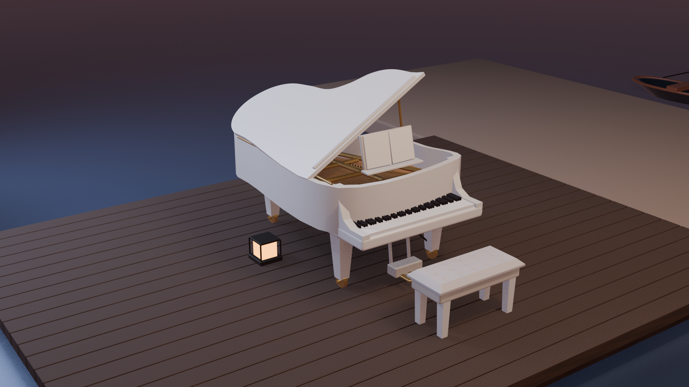

# 海边钢琴外景：2026-10-29 新建候选

**重建候选 / 待来源复核 / 未经用户接受。** 今日在独立`scene/piano-seaside`分支实际新建，不是已有钢琴门廊或海边吧台改名。暂称第17场景候选，不等于新增场景已验收。本轮只作本地制作与验证，没有push、PR或Issue评论。

## 当前候选原文件

| 文件 | 作用 |
|---|---|
| [材质BLEND](models/r06/piano_seaside_material.blend) | 可编辑对象、材质、修饰器，木纹PNG已打包 |
| [材质GLB](models/r06/piano_seaside_material.glb) | 实际跨格式导出并回导检查 |
| [同几何白模BLEND](models/r06/piano_seaside_white.blend) | 仅替换材质的诊断白模 |
| [同几何白模GLB](models/r06/piano_seaside_white.glb) | 实际导出并回导检查 |
| [5组来源/渲染/直接叠图](qa/r06/source-render-overlay-contact.jpg) | 原生图保持原样；机位仍为条件性手动拟合 |
| [9角检查联系表](qa/r06/inspection-contact.jpg) | 普通检查角度，不充作来源基线 |
| [几何检查](qa/r06/geometry-checks.json) | 网格、支撑、密集射线、BLEND/GLB验证 |
| [复现方式](docs/reproduce.md) | 全部脚本相对目录运行，不安装新软件 |

## 来源与身份

来源：[BV1CY411k7Co](https://www.bilibili.com/video/BV1CY411k7Co/)。采集交接识别为星瞳2023-02-24回放、2023-02-25上传。5张1920×1080原生PNG已通过本端大小、SHA256和实际解码/像素检查；最高实际使用1080P高清，更高高码率会员权限未确认。第一张只有00:40:37整秒UI时刻、缺DOM稳定性记录，第二张缺readyState；未补填。详见[原始交接](sources/SOURCE_HANDOFF.md)和[来源清单](sources/source-manifest.json)。

旧6300.916514秒参考是1180×663视口裁图，保留历史身份，不升级为原生。旧吧台说明把00:40:30及约105分钟钢琴外景排除；本轮N2453证实琴区与装饰吧台样背景同框邻近，但连续通路和与旧模型一一身份仍未证。BV1yD9VY9EEC白琴圆窗门廊属于另一场景。

## 实际建模范围

604个共同网格：曲面琴体、开盖/撑杆、88键候选、谱架、三腿/脚轮、三踏板、铜骨架与简化弦列、纽扣凳、有限木甲板、沙带、两灯、编织椅/篮、近艇、远帆船及环境海面。所有相机共用几何、材质和照明。隐藏尺寸、第三轮触地、弦数、甲板边界及远物距离均属推断；尺寸是模型单位。保留开放性质，未补屋顶、整栋建筑、未知围墙或吧台连接。

[逐物体证据表](docs/object-evidence.md)区分来源观察、推断和未见。人物、漂浮光点、水印、Cam2节目叠层不变成实体；不使用缩小角色定尺度。源图没有擦除、warp或AI补画。局部裁图不新增机位。

## 阶段与限制

R01保留已生成模型及降噪失败；R02保留方向错误的首次渲染；R03纠正相机侧面；R04加入琴内结构及四源/9角检查；R05改盖板和可移植材质、五源叠图，并记录海景机位退步及近艇/沙地相交；R06将近艇整体移至海面并回归。各阶段真实提交，不覆盖旧版本。

部分数值几何检查通过，不能代替来源还原：相机尚未标定，曲率、谱架、材质/光照及道具布局仍有显著残差；未完整建背景植被/建筑/吧台。不同时间的源帧都用同一近似黄昏灯光作诊断，晚间颜色不匹配。完整自交、通行、连续连接、全物件足迹及跨BV后续回放同场确认未通过；用户尚未接受。详见[R06复核](qa/r06/review.md)。
